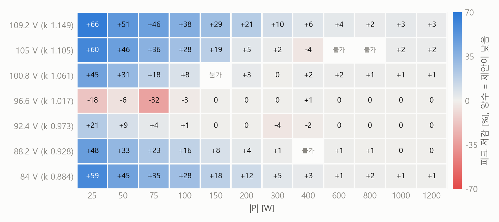

# DAB 컨버터 경부하 피크 전류 저감 제어기: 적용 판단 보고서

작성 2026-11-01. 수치별 출처와 계산 조건은 별도의 근거표에 있다.

<!-- 초안: [대기: …] 표시는 아직 끝나지 않은 Simulink 실행의 자리다. 결과가 나오면 지우고 값을 넣는다. 끝나지 않으면 [미완료]로 바꾼다. -->

## 1. 결론과 권고

1차 380 V, 2차 84–109.2 V, 변압비 4, 직렬 인덕터 90 µH, 80 kHz, 최대 1.2 kW인 양방향 DAB 컨버터에서, 제안 제어기(전력 명령과 측정 전압으로 내부 듀티 D1, D2를 내는 회귀식 하나, 외부 위상 D0는 PI)는 **경부하 피크 전류를 줄이는 것이 목적이고 전압비 k = 4·V2/V1이 1에서 떨어진 곳에서 오래 운전하는 제품이라면 실기 시험으로 넘어갈 만하다.** 실기 검증 전에는 양산에 쓰지 말 것. 소자·자성 정격을 줄이는 근거로 쓰지 말 것. 효율 향상을 채택 근거로 삼지 말 것(이 모델에서 확정되지 않았다). V1이 변하는 시스템에서 측정 V1 정규화 없이 쓰지 말 것. k가 1 근처(V2 약 91–99 V)에 머무는 제품에는 얻는 것이 없다. "어떤 조건에서도 SPS보다 높지 않다"를 보증해야 하는 제품에는 아직 쓰지 말 것.

숫자로 줄이면 이렇다. 100 W 피크 전류는 84 V에서 1.747 → 1.252 A(−28 %), 109.2 V에서 2.269 → 1.410 A(−38 %)로 줄지만, 1 kW에서는 −1.0 %, −3.3 %, 1.2 kW에서는 일곱 V2 평균 −0.9 %이고, k ≈ 1(92.4, 96.6 V)에서는 전력 단 평균 −0.008, +0.002 A다. 전부 시뮬레이션 값이고 실기에서 잰 값은 없다. 모델에는 소자 출력 용량(Coss), 변압기 자화 인덕턴스, 코어·권선 손실이 없다. 경부하 피크는 이 요소들의 영향을 받을 수 있어 실기 값이 달라질 수 있다(추정, 재지 않음).

**수치를 읽는 법.** 표시가 없는 값은 모두 같은 조건의 Simulink 측정값이다 [S]. 모델은 비교 데이터셋을 만든 시기의 Simulink 모델 사본이고, 파일을 저장하지 않은 채 실행마다 제어기와 솔버의 시간 격자를 원본 100 ns에서 25 ns로 바꿨다. 방향은 HV→LV, V1은 380 V다. 외부 위상을 상수로 둔 20 ms 실행 두 개를 목표 전력으로 보간한 정상상태 값이고, PI를 돌린 값이 아니다. D1, D2는 제어기 밖에서 계산해 넣었다. 피크는 1차측 인덕터 전류 크기의 마지막 1 ms(80주기) 최댓값이고, "중앙값"은 80주기 피크의 중앙값이다. 이 격자의 전류 한 스텝은 V1·Ts/L = 0.106 A다. "높다·낮다"는 허용치 max(0.03 A, SPS 피크의 2 %)를 넘는 차이만 말하고, "규칙상"은 실행 전에 고정한 판정 규칙의 답이라는 뜻이다. 평균 전류가 20 mA를 넘는 실행은 판정 불가로 뺐다. "기본 56점"은 V2 7개(84, 88.2, 92.4, 96.6, 100.8, 105, 109.2 V) × |P| 8단(100–1000 W)이다. [참고]는 해석 모델이나 Python 플랜트의 값으로 Simulink 검증이 없고 결론의 근거가 아니다. [미완료]는 재지 않았다는 뜻이다.

## 2. 무엇이 바뀌었나

기존 방식(ICROS 2026 논문)은 SPS/TPS 분류기, TPS 회귀, 상태기계 후처리를 묶었고 1 ms 계단 Simulink 데이터셋으로 학습했다. 제안 제어기는 이 셋을 연속 회귀식 하나로 바꾼다. 입력 (|P|, V2)를 256차원 고정 무작위 코사인 특징으로 바꾸고, 선형 읽기층과 softplus를 거쳐 D1, D2 = 0.5 − Δ(Δ ≥ 0)를 낸다. SPS(D1 = D2 = 0.5)는 Δ가 0으로 포화한 영역일 뿐이라 분류 경계가 없다. V1이 380 V에서 벗어나면 측정한 V1로 입력을 (|P|·(380/V1)², V2·380/V1)로 바꾼다.

학습 목표도 바뀌었다. 제어 곡면은 이상 소자 해석 모델의 정상상태 최적에서 얻었고, Simulink는 평가에만 썼다. 기존 데이터셋을 그대로 목표로 삼으면 같은 구조의 제어기가 기본 56점 중 16점(중앙값 기준 15점)에서 SPS보다 높고(최대 96.6 V 150 W 0.665 → 1.507 A), 제안 제어기가 그 제어기보다 평균 0.134 A(중앙값 기준 0.139 A) 낮다.

## 3. 얻는 것

**표 1. 정상상태 피크 전류 [A], SPS → 제안 제어기 (괄호는 변화율).** 25, 1200 W는 0.72° 간격, 나머지는 2.88° 간격의 두 계단으로 보간했다. 92.4 V 300 W는 6.25 ns에서 두 값이 같고(차 0.000 A), 96.6 V 25 W는 더 고운 격자로 재지 않았다.

| V2 (k) | 25 W | 100 W | 300 W | 1000 W | 1200 W |
|---|---|---|---|---|---|
| 84 V (0.884) | 1.559 → 0.638 (−59 %) | 1.747 → 1.252 (−28 %) | 2.260 → 2.138 (−5.4 %) | 4.345 → 4.300 (−1.0 %) | 5.061 → 5.032 (−0.6 %) |
| 92.4 V (0.973) | 0.412 → 0.326 (−21 %) | 0.601 → 0.596 (−0.8 %) | 1.114 → 1.162 (+4.4 %) | 3.165 → 3.166 (0.0 %) | 3.850 → 3.854 (+0.1 %) |
| 96.6 V (1.017) | 0.304 → 0.357 (+18 %) | 0.521 → 0.535 (+2.6 %) | 1.105 → 1.101 (−0.3 %) | 3.361 → 3.354 (−0.2 %) | 4.095 → 4.088 (−0.2 %) |
| 109.2 V (1.149) | 2.079 → 0.703 (−66 %) | 2.269 → 1.410 (−38 %) | 2.783 → 2.495 (−10 %) | 4.758 → 4.599 (−3.3 %) | 5.378 → 5.232 (−2.7 %) |

*그림 1. 피크 저감률 [%], 80주기 최댓값, 양수는 제안 제어기가 낮다. "불가"는 판정 불가. 조건은 표 1과 같다.*

저감은 경부하와 k ≠ 1에 몰려 있으므로 평균 하나로 인용하면 안 된다. 판정 가능한 기본 52점의 평균은 +0.115 A(+5.4 %, 중앙값 기준 +0.127 A, +5.9 %)이지만 이 전력 단은 경부하에 치우쳐 있다. 전력에 고르게 가중하면 +0.063 A(+2.5 %, 중앙값 기준 +0.076 A, +3.0 %)이고, 기본 56점에 없는 V2·전력 44점(84, 109.2 V를 포함하지 않음)은 +0.069 A(+3.1 %, 중앙값 기준 +0.072 A, +3.2 %)다. 시간 격자를 바꾸면 점별 값도 움직인다. 원본 100 ns에서 100 W 저감은 84 V 23.9 %, 109.2 V 23.2 %이고, 109.2 V 100 W를 0.72° 계단으로 다시 재면 1.476 A(−35 %), 중앙값 1.371 A(−40 %)다. 대표 6점(84, 109.2 V × 100, 300, 1000 W)의 평균 저감은 25 ns +0.328 A, 12.5 ns +0.334 A로 수렴했다.

곡면은 잰 범위에서 최적에 가깝다. 곡면에서 먼 듀티 155쌍까지 포함해 잰 후보 중 가장 낮은 값과 비교하면 저감의 91 %(중앙값 기준; 80주기 최댓값 기준 83 %)를 얻는다. 전역 최적과 비교한 값은 아니다. 25 ns 측정값으로 다시 학습한 곡면도 학습에 쓰지 않은 48점에서 이득이 없었다(평균 −0.004 A, 중앙값 기준 +0.004 A).

분류 경계의 전류 튐이 사라진다. 100 → 900 W 전력 램프(40 ms, 폐루프, 제어기 사본, 25 ns, 주기 경계 위상 갱신, PI 이득 ½)에서 기존 구조를 다시 구현한 제어기는 분류 경계에서 피크가 3.18 A(109.2 V), 1.03 A(90 V) 튀었고, 제안 제어기는 0.24, 0.18 A로 SPS(0.23, 0.18 A)와 같았다. 명령 듀티의 한 주기 변화는 0.125–0.170 대 0.0002–0.0004다. 비교 대상은 논문의 제어기 자체가 아니라 재구현이고, 분류기는 데이터셋 라벨로 대신한 최선의 경우다. 처음 쓴 PI 이득에서는 제안 제어기도 한계 주기로 1.39 A(109.2 V) 튀었다. 경부하 전력 계단의 과도 피크도 줄어(300 → 100 W, 84 V 4.89 → 2.83 A, 109.2 V 3.58 → 2.42 A), 여덟 계단 중 일곱에서 SPS 이하였고 나머지 하나(109.2 V 500 → 1000 W)는 0.18 A(+1.3 %) 높았다.

하드 스위칭도 줄어든다. 전환 순간 전류가 ZVS에 불리한 방향인 다리의 V·I 합이 기본 52점 합으로 22,619 → 4,599 VA(−80 %, 시각 오프셋을 옮기는 점검에서 −76 … −83 %)다. 다만 모델에 Coss가 없어 이것이 손실로 나타나지 않는다. 스위칭 손실, EMI, 소음 같은 제품 이득으로 이어지는지는 이 모델로 답할 수 없다.

**효율 이득은 이 모델에서 확정되지 않았다.** 같은 입력을 네 시간 격자로 재면(표 2) 입력 − 출력 전력이 수렴하지 않는다. 12.5 → 6.25 ns에서도 중앙값 13 %(최대 34 %) 더 줄고, 그 변화는 솔버 스텝에 비례한다. 제어기를 25 ns로 두고 솔버만 6.25 ns로 줄이면 손실이 6.25 ns 값과 0.008 W 안으로 같으므로(8회) 원인은 제어기 격자가 아니라 솔버 스텝이고, 분석 블록의 샘플링도 아니다(차이 중앙값 0.002 W). 실행 전에 정한 조건(여섯 칸 모두 12.5, 6.25 ns의 효율 차 0.10 pp 안)을 LV→HV 109.2 V 100 W가 넘었다(0.18 pp). 6.25 ns 손실은 제안 제어기 100 W 7회에서 저항과 다이오드 계산값의 1.13–1.59배여서 에너지 수지도 규칙상 맞지 않는다(23회 중 16회만 맞음). 1 kW의 효율 차는 격자를 줄일수록 작아져 스텝 0 외삽에서 0이고(측정 아님), 25 ns 기본 52점 평균 +0.33 pp는 수렴값이 아니다. 100 W의 6.25 ns 값은 모두 양수지만 SPS 쪽 두 계단이 131–181 W 떨어져 보간으로 최대 0.2 pp 부풀었을 수 있다(어림). 이 모델의 손실은 스위치 전도와 데드타임 다이오드뿐이고 스위칭, Coss, 코어, 권선 손실이 없으므로 어느 값도 제품 효율로 인용하면 안 된다.

**표 2. 손실 [W], SPS → 제안 제어기 (효율 차 [pp]).** 같은 명령을 격자만 바꿔 쟀다(25 ns 이하는 게이트 시각까지 같고, 듀티를 25 ns 칸으로 올린 값이다). 외삽은 2·L(6.25) − L(12.5)이고 측정이 아니다. 상수 위상 두 계단 보간, V1 380 V.

| 방향, 점 | 100 ns | 25 ns | 12.5 ns | 6.25 ns | 외삽 |
|---|---|---|---|---|---|
| HV→LV 84 V 100 W | 3.94 → 5.34 (−1.28) | 2.31 → 1.72 (+0.57) | 1.85 → 1.07 (+0.76) | 1.59 → 0.74 (+0.83) | 1.33 → 0.42 (+0.89) |
| LV→HV 84 V 100 W | 6.19 → 4.70 (+1.49) | 2.53 → 1.47 (+1.06) | 1.93 → 0.95 (+0.98) | 1.65 → 0.67 (+0.98) | 1.37 → 0.39 (+0.97) |
| HV→LV 84 V 1 kW | 51.24 → 44.65 (+0.60) | 23.25 → 21.59 (+0.16) | 18.44 → 17.62 (+0.08) | 16.05 → 15.65 (+0.04) | 13.65 → 13.67 (0.00) |
| LV→HV 84 V 1 kW | 50.59 → 43.77 (+0.68) | 23.94 → 22.15 (+0.18) | 19.21 → 18.28 (+0.09) | 16.84 → 16.34 (+0.05) | 14.47 → 14.40 (+0.01) |
| HV→LV 109.2 V 100 W | 6.83 → 5.23 (+1.42) | 3.61 → 1.81 (+1.70) | 2.87 → 1.10 (+1.70) | 2.51 → 0.75 (+1.71) | 2.15 → 0.39 (+1.72) |
| LV→HV 109.2 V 100 W | 5.29 → 7.01 (−1.72) | 3.20 → 2.36 (+0.84) | 2.65 → 1.47 (+1.18) | 2.37 → 1.01 (+1.36) | 2.09 → 0.55 (+1.54) |

모델의 효율 분석 블록 출력은 효율로 읽지 말 것. 입출력을 두 방향 모두 뒤집어 잡아 입출력 비가 100 %를 넘고, 그러면 "전류² × 모델에 없는 0.05 Ω + 소자 V·I"로 만든 추정식을 내보낸다(코드 판독, 25 ns 이하 72회 중 71회가 0.1 pp 안에서 일치). 입출력 비와의 차는 중앙값 +3.25 pp(원본 100 ns), +0.19 pp(6.25 ns)다. 원본 100 ns에서는 입출력 비 자체도 낮다(84 V 1 kW SPS 95.13 %, 6.25 ns 98.42 %).

## 4. 못 얻는 것과 나빠지는 조건

**소자·자성 정격을 줄이는 근거가 되지 않는다.** 정격을 정하는 최대 부하 피크는 1.2 kW에서 84 V 5.061 → 5.032 A, 109.2 V 5.378 → 5.232 A(−2.7 %)이고 일곱 V2 평균 −0.9 %다. 규칙상 저감은 109.2 V 하나이고 나머지 여섯 점은 허용치 안이다. 게다가 변화율 제한이 없는 전력 계단(500 → 1000 W, 폐루프)의 과도 피크는 13–14 A로 정상상태의 약 3배이고 두 제어기가 거의 같으므로(84 V 13.09 A 대 13.09 A, 109.2 V 13.31 A 대 13.49 A), 정격은 과도 동작과 보호 설정이 정한다.

**k ≈ 1에서는 이득이 없다.** |1 − k| ≤ 0.04(V2 91.3–98.7 V) 33점의 평균 차는 중앙값 기준 −0.004 A, 최댓값 기준 −0.006 A이고, 제안 제어기가 허용치 넘게 낮은 점은 0, 높은 점은 3이다. k = 1에 TPS가 파고들 골도 없다. 95 V 100 W에서 SPS가 0.297 A로 D1 = D2 = 0.40의 0.360 A보다 낮다. 원본 100 ns에서 보이던 골은 격자 산물이었다.

**V1 변동은 실제 위험이다.** V1을 입력에 넣지 않으면, V1이 ±5 % 움직여 k가 1을 지나는 V2(361 V에서 88.2–92.4 V, 399 V에서 98.7–102.9 V), 100–300 W의 18경우 중 12경우에서 SPS보다 높아진다. 최대는 361 V 90.3 V 100 W의 0.371 → 0.641 A(+0.270 A, 중앙값 기준 +0.247 A)다. 측정 V1로 입력을 정규화하면 양 끝 V2를 더한 30경우(둘 다 판정 가능 27)에서 이런 경우가 12에서 0이 된다. 작은 어긋남도 남는다. 입력이 믿는 V1과 실제 V1이 1 % 어긋나면 92.4 V 100 W에서 0.476 → 0.527 A(+0.051 A, 25 ns 한 스텝의 절반, 더 고운 격자로 재지 않음), 2 % 어긋나면 0.352 → 0.534 A(+0.182 A)다(100, 200 W, V2 여섯 값, 어긋남 크기마다 12경우). 따라서 "어디서도 SPS보다 높지 않다"고 말하려면 링크가 ±1 %로 조정돼도 정규화를 뺄 수 없고 V1 판독도 1 %보다 좋아야 한다. 0.5 %는 재지 않아 얼마면 충분한지 모른다. V2 판독 오차도 [미완료]다.

**LV→HV에서 평균 저감은 같지만 점별로는 다르다.** 같은 28점(7 V2 × 100, 300, 600, 1000 W)의 평균 저감은 LV→HV +0.115 A(중앙값 기준 +0.123 A), HV→LV +0.116 A(+0.125 A)다. 25 ns에서 제안 제어기가 높게 나온 점은 100.8 V 600 W 하나이고(+0.069 A, 중앙값 기준 +0.030 A로 허용치 안), 6.25 ns에서는 사라진다(SPS가 0.004 A 높음, 중앙값 기준 0.012 A). 6.25 ns로 잰 것은 이 점을 포함해 여섯 점뿐이고(모두 제안 제어기가 0.003–0.054 A 낮음) 나머지 26점은 25 ns 값이다. 이 방향의 곡면 최적성, 25–75 W와 1200 W, V1 변동은 [미완료]다. SPS 피크 자체가 방향에 따라 최대 0.489 A 다른데(109.2 V 1 kW), 버스 저항 강하로 k가 움직인 것으로 보인다(V_LV 차 최대 1.19 V는 [S], 원인 분리는 [참고]).

**"어디서도 SPS보다 높지 않다"는 좁은 범위에서만 말할 수 있다.** HV→LV, V1 380 V, 100–1000 W에서 25 ns 값이 낸 위반 네 점(92.4 V 300 W, 105 V 400 W, 98.7 V 175, 350 W; 최댓값 기준 +0.049–0.103 A)은 전류 한 스텝이 허용치보다 작은 6.25 ns에서 모두 성립하지 않았다(SPS − 제안 0.000 … +0.098 A). 다시 잰 것은 이 넷과 98.7 V 250 W, 다섯 점뿐이고 나머지 91점은 25 ns 값이다. 판정 불가 8점은 답이 없다. 사양 끝의 96.6 V 25, 75 W는 25 ns에서 높고(+0.053, +0.142 A; 중앙값 기준 +0.025, +0.055 A) 더 고운 격자로 재지 않았다. 98.7 V 200 W도 최댓값 기준으로만 +0.032 A다(중앙값 기준 −0.014 A).

**경부하 응답이 느리다.** 84 V 300 → 100 W 정착은 3.44 ms로 SPS 1.35 ms보다 길고(폐루프, PI 이득 ½), 다른 일곱 계단은 0.7–1.1 ms로 SPS와 비슷하다. 같은 전력을 큰 위상으로 내 위상 이득이 작아지기 때문으로 본다(추정). V2가 0.5 ms에 84 → 95 V로 오르는 극단 엣지에서는 제안 제어기의 피크가 SPS보다 0.80 A(300 W), 0.29 A(1 kW) 높다.

## 5. 적용 방법

**측정과 입력.** 필요한 신호는 전력 명령 |P\*|, V2, V1이다. 모델의 제어기에 V2, V1 측정이 이미 있어 센서는 늘지 않고, 정규화에는 나눗셈 1회와 곱셈 3회가 더 든다. 표의 듀티는 제어기 밖에서 계산해 넣은 값이지만, 회귀식을 제어기 사본 안에서 측정 전압의 한 주기 이동평균으로 돌린 폐루프 램프(90, 109.2 V, 100 → 900 W, 정규화 입력 포함)도 규칙상 같았고(듀티 차 최대 0.0027, 최대 피크 차 +0.036, +0.102 A, 문턱 0.106 A), 추론을 8주기(100 µs)마다 해도 같았다(듀티 차 최대 0.0028). 이것은 배정밀도 시뮬레이션이고 MCU 시험이 아니다. 기동은 따로 봐야 한다. 이동평균이 0에서 시작하면 듀티가 (0.447, 0.500)으로 시작해 기동 0–6 ms 최대 피크가 외부 입력의 21.9, 19.9 A에서 27.1, 26.3 A로 올랐다(소프트 스타트 없는 시험이라 크기는 설계값이 아니다). 이동평균을 측정값으로 초기화하고 소프트 스타트를 쓰길 권한다(재지 않은 권고).

**위상 분해능과 갱신.** 원본 100 ns 제어기(위상 2.88°)에서는 PI가 두 계단을 오가며 SPS 피크를 부풀렸다(84 V 100 W 정상상태 1.73 A가 폐루프 3.1 A). 25 ns(0.72°)와 주기 경계 위상 갱신에서는 폐루프 정상상태가 상수 위상 값과 −0.079 … +0.054 A 안으로 같았다(36구간). 따라서 위상 분해능 0.72° 이하와 주기 동기(섀도 레지스터) 갱신을 전제로 한다. PI 이득은 Kp 1, Ki 24500에서 안정했고(위상 흔들림 최대 0.61°), Kp 2, Ki 49000에서는 위상 이득이 큰 곳에서 약 4 kHz 한계 주기가 났다. 이 이득은 시험값이고 실기 설계값이 아니다.

**MCU 자원.** int16 구현이 4,618 B, float32 구현이 5,128 B이고, 연산량은 256차원 × 곱셈 4회와 코사인 표(1025개) 보간이다. C 코드는 PC 컴파일러로 20,253점을 시험해 평가 모델과 비트 단위로 같음을 확인했다. **ARM 컴파일, MCU 연산 시간, ADC 양자화는 [미완료]다.** 논문의 약 60 µs는 기존 제어기의 값이고 이 제어기로 잰 것이 아니다 [참고]. 같은 크기의 LUT 49×22(4,328 B)는 규칙상 "같음"이고(피크 차 −0.001 A, 중앙값 기준 −0.003 A), 64차원(1,288 B), LUT 25×11(1,116 B), LUT 13×6(328 B)은 규칙상 "부분"이다(평균은 작은 모델이 0.008–0.029 A 낮지만 허용치 안의 점이 58–70 %, 중앙값 기준 78–88 %). 모두 상수 위상 25 ns 값이고 폐루프와 더 고운 격자는 재지 않았으므로 "작아도 된다"고 단정하지 않는다.

**검증된 범위와 범위 밖 동작.** 정상상태를 잰 범위는 V2 84–109.2 V, HV→LV 25–1200 W, LV→HV 100–1000 W, V1 380 V이고, V1 361–399 V는 100–1000 W의 일부 V2·전력이다. 전력 부호 전환은 ±300 W, 50 W/ms 한 가지를 84, 95, 109.2 V에서 재서 규칙상 문제가 없었고, 95 V에서는 두 제어기 모두 0 W 둘레에서 전력이 약 1 ms 멈췄다. 구현은 범위 밖 입력을 경계값으로 자른다. 범위 밖 V2, V1이나 25 W 미만에서는 SPS(D1 = D2 = 0.5)로 천천히 돌아가길 권한다. SPS가 모든 비교의 기준으로 잰 동작이기 때문이고, 이 전환 자체는 재지 않은 판단이다.

**다른 설계로 옮기는 법.** V1이 바뀌는 경우는 정규화로 옮겨 간다(잰 범위 ±5 %). V2 범위, L, 변압비가 다르면 다시 학습한다. L ±10 %만이면 재학습 없이 저감의 72–136 %가 남았고 데드타임 200 ns는 96–102 %다(84, 109.2 V × 100, 300, 1000 W). 절차는 ① 해석 모델의 설계값을 바꿔 최적 곡면과 회귀를 다시 구하고(6코어 PC에서 수 분), ② 대상 Simulink 모델에서 위상 0.72° 이하 격자로 SPS와 제안 제어기를 기본 56점과 같은 방식으로 재고(이 연구는 238회, 약 3시간, 6 병렬), ③ 위반으로 나온 점을 전류 한 스텝이 허용치보다 작은 격자로 다시 재고, ④ V1 변동, L 공차, 역방향을 잰다. 해석 모델 위의 미세조정(약 18분)은 25 ns에서 저감을 더했다는 증거가 없어(평균 −0.018 A, 중앙값 기준 −0.012 A, 대부분 한 점의 차) 생략을 검토할 만하다. 기존 1 ms 계단 데이터셋을 학습 목표로 쓰지 말 것.

## 6. 근거의 신뢰도

곡면은 해석 모델로 학습했고 Simulink는 평가에만 썼다. 표와 평균은 PI 폐루프가 아니라 상수 위상 두 계단의 보간이다. 폐루프와의 일치는 위 36구간으로, 계단 간격의 영향은 0.72°와 2.88° 대조 10점(저감 차 평균 −0.015 A, 중앙값 기준 −0.001 A)으로 확인했다. 판정 규칙은 결과를 보기 전에 코드 머리말에 고정했고 값을 본 뒤 바꾸지 않았다. 불리한 답도 그대로 적었다. 실행 [대기: 총수]회 중 오류는 [대기: 수]회이며, 오류가 난 묶음은 원인을 고쳐 다시 돌렸다. [대기: 대표 행 재현 판정.]

불확도의 가장 큰 몫은 시간 격자다. 25 ns에서 709회 중 76회(11 %)는 주기적이지 않았고 그중 72회는 전환 전류가 0.2 A 이하인 엣지를 가졌다. 그래서 점별 차가 한 스텝(0.106 A) 안이면 같다고 읽어야 한다. 같은 42구성을 12.5 ns로 재면 두 격자에서 주기적인 27구성의 값 차가 중앙값 0.003 A, 최대 0.024 A다. 10 ns에서는 모든 실행이 흔들렸는데, 드라이버 지연을 5 ns 옮기면 12회 중 10회, 12.5 ns로 바꾸면 9회의 흔들림이 사라져 그 격자의 현상으로 판정하고 쓰지 않았다.

기존 데이터셋의 "수 A 저감"은 대부분 측정 산물이다. 생성 실험을 다시 돌린 195행이 비트 단위로 같았고, D0 블록의 기본 선형보간이 SPS 행을 부풀렸다. 대표 7점 평균 1.35 A는 SPS 행 과대 1.15 A와 제안 제어기의 정상상태 저감 0.21 A로 나뉜다(나머지 −0.01 A). 논문의 최대 저감 3.392 A는 출처가 저장돼 있지 않아 운전점은 추정이다. [대기: 110 V 150, 200 W 측정 판정.] 기존 구조와의 비교는 모두 재구현 값이고(제안 제어기보다 평균 0.415 A, 중앙값 기준 0.422 A 높음), 논문의 제어기 자체를 잰 값이 아니다.

## 7. 양산 전에 남은 일

가장 먼저 할 일은 실기 정상상태 피크 측정이다. 경부하 k ≠ 1 몇 점(예: 84, 109.2 V × 100, 300 W)을 SPS와 나란히 재면 된다. Coss, 자화 전류, 역회복은 경부하 파형을 바꿀 수 있으므로(추정), 여기서 저감이 작게 나오면 이 보고서의 권고가 뒤집힌다. 모델의 다이오드 역회복 값은 0으로 바꿔도 결과가 비트 단위로 같아 작동 여부조차 확인되지 않았다. 스위칭 손실과 실제 효율도 같은 시험에서 나온다.

둘째는 MCU 이식이다. ARM 컴파일, 연산 시간, 입력 양자화를 재고, 추론 주기가 램프와 계단에 주는 영향을 확인한다. 연산이 8주기보다 오래 걸리면 위 결과 밖이다. 셋째는 판독 오차와 소자 편차다. V1 0.5 %, V2 판독 오차, 중간 V2의 L·데드타임 공차는 Simulink로 재지 않았다([참고] 플랜트로는 V2 9개 × 100, 300 W 54경우에서 위반 없음). "어디서도 높지 않다"는 문장은 이 결과에 달려 있다. 넷째는 손실 모델이다. 효율을 말하려면 코어·권선·스위칭 손실이 들어가고 솔버 스텝의 수치 손실을 제거해야 한다.

이 연구에서 끝내지 못한 것은 다음과 같다. 96.6 V 25, 75 W와 V1 1 % 어긋남 92.4 V 100 W의 고운 격자 재측정, 판정 불가 8점, LV→HV의 최적성과 양 끝 전력, 작은 모델과 LUT의 폐루프, 이동평균 초기화를 고친 기동, PI 이득 스케줄링, 고부하 역방향과 빠른 부호 전환. 이들은 위 문장의 범위 밖이다.
