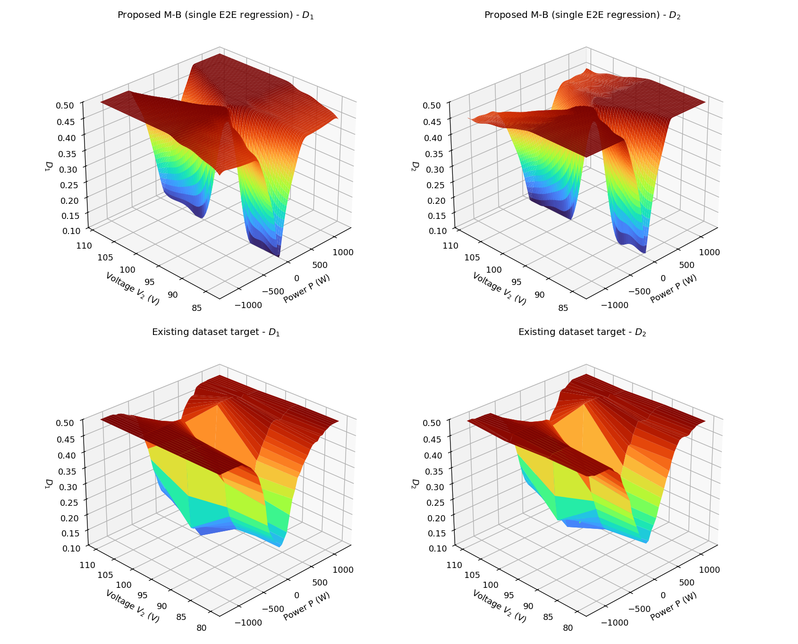
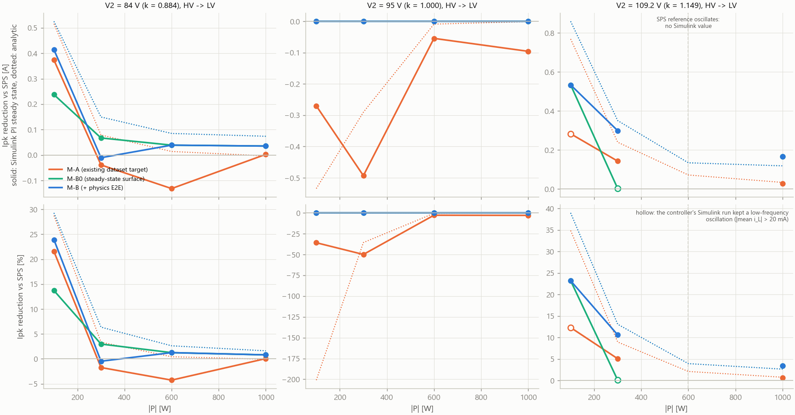
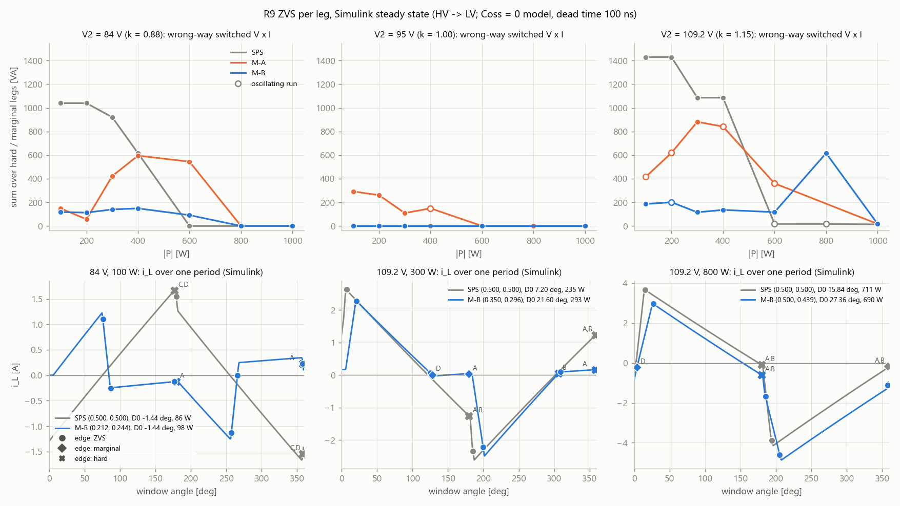
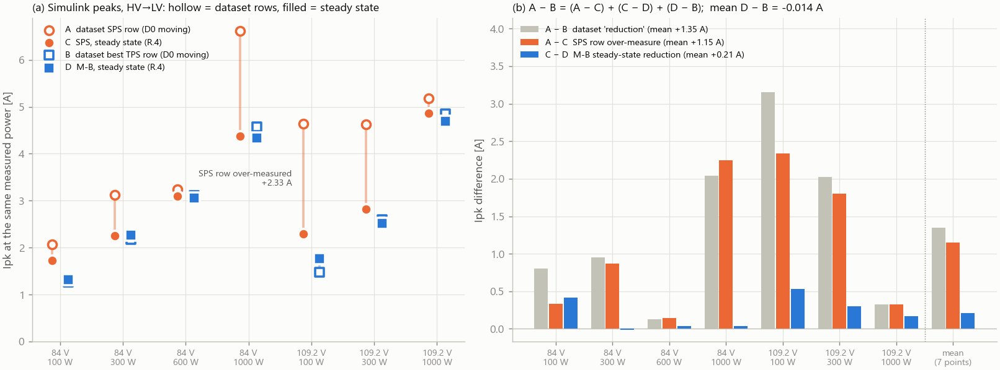
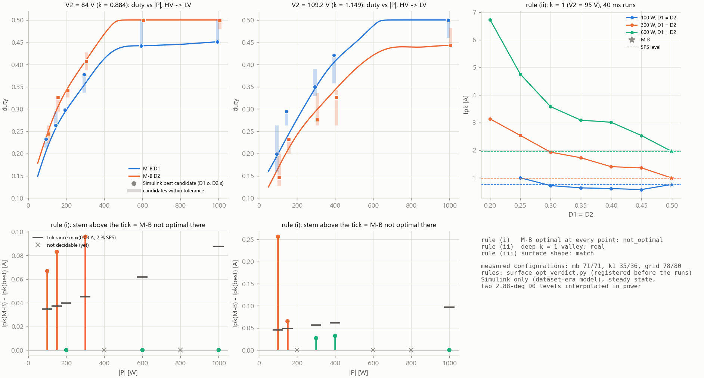
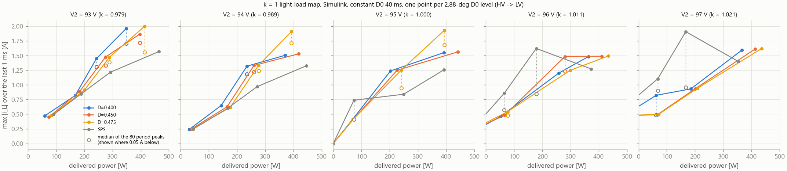
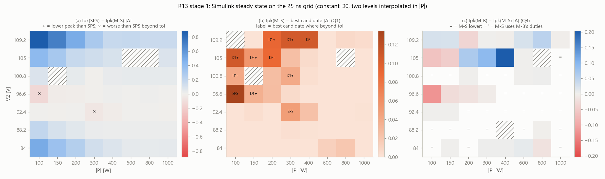
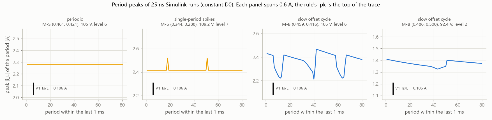

# DAB 컨버터 TPS 피크 전류 저감 — 분류기 없는 단일 회귀 제어기: 검증 보고서

작성 2026-10-29, 0절 재작성 2026-10-30 (자율 루프). 졸업논문 원고의 바탕으로 처음부터 끝까지 읽히도록 쓴 문서다. 루프의 작업 일지인
`RESULTS.md`(누적 기록, 내부 작업 번호 사용)와 별개다. 새 Simulink 결과가 나오면 이 문서를 고친다.

**수치 표시 규칙**(사용자 지시 2026-10-29: 결론은 Simulink로 검증한 값만 쓴다)

| 표시 | 뜻 |
|---|---|
| **[S]** | MATLAB Simulink에서 실행해 얻은 값이다. 모델은 데이터셋을 만든 시기의 `dataset_era/Control_Logic_dataset_era.slx`(git 35d5a78)이다. 결론의 근거로 쓴다. |
| **[참고]** | 해석 모델(`tps_model.py`, 이상 소자 정상상태) 또는 Python 플랜트(`plant_full.py`, .slx에서 추출한 비이상 회로)의 값이다. **Simulink로 검증하지 않았다.** 설명·예측용이며 결론의 근거로 쓰지 않는다. |
| **[대기]** | Simulink 실행을 계획·제출했고 결과가 아직 없다. |

수치 옆의 경로는 저장소 `Simulink/Thesis/` 기준 출처 파일이다. 저감은 ΔI = Ipk(SPS) − Ipk(제어기)이고, 양수가 저감이다. 항상
**같은 전력**에서 비교한다. Ipk는 1차측 인덕터 전류 |i_L|의 최댓값이다.

---

## 0. 한 쪽 요약

**무엇을 했나**
1. ICROS2026의 "SPS/TPS 분류기 + TPS 회귀 + FSM 후처리"를 **하나의 연속 회귀**로 바꿨다. 입력은 (|P|, V2)이고, 출력은 내부
   위상 (D1, D2)이다. 외부 위상 D0는 PI 제어기가 전력 오차로 닫는다. SPS 영역은 출력이 0.5로 포화하는 영역일 뿐이며, 분류
   경계와 FSM이 없고, 제어 곡면은 무한히 매끄럽다(2절).
2. 같은 회귀 구조에 학습 목표 두 가지를 넣어 비교했다. **제어기 A**는 기존 파이프라인 데이터셋을 목표로 한다. **제어기 B**는
   정상상태 최적 곡면에서 출발해, PI 정상상태의 Ipk를 직접 줄이도록 미세조정했다(E2E)(3절). 결과 파일에서는 이 둘을 각각 M-A, M-B라고 부른다.
3. 두 제어기를 데이터셋을 만든 바로 그 Simulink 모델에서 PI 정상상태로 비교했다(4–5절).
4. 사용자 데이터셋이 "수 A 저감"을 보인 이유를 Simulink에서 생성 실험을 그대로 다시 돌려 확인했다(6절).

**핵심 결론** [S] 25 ns 격자 Simulink 정상상태. V2 84–109.2 V 7값 × |P| 100–1000 W 8단 = 56점, HV→LV, 상수 D0 두 계단 전력 보간, 20 ms 창(`out/r13_verdict.md`, 11.5절).

| 질문 | 답 |
|---|---|
| 왜 25 ns인가 | 데이터셋 시기 모델은 제어기와 Simscape 로컬 솔버가 100 ns로 돈다. 그래서 Ipk가 듀티 0.004 칸의 계단 함수이고, 0.1–1 A 크기의 점별 차가 격자에서 나온다(11.4절). 격자만 25 ns로 줄여 다시 쟀다. 100 ns에서 나온 "SPS보다 낮다" 8개는 모두 남고, "M-S가 B보다 낮다" 5개와 k = 1 골은 사라지거나 뒤집혔다. |
| 10 ns에서도 그대로인가 | 대표 저감은 남는다. 84·109.2 V 6점 SPS − B는 25 ns +0.328 → 10 ns **+0.403 A**이고, 진술 5개가 모두 유지됐다. 다만 규칙(차 ≤ 0.03 A)으로는 **"미수렴"**이다. 주기 피크 중앙값으로는 +0.351 → +0.373 A다(판정 아님). **10 ns에서는 42구성 모두 80주기 피크가 일정하지 않다**(SPS 폭 0 → 0.06–0.25 A). 그래서 10 ns 최댓값은 25 ns 값보다 깨끗한 값이 아니다. 원인을 가르는 진단과 12.5 ns 재측정을 등록했다(잡 `g12`, 11.5절). 그때까지 0.1 A 단위 진술은 잠정이다. |
| 저감은 얼마인가 (목표 1) | 제어기 B, 52점 평균 **+0.115 A (+5.4 %)**, 중앙값 +0.038 A. 80주기 피크의 중앙값으로 재면 +0.127 A (+5.9 %). 크기는 \|1 − k\|와 경부하가 정한다: 84 V 100 W 1.747 → 1.252 A (**−28 %**), 109.2 V 100 W 2.269 → 1.410 A (**−38 %**), 1 kW 84 V −1.0 %, 109.2 V −3.3 %, k ≈ 1(92.4·96.6 V) 평균 0. V2별 평균 84 V +0.177, 88.2 V +0.062, 92.4 V −0.008, 96.6 V +0.002, 100.8 V +0.039, 105 V +0.158, 109.2 V +0.368 A. |
| 곡면이 매끄러운가 (목표 2) | 분류기·FSM 없는 단일 연속 회귀, C∞, int16 4.6 kB(2절). 분류 경계를 지나는 램프에서 ICROS 구조의 명령 듀티는 한 주기에 0.125 뛰고 B는 0.0002다. 피크 튐은 109.2 V에서 3.18 A(775 W) 대 1.39 A이고, B의 값에는 PI 한계 주기 몫이 섞여 있다(8.3절, 1라운드). |
| 어디서도 SPS보다 나쁘지 않은가 (목표 3) | 규칙(80주기 최댓값)으로는 **아니다**. B 2점(92.4 V 300 W +0.049 A, 105 V 400 W +0.103 A), M-S 2점(92.4 V 300 W +0.049 A, 96.6 V 100 W +0.135 A). 세 점 모두 괄호 실행 하나가 주기적이지 않다. 주기 중앙값으로는 B 1점(92.4 V 300 W +0.032 A, 허용 0.030 A)이다. 100 ns의 84 V 400·800 W, 93 V 위반은 25 ns에서 없다. **10 ns에서는 25 ns의 위반 진술 셋이 모두 성립하지 않는다**(92.4 V 300 W B −0.044 A, 105 V 400 W B −0.169 A, 96.6 V 100 W M-S −0.023 A; 음수 = SPS보다 낮음, 중앙값도 같은 쪽). 단 10 ns SPS 값에 위의 흔들림 몫이 있어, 어느 쪽이든 단정은 `g12` 뒤로 미룬다. |
| 곡면이 Simulink 최적인가 (사용자 최우선) | **국소적으로는 대부분 그렇다.** M-S 둘레 ±0.03 스텐실로 53점을 판정해 규칙 값 최적 42·최적 아님 11, 주기 중앙값 최적 49·최적 아님 4다. 규칙 값으로만 어긋나는 7점의 차는 격자 한 스텝(0.106 A)의 단발 스파이크이고, 중앙값으로 남는 넷은 k ≈ 1 쪽 0.03–0.06 A다(D1을 SPS 쪽으로 올리면 낮아짐). 평균 차는 규칙 값 0.019 A, 중앙값 0.007 A다. B 자신은 54점 중 규칙 값 44, 중앙값 49점이 허용오차 안이다. 규칙의 문턱(최적 아님 5점)을 넘어 재학습 M-D를 판정하는 중이고(`md1`), 스텐실이 못 보는 먼 듀티는 `o25r`이 잰다. 이 11개 진술을 10 ns로 다시 재면 유지 2, 사라짐 8, 뒤집힘 1이다(`g10`). 재학습을 부른 차의 대부분이 25 ns 격자의 크기라는 뜻이다. [참고] 25 ns 플랜트 스캔에서는 56점 모두 듀티 격자의 최저가 곡면보다 0.03 A 넘게 낮지 않다. |
| k = 1에서 골이 있는가 | **없다.** 95 V 100 W에서 SPS 0.297 A, D1 = D2 = 0.40 0.360 A다(70 W 0.208 대 0.252 A). 실행은 모두 주기적이고, 손실 없는 회로의 하한 Ipk ≥ P/(2·D1·V1)과 맞는다. 100 ns의 "골"(11.2절)은 SPS 실행의 격자 스파이크였다. 10 ns에서도 SPS가 0.051 A 낮다(0.368 대 0.418 A, 규칙 "유지"; 중앙값 0.073 A). |
| 보정 곡면 M-S를 쓸 것인가 | **주 곡면은 B로 권고한다.** M-S는 100 ns 규칙으로 채택됐지만(46점 중 43점, 11.3절), 그 이득은 25 ns에서 사라졌다. 지도에서 M-S 대 B는 다른 31점 중 개선 3·열화 3·같음 23, 평균 +0.006 A로 규칙상 "유지"이나 사실상 무승부다. k = 1 앵커는 근거를 잃었고, 그 때문에 96.6 V 100 W에서 SPS보다 높다. B는 Simulink 격자에 맞춘 앵커가 없다. `md1`의 앵커 밖 48점 비교까지 본 뒤 확정한다. |
| 효율·ZVS | B − SPS, 52점 평균 손실 −1.09 W, Δη +0.33 pp, 최대 +1.69 pp(109.2 V 100 W). η가 0.05 pp 넘게 낮은 점은 88.2 V 100 W(−0.06)·92.4 V 100 W(−0.17 pp)다. 엇방향 전환 V·I 합 4599 대 22619 VA(−80 %; 오프셋을 옮기는 점검은 51점일 때 −76 … −83 %). Coss 0 모델이라 hard 전환 손실은 이 값에 안 보인다(5·11.5절). |
| 측정의 해상도 | 규칙의 Ipk는 마지막 1 ms 80주기 피크의 최댓값이다. 이 값은 격자 한 스텝 V1·Ts/L(100 ns 0.42 A, 25 ns 0.106 A) 크기의 잡음을 갖는다. 25 ns 실행 709회 중 76회(11 %)가 주기적이 아니고, 그중 72회는 전환 전류가 0.2 A 이하인 엣지를 가진다(0.42 A 넘는 188회에서는 0회). 그래서 새 판정(재학습, 전역 탐색)은 최댓값과 주기 중앙값을 둘 다 본다(11.5절). 격자를 더 줄인다고 이 잡음이 줄지는 않았다. 10 ns 폭의 중앙값은 0.114 A로, 한 스텝 0.042 A의 2.7배다. |

**다른 검증** [S]

| 항목 | 값 |
|---|---|
| 100 ns 표준 12점 (V2 84 / 95 / 109.2 V × 100 / 300 / 600 / 1000 W, `out/simulink_pi_compare.csv`) | B 평균 +0.13 A (+5.7 %, 진동 점 제외 11점), 84 V 100 W +0.41 A, 109.2 V 100 W +0.53 A. 이 표의 84·109.2 V × 100·300·1000 W 6점은 25 ns에서 +0.249 → **+0.328 A**다(11.4절). |
| 학습 목표 비교 | 같은 구조에서 기존 데이터셋 목표(제어기 A)는 12점 중 6점에서 SPS보다 나쁘다(95 V 300 W −0.49 A, −50 %). 정상상태 목표 + E2E(제어기 B)와 갈리는 것은 학습 목표뿐이다(3·5절). |
| 데이터셋 "수 A 저감"의 정체 | 생성 실험을 다시 돌린 195행이 체크포인트와 **비트 단위로 같다**. D0 블록의 기본 선형보간이 원인이다(6.1–6.2절). 7점 평균 1.35 A = SPS 행 과대 1.15 A + B의 정상상태 저감 0.21 A + 차 −0.01 A(6.6절). 보간만 끈 진짜 계단에서는 0.5 A 이상이던 저감 13칸이 평균 1.42 → **0.47 A**(규칙 "대부분 보간 산물", 6.4절). |
| 수정 데이터셋 363조합 (보간만 끔) | 격자 최저 TPS의 같은 전력 저감 84 V +0.23 A, 109.2 V +1.11 A(원 데이터셋 +0.82 / +1.95 A). "최선이 B보다 0.40 A 더 줄인다"의 87 %는 계단 SPS 칸 과대이고, 같은 전력 피크 차는 평균 0.05 A다(6.4b절). 그래서 재학습은 계단 데이터가 아니라 25 ns 정상상태 지도로 한다. |
| 파라미터 견고성 (L ±10 %, 데드타임 200 ns, V1 ±5 %, 30경우, **100 ns**) | 규칙상 **"열화 있음"**(판정 가능 23경우 중 V1 −5 % 84 V 300 W 한 점, B가 SPS보다 0.090 A 높음; 저감 14, 같음 8). 경부하 저감은 k가 1에서 멀어지는 변형에서 커진다. V1 정규화 입력은 109.2 V 쪽이 나빠 채택 안 함(8.1절). 25 ns 재측정 잡 `rob25` 대기. |
| PI 폐루프 (위상 격자를 고친 제어기 복사본) | 25 ns에서 폐루프 정상상태가 상수 D0 정상상태와 −0.08 … +0.05 A 안으로 같다(평균 0.00 A). 처음 이득에서 난 약 4 kHz 한계 주기는 이득 ½에서 사라진다(위상 p2p 10.9° → 0.61°). 계단 직후 피크 B ≤ SPS 7/8(예외 +0.18 A), 경부하 내림 계단 −1.2 … −2.1 A, 정착 약 1 ms(84 V 300 → 100 W만 B 3.4 ms)(8.2절). V2 변화 시험은 `r12r2`에 대기. |
| 분류기 제거 램프 | 109.2 V "효과 확인"(ICROS 경계 775 W 피크 튐 3.18 A, 램프 최대 7.49 대 B 5.83 A), 90 V "부분"(B도 같은 PI 이득의 한계 주기로 떪)(8.3절). 안정 이득 2라운드 `r12r2`. |

**ICROS2026 대비 바뀐 것**

| 항목 | ICROS2026 | 이 연구 |
|---|---|---|
| 제어 구조 | SPS/TPS 분류기(정확도 97.44 %) + TPS 회귀(RegHDC, D 32, K 8, Q 32, γ 8) + FSM 후처리 | (\|P\|, V2) → (D1, D2) 단일 연속 회귀. 분류기·FSM이 없다. |
| 제어 곡면 | 분류 경계에서 불연속이고, 입력 양자화 때문에 계단형이다 | C∞ (무한히 매끄럽다) |
| 학습 목표 | 1 ms 계단 Simulink 데이터셋 → 대리모델(MLP/XGBoost) → SQP 최적 → 고부하 SPS 근사 후처리 | 정상상태 최적 곡면 + PI 정상상태 Ipk를 직접 최소화하는 E2E 학습 |
| 모델 크기 | 5.1 kB | int16 4,618 B, float32 5,128 B |
| 검증 | 데이터셋·대리모델 위의 평가: 전체 0.337 A, TPS 구간 1.222 A, 최대 3.392 A | Simulink 25 ns 정상상태 지도 56점과 100 ns 표준 12점, 폐루프 계단·램프(위 표) |
| 최대 저감 3.392 A | 초록의 수치 | 데이터셋 SPS 기준이 부풀려진 값이다. 정상상태에서는 도달할 수 없다(6.6절). |
| MCU | STM32G474RET6, 약 60 µs | C 코드를 PC 컴파일러로만 비트 단위 검증했다. 실기는 아직이다. |

**남은 것** (모두 대기열에 있고, 규칙은 실행 전에 등록했다)
- 잡 `r12r2`: 안정 이득(½)으로 램프 2라운드, 폐루프 V2 변화 12회(8.2·8.3절).
- 잡 `rob25`: 견고성 25 ns 재측정(8.1절).
- 잡 `o25r`: 곡면에서 먼 듀티의 25 ns 전역 탐색(11.5절).
- 잡 `md1`: 재학습 곡면 M-D를 앵커 밖 48점에서 B·M-S와 비교(11.5절). 앵커 밖 48점은 B·M-S의 저감을 지도 밖에서 다시 재는 값이기도 하다.
- 잡 `g12`: 10 ns 흔들림의 원인 진단(드라이버 지연, 다이오드 회복) + g10 전체를 12.5 ns로 재측정(11.5절).
- 이 모델로 답할 수 없는 것: Coss·자화 인덕턴스 효과, 실기 크기(8절).

---

## 1. 문제와 설계

**사양**: V1 = 380 V(HV), V2 = 84–109.2 V(LV), 변압비 n = 4, 직렬 인덕터 L = 90 µH(1차측), fs = 80 kHz, |P| ≤ 1.2 kW.
전압 변환비 k = n·V2 / V1 = 0.884–1.149이고, **k = 1은 V2 = 95 V**다.

**PWM 규약**(`DAB_Controller_System.m` STAGE 6/7과 같다): 1차 브리지는 0°에서 시작하는 폭 D1·Ts의 +V1 펄스를 낸다. 2차 브리지는
D0°(리딩 엣지)에서 시작하는 폭 D2·Ts의 +V2 펄스를 낸다. **D1 = D2 = 0.5가 SPS**다. 이 규약은 여러 문헌이 쓰는 "1 = SPS"
스케일과 2배 차이가 난다(문헌의 D = 2 × 이 문서의 D). 부호는 Simulink 데이터의 P_act_W를 따른다. P > 0 ⇔ D0 < 0이고, LV→HV 방향이다.

**제어 가정**: 회귀 모델은 (D1, D2)만 낸다. D0는 PI 제어기가 닫는다. TPS 최적화의 연산 병목을 회귀 하나로 없애는 것이
이 프로젝트의 가정이다. PI가 0에서 출발해 전력 오차를 적분하면, D0는 |P|(D0) = |P*|의 **첫 상향 교차점**에 멈춘다. 평가는
모두 이 점에서 한다(`pi_steady.py`). 대칭성 때문에 최적 (D1, D2)는 |P|만의 함수이므로(`test_tps_model.py`) 입력을 (|P|, V2)로 둔다.

**목표**(사용자, 2026-10-21)
1. TPS 성능 강화.
2. 전 구간을 하나의 회귀 모델로 통합한다(SPS/TPS 분류기·FSM 없음). 이것으로 제어 곡면을 매끄럽게 한다.
3. 전 구간에서 SPS 대비 피크 전류를 낮춘다. 최소한 어디서도 SPS보다 나쁘지 않아야 한다.

---

## 2. 제어기 구조 — Smooth RegHDC



*그림 1 (`out/fig_surface3d.png`). 위: 제안 제어기 B의 D1, D2 곡면. 아래: 기존 데이터셋 목표 곡면. B의 곡면은 경부하·V2 가장자리
(84 V, 109.2 V)에서 두 골로 깊어지고, k = 1(95 V) 능선과 고부하에서는 0.5(SPS)로 평평하게 포화한다. 데이터셋 곡면은 조각마다
꺾이는 다면체이고, 95 V 부근까지 깊은 TPS를 건다(5절에서 이것이 열화를 낳는다).*

**계산 순서**
1. (|P|, V2)를 [0, 1]로 정규화한다.
2. 고정 무작위 사상 h = √2·cos(xW + b)를 계산한다. 차원은 D = 256, σ = 0.1이다. 무작위 푸리에 특징으로, HDC의 연속 부호화에 해당한다.
3. 선형 읽기층으로 y(2개)를 계산한다.
4. Δ = softplus_τ(y)를 계산한다(τ = 0.004).
5. D1, D2 = 0.5 − Δ를 출력한다.

softplus 출력 때문에 Δ ≥ 0, 곧 D ≤ 0.5가 구조적으로 보장된다. SPS 영역은 Δ ≈ 0으로 포화한 영역이다. 분류기 없이 한 식이
두 영역을 덮는다. 학습하는 것은 읽기층(2 × 257개 가중치)뿐이고, 부호화(W, b)는 고정이다.

**MCU 구현**(`export_mcu.py` → `out/SmoothRegHDC_STM32.h`, `out/smooth_reghdc.c/.h`)
- int16 경로는 4,618 B, float32 경로는 5,128 B다. 연산량은 차원당 MAC 4회 + cos 표(Q15, 1025개) 선형보간이다. W를 2^-12 회전 단위로
  두어 uint32 랩어라운드가 곧 mod 2π가 되게 했다. 누산은 int64로 한다.
- C 파일을 MATLAB에 딸린 LCC-win64로 컴파일해 20,253점을 시험했다. int64 누산값과 float32 출력이 평가에 쓴 Python 에뮬레이션과
  모든 점에서 비트 단위로 같았다(`c_compile_check.py` → `out/c_compile_check.log`). float64 모델 대비 오차는 int16에서
  max|ΔD| = 2.6e-4다. **ARM 툴체인 컴파일과 실기 실행은 하지 않았다.**
- MATLAB 추론 함수 `smooth_reghdc_infer.m`(Simulink MATLAB Function·codegen용)은 MATLAB에서 시험 벡터 208개로 확인했다
  (Python 모델과 max|ΔD| 4.4e-16).

---

## 3. 두 학습 목표와 만든 방법

세 모델은 부호화(W, b; D = 256, σ = 0.1, seed 0)가 같고 **읽기층만 다르다**. 그래서 결과의 차이는 목표에서 나온다
(`train_targets.py`, `train_e2e.py`).

| 모델 | 학습 목표 | 만든 방법 |
|---|---|---|
| **제어기 A** (M-A) | 기존 파이프라인 데이터셋 `Simulink/Physics_Dataset_Final_Regression_Ready.csv`. 사용자 최신 trainer `RegHDCTrainer.m`이 읽는 파일이고, 196점(±1200 W 50 W 간격 × V2 80/90/100/110 V)이다. | 목표 표를 쌍선형으로 조밀화한 뒤 ridge 회귀(α 1e-3). 적합 RMSE(D)는 0.006–0.008이다. 즉 모델이 데이터셋 곡면을 충실히 따른다. |
| 제어기 B0 (M-B0) | 정상상태 최적 매끄러운 곡면 | 해석 모델에서 점별로 최적을 구한다(PI 첫 교차점, SPS보다 나빠지는 것 금지). 여기에 곡면 기울기 벌점(λ)을 더해 매끄럽게 한 뒤(`smooth_surface_v2.py`), ridge로 적합한다. |
| **제어기 B** (M-B, 제안) | B0 + 물리 내장 E2E | 무작위 (\|P\|, V2) 배치에서 PI 정상상태의 Ipk − Ipk_SPS를 직접 최소화한다. 벌점은 SPS 열화(힌지), 전력 미달, 거칠기에 준다. 기울기는 전력 제약에 대한 암시 함수 정리로 구한다: dIpk/dD = ∂Ipk/∂D − (∂Ipk/∂φ)(∂P/∂D)/(∂P/∂φ). 유한차분과 일치함을 확인했다(`test_train_e2e.py`). |

**기존 데이터셋의 출처**: `Simulink/Data/TPS_Dataset_20260316_021229.csv`가 원 데이터셋이다. 312,000행이고, 20 × 20 (D1, D2) ×
20 V2 × D0 39계단(1 ms씩, 44 ms 실행)이다. 이것에서 대리모델(MLP/XGBoost) → SQP 최적 → 후처리를 거쳐 제어기 A의 목표 표가 나왔다.
이 데이터셋이 어떻게 측정됐는지가 6절의 주제다.

**주의**: 제어기 B의 목표는 이상 소자 해석 모델로 만들었다(데드타임 없음). 해석 모델은 **설계(학습)에만** 썼다. 성능 판정은 5절의
Simulink로 한다.

---

## 4. 검증 방법

**모델**: 데이터셋을 만든 시기의 Simulink 모델(git 35d5a78)과 `DAB_Controller_System.m`을 `dataset_era/`로 꺼내 읽기 전용으로
쓴다(`make_dataset_era.py`). 현재 HEAD의 `Modules/Control_Logic.slx`는 입력이 상수(Phi 70°, D = 0.5, V2 96 V)로 바뀌어 있어 쓰지
않는다. .slx에서 읽은 플랜트(`slx_dump.py` → `out/plant_params.md`)는 다음과 같다.
- MOSFET SCT3040KR, Ron 40 mΩ, 바디 다이오드
- 데드타임 100 ns, 소자 정전용량(Coss) 사실상 0
- 이상 변압기 n = 4, L 90 µH, 직렬 DC 차단 C 1000 µF × 2, 이상 전압원 + 0.05 Ω
- 제어기 PWM은 100 ns 샘플이고, 모든 엣지가 **2.88° 격자**에 놓인다
- 자화 인덕턴스는 없다

**PI 정상상태 측정**(`verify_steady_state.m`, `verify_steady_batch.m`, `simulink_sweep.py`)
1. 각 (제어기, V2, |P|)에서 제어기가 낸 (D1, D2)를 고정한다.
2. 2.88° 격자에서 목표 전력을 사이에 두는 **인접한 두 D0 계단**을 고른다. 첫 상향 교차점 쪽, 곧 PI가 먼저 닿는 쪽이다.
3. 각 계단을 상수 D0로 30 ms씩 실행하고, 마지막 1 ms의 max|i_L|과 평균 전력을 잰다.
4. Ipk를 측정 전력에 대해 선형보간해 목표 전력의 값을 얻는다.

이것이 디더 없는 PI 정상상태다. 4차에 걸쳐 150회를 실행했고 48개 구성이 모두 감싸졌다.
- 마지막 1 ms 평균 전류가 20 mA를 넘으면 저주파 진동이 남은 것으로 보고 °로 표시한다. 직렬 C가 있어 정착하면 평균이 0이어야 한다.
- 엣지가 격자점에 정확히 놓이면 주기마다 62/63샘플로 흔들려 SPS가 진동했다(Ipk가 0.2–2 A 부풂). 그래서 모든 듀티를 0.4999999
  이하로 두었다. 위상 차는 3.6e-5°이므로 물리적으로는 SPS다.

**진짜 PI 폐루프를 판정에 쓰지 않은 이유** [S] (`verify_pi_closed_loop.m`, `out/simulink_pi_pilot*.csv`): 모델 안의 "외부 D1/D2 +
위상 PI" 모드를 시뮬레이션마다 블록 값만 바꿔 시험했다(SPS, 35 ms, 모델 저장 안 함).
- 모델 자체 이득(Kp 20, Ki 490000)에서는 위상이 크게 떨려 Ipk가 16–18 A였다.
- Kp 2 / Ki 49000에서는 전력을 0.2 % 안에서 맞췄다. 그러나 SPS Ipk가 3.1 A(84 V 100 W; 정상상태 1.73 A), 4.9 A(95 V 1 kW;
  3.25 A), 5.3 A(109.2 V 300 W; 2.82 A)였다.
- 적분 지배형 이득 두 가지에서도 값이 거의 같았다.

원인은 2.88° 위상 격자다. PI가 인접한 두 계단 사이를 오가며 디더하고, 그 비대칭이 DC 편차와 큰 피크를 만든다. 이득을 바꿔도
결과가 같은 것이 그 증거다. MCU의 HRTIM(184 ps)에는 이 격자가 없으므로 시뮬레이션 모델의 산물이다. 이 문제를 고친 폐루프
동특성 실험은 남은 작업이다(8절).

---

## 5. Simulink 결과 — 같은 구조, 목표만 다른 두 제어기

> **10-30 18:10 읽기 전에.** 표 5-1을 비롯한 이 절의 값은 **100 ns 격자**의 것이다. 격자를 줄이면 절대값이 함께 움직인다(95 V 100 W SPS 0.753 → 0.297 A, 11.4·11.5절). 제어기 A·B의 비교 구조와 순서는 그대로 쓰지만, 논문의 저감 수치는 25 ns 지도(11.5절)를 쓴다. 제어기 A는 25 ns로 다시 재지 않았다.

**표 5-1** [S] HV→LV, PI 정상상태, ΔI = Ipk(SPS) − Ipk(제어기) [A] (괄호는 SPS 대비 %). 출처 `out/simulink_pi_compare.csv`,
`out/simulink_pi_compare.log`. 마지막 열만 **[참고]**(해석 모델, `out/eval_table.csv`와 같은 모델).

| V2 (k) | \|P\| | SPS Ipk | 제어기 A ΔI | 제어기 B0 ΔI | **제어기 B ΔI** | [참고] 해석 모델 B ΔI |
|---|---|---|---|---|---|---|
| 84 V (0.884) | 100 W | 1.732 | +0.373 (+21.6 %) | +0.238 (+13.7 %) | **+0.414 (+23.9 %)** | +0.525 (+29.3 %) |
| | 300 W | 2.253 | −0.039 (−1.7 %) | +0.067 (+3.0 %) | **−0.011 (−0.5 %)** | +0.149 (+6.4 %) |
| | 600 W | 3.094 | −0.132 (−4.3 %) | +0.039 (+1.3 %) | **+0.039 (+1.3 %)** | +0.085 (+2.6 %) |
| | 1000 W | 4.376 | +0.003 (+0.1 %) | +0.035 (+0.8 %) | **+0.035 (+0.8 %)** | +0.074 (+1.6 %) |
| 95 V (1.000) | 100 W | 0.753 | −0.270 (−35.8 %) | 0 | **0** | 0 |
| | 300 W | 0.987 | −0.493 (−49.9 %) | 0 | **0** | 0 |
| | 600 W | 1.953 | −0.054 (−2.8 %) | 0 | **0** | 0 |
| | 1000 W | 3.248 | −0.096 (−2.9 %) | 0 | **0** | 0 |
| 109.2 V (1.149) | 100 W | 2.298 | +0.283 (+12.3 %)° | +0.533 (+23.2 %) | **+0.533 (+23.2 %)** | +0.859 (+39.0 %) |
| | 300 W | 2.820 | +0.142 (+5.1 %) | +0.002 (+0.1 %)° | **+0.299 (+10.6 %)** | +0.350 (+13.1 %) |
| | 600 W | 5.147° | +0.811° | +1.607° | +1.181° | +0.134 (+3.9 %) |
| | 1000 W | 4.857 | +0.028 (+0.6 %) | +0.165 (+3.4 %) | **+0.165 (+3.4 %)** | +0.118 (+2.6 %) |

° = 그 실행이나 SPS 기준 실행에 저주파 진동이 남은 점. 109.2 V 600 W는 SPS 기준 자체가 진동했다(5.15 A, 해석 3.43 A). 그래서
그 점의 ΔI는 크기를 해석하지 않는다.

**표 5-2** [S] 요약 (`out/simulink_pi_compare.log`)

| | 평균 ΔI (진동 점 제외) | 평균 [%] | 최악 | SPS보다 5 mA 넘게 나쁜 점 |
|---|---|---|---|---|
| 제어기 A (기존 데이터셋 목표) | −0.054 A (10점) | −7.0 % | −0.493 A | **6 / 10** |
| 제어기 B0 (정상상태 곡면) | +0.108 A (10점) | +4.5 % | 0 | 0 / 10 |
| **제어기 B (제안)** | **+0.134 A (11점)** | **+5.7 %** | −0.011 A | 1 / 11 (−11 mA) |

인용하는 평균은 위 표의 값이다. 진동 점까지 넣은 12점 평균(제어기 B +0.22 A, +7.1 %)은 109.2 V 600 W 한 점(+1.18 A)이 끌어올린
값이므로 **인용하지 않는다**.



*그림 2 (`out/fig_simulink_pi_compare.png`) [S]. V2별 ΔI. 109.2 V 600 W의 Simulink 값은 비워 두었다(세로 점선).*

**읽는 법**
- **학습 목표가 결과를 가른다.** 구조와 부호화가 같은데, 기존 데이터셋 목표(A)는 12점 중 6점에서 SPS보다 나쁘다. 정상상태 목표 +
  E2E(B)는 이 12점에서는 어디서도 의미 있게 나쁘지 않다. **(10-30 정정) 표 5-1에 없는 84 V 400·800 W에서는 B가 SPS보다 0.075·0.172 A
  (3.0·4.6 %) 높다** [S](11절 5라운드, 아래 효율 표). SPS로 넘어가는 무릎에서 해석 모델에 없는 기생 효과가 최적 듀티를 옮긴 곳이다.
- **k = 1(95 V)에서 기존 목표의 열화** [S]: A는 네 점 모두 SPS보다 나쁘다(−0.27, −0.49, −0.05, −0.10 A). 300 W에서는 50 %
  나쁘다. 데이터셋이 SPS가 최적인 곳에 깊은 TPS를 넣었기 때문이다(그림 1 아래). B는 이 영역에서 정확히 SPS로 남는다.
  "k ≈ 1에서 TPS 이득이 있다"는 관찰은 Simulink 정상상태에서 재현되지 않는다.
- **목표 3의 판정** [S]: 표 5-1에서 B의 유일한 음수 −11 mA(84 V 300 W)는 SPS와 B가 각각 약 100 W 폭의 계단 사이를 보간한 값의 차다.
  보간 불확도(수십 mA) 안이므로 "나쁘지 않음"과 구별되지 않는다. **그러나 200 W 간격으로 넓히면(효율 표, 11절) 84 V 400 W −0.076 A,
  800 W −0.172 A가 나온다.** 둘 다 허용오차(SPS의 2 %)를 넘고 측정 창에 흔들리지 않는다. 따라서 목표 3은 제어기 B로는 84 V 400–800 W에서
  지켜지지 않는다. 보정 곡면 M-S(11.3절)가 이 두 점을 앵커로 겨냥한다.
- **해석 모델보다 작은 경부하 저감**: Simulink는 84 V 100 W 24 %, 109.2 V 100 W 23 %이고, [참고] 해석 모델은 29 %, 39 %다.
  가능한 원인은 데드타임과 2.88° 격자다. 경부하 TPS의 D 차이는 이 격자에서 0.008 단위로만 표현되고, 스위칭 전류가 작아 데드타임
  영향이 크다(원인 분해는 하지 않았다).
- **B0와 B**: D가 0.003 이내로 같다. Simulink에서 보이는 차이(84 V 100 W 0.24 vs 0.41 A)는 엣지가 격자에서 한 칸 다르게 걸린
  효과로 보이며, 둘의 우열로 해석하지 않는다.
- 범위: HV→LV 한 방향만 실행했다(LV→HV는 이상 모델 대칭성으로 같다고 보지만 Simulink 미실행).

**효율·손실 (부분 결과, 2026-10-29)** [S] (`efficiency_sweep.py compare` → `out/efficiency_compare.{csv,log}`). 표 5-1과 같은 실행에서
Ipk와 같은 방법(측정 전력에 대한 선형보간)으로 단자 간 손실 = 입력 전력 − 출력 전력을 구했다. 전력은 브리지 쪽 단자에서 잰 HV 입력과
LV 출력이다. 효율은 η = |P| / (|P| + 손실)이다. Ipk 열은 표 5-1과 같은 값이다(같은 보간의 확인).

| V2 | \|P\| | SPS 손실 / η | 제어기 A Δη | 제어기 B 손실 / η | 제어기 B Δη (손실 차) |
|---|---|---|---|---|---|
| 84 V | 100 W | 3.94 W / 96.21 % | −0.40 pp | 5.37 W / 94.90 % | **−1.31 pp** (+1.44 W) |
| | 200 W (10-30) | 7.60 W / 96.34 % | +0.72 pp | 7.28 W / 96.49 % | +0.15 pp (−0.33 W) |
| | 300 W | 11.57 W / 96.29 % | +0.36 pp | 9.69 W / 96.87 % | +0.58 pp (−1.87 W) |
| | 400 W (10-30) | 15.90 W / 96.18 % | +0.79 pp | 11.69 W / 97.16 % | +0.98 pp (−4.21 W); **Ipk는 SPS보다 0.076 A 높음** |
| | 600 W | 25.76 W / 95.88 % | +0.97 pp | 16.41 W / 97.34 % | +1.46 pp (−9.35 W) |
| | 800 W (10-30) | 37.48 W / 95.52 % | +0.17 pp | 29.67 W / 96.42 % | +0.90 pp (−7.81 W); **Ipk는 SPS보다 0.172 A 높음** |
| | 1000 W | 51.24 W / 95.13 % | +0.10 pp | 44.65 W / 95.73 % | +0.60 pp (−6.59 W) |
| 95 V | 100–1000 W | 2.27–47.85 W / 97.78–95.43 % | −4.00 / −2.28 / +0.15 / (진동) / +0.57 / +0.10 / +0.07 pp | = SPS | 0 |
| 109.2 V | 100 W | 6.83 W / 93.61 % | (진동) | 6.11 W / 94.24 % | +0.63 pp (−0.72 W) |
| | 300 W | 14.56 W / 95.37 % | +0.67 pp | 10.32 W / 96.68 % | +1.30 pp (−4.24 W) |
| | 400 W (10-30) | 18.73 W / 95.53 % | (진동) | 12.93 W / 96.87 % | +1.34 pp (−5.79 W) |
| | 1000 W | 49.38 W / 95.29 % | +0.14 pp | 38.31 W / 96.31 % | +1.02 pp (−11.07 W) |

Δη = η(제어기) − η(SPS), 단위 %p. 109.2 V 200 W(B 진동), 600·800 W(SPS 진동)는 뺐다(값은 `out/efficiency_compare.log`).
- 제어기 B는 손실 측면에서도 대체로 SPS보다 낫다. 진동 없는 18구성(10-30 13:00, 63/63구성; 95 V 7구성은 B = SPS라 0)
  평균은 ΔIpk +0.088 A, 손실 −2.81 W, Δη +0.43 pp다(59/63 때 16구성은 +0.099 A, −3.16 W, +0.48 pp). 84 V 400·800 W에서는 B의 피크가 SPS보다
  높은데 효율은 0.9–1.0 pp 높다(RMS 전류는 같다 — 손실 차의 원인은 분해하지 못했다).
  예외는 84 V 100 W다. Ipk(−0.41 A)와 RMS 전류(0.543 vs 0.914 A)가 모두 낮은데도 손실이 1.44 W 크다(−1.31 pp).
- 제어기 A는 95 V 100 W에서 손실이 SPS의 약 3배다(6.63 vs 2.27 W, −4.0 pp).
- **원인은 분해하지 않았다.** 1 kW SPS 손실 약 50 W 가운데 Ron 전도 손실 추정(1차 환산 루프 저항 약 1.36 Ω × RMS²)은 약 13 W다.
  나머지는 LV 소스 직렬 0.05 Ω, 바디 다이오드(데드타임 도통, 역회복 TT 16 ns) 등으로 추정한다. 손실 차가 RMS 전류 차로 설명되지
  않는 점(1 kW 109.2 V: RMS −1.7 %, 손실 −11 W)도 미해결이다. 이 모델은 Coss가 0이라 실기의 스위칭 손실과 다르다.
  hard 스위칭이 이 손실에 들어 있는지는 아래 ZVS 단락의 손실 점검에서 봤다(드러나지 않음).
- 200 / 400 / 800 W 구성 38회는 잡 `eff1`로 돌렸다(10-30 05:27, 오류 0). 11절 실행이 나머지 대부분을 같은 방법으로 감쌌고, 남은 4구성
  (SPS 95 V 800 W, 제어기 A 109.2 V 800 W, 제어기 B 95 V 400/800 W) 7회를 잡 `eff2`로 돌려(10-30 12:50, 오류 0) **63/63구성을 모두 감쌌다**.
- **보정 곡면 M-S의 효율 (10-30 11:55, 13:00 갱신, 판정 아님)** [S]. M-S는 11.3절의 M-S 검증 실행(30 ms, 같은 방법)으로 21구성 중 20구성을 감쌌다
  (그중 9구성은 M-S가 B와 듀티 0.003 안이라 돌리지 않았고 B의 실행을 쓴다; 95 V 300 W만 미포착). 진동 없는 17구성 평균은 ΔIpk +0.132 A, 손실 −2.24 W,
  Δη +0.32 pp다. B와 같은 깨끗한 16구성에서 비교하면 ΔIpk는 B +0.096 / M-S +0.111 A, Δη는 B +0.39 / M-S +0.27 pp다. **즉 M-S는 피크를 조금 더 줄이는 대신
  효율 이득이 0.12 pp 작다**(11:55의 14구성으로는 0.14 pp). 차는 두 점에 몰려 있다. 84 V 800 W(M-S 95.80 대 B 96.42 %, 손실 35.04 대 29.67 W, RMS 전류는 2.550 대 2.566 A로 같음)와
  109.2 V 100 W(92.29 대 94.24 %, RMS 0.602 대 0.531 A)다. 84 V 400 W에서는 M-S가 피크와 효율 둘 다 낫다(97.37 대 97.16 %).
  11.3절 판정 규칙은 피크만 본다(이 연구의 목표 3). 효율을 함께 보면 M-S 채택은 피크와 효율의 맞바꿈이다.
- **그림 `out/fig_efficiency.png`** (레퍼런스 [1] Fig. 26–28 형식: V2별 Ipk·효율 대 |P|; SPS 회색 점선, A 주황, B 파랑, M-S 노랑, 속 빈 표시 = 진동,
  표시 없는 M-S = B와 같음). 63/63구성으로 다시 그렸다(10-30 12:58). 빈칸(M-S 95 V 300 W)은 선을 끊었다.

**다리별 ZVS (2026-10-30)** [S] (`zvs_check.py compare` → `out/zvs_check.{csv,log}`, 그림 `out/fig_zvs_check.png`). 위 효율 표와 같은 정상상태
실행 가운데 i_L 마지막 한 주기를 저장한 811개(잡 `zvs2` 70회 + 효율·11절 실행; 플랜트 변형·격자 점검 실행은 뺌)로 63구성을 모두 판정했다(10-30 13:10). 이 Simulink 모델은 Coss가 0이고
드라이버 데드타임이 100 ns다. 그래서 판정 기준은 "데드타임 동안 들어오는 소자의 바디 다이오드가 전류를 나르는가"다. 끄는 순간과 켜는
순간 전류 방향이 둘 다 맞으면 ZVS(Z), 하나만 맞으면 marginal(m), 둘 다 틀리면 hard(H; 0.2 A 미만이면 h ≈ 영전류)다. 다리 A·B는 1차,
C·D는 2차다. 칸의 숫자는 엇방향으로 전환하는 전류 × 그 다리 전압(A·B 380 V, C·D V2)의 합 [VA]이다(턴온 손실의 대리 지표).
변압기 방향·전류 부호·창 시간 오프셋은 모든 실행에 공통인 하나를 di/dt 상관으로 맞췄다(상관 중앙값 0.85). 같은 판정을 Python 플랜트
파형에 돌린 자체 시험은 교과서 SPS 패턴을 낸다(PASS).

| V2 (k) | \|P\| | SPS | 제어기 A | 제어기 B |
|---|---|---|---|---|
| 84 V (0.88) | 100 W | ZZHH 1039 | hZHH 148 | HZZZ 118 |
| | 200 W | ZZHH 1039 | hZZH 57 | HZmZ 113 |
| | 300 W | ZZHH 921 | ZZmH 422 | HZZZ 140 |
| | 400 W | ZZHH 616 | ZZZH 595 | HZZZ 149 |
| | 600 W | ZZZZ 0 | ZZZH 544 | mZZZ 91 |
| | 800 / 1000 W | ZZZZ 0 | ZZZZ 0 | ZZZZ 0 |
| 95 V (1.00) | 100 / 200 W | mmZZ 0 | HmZZ 292 / HZZZ 261 | mmZZ 0 (= SPS) |
| | 300 W | ZZZZ 0 | HZZZ 109 | ZZZZ 0 |
| | 400 W | ZZZZ 0 | hZZH° 149 | ZZZZ 0 |
| | 600 / 800 / 1000 W | ZZZZ 0 | ZZZZ 0 | ZZZZ 0 |
| 109.2 V (1.15) | 100 W | HHZZ 1429 | HhZZ° 415 | hhZm 186 |
| | 200 W | HHZZ 1429 | HhZZ° 620 | HhZZ° 201 |
| | 300 W | HHZZ 1086 | HHZZ 882 | HhZm 116 |
| | 400 W | HHZZ 1086 | HHZZ° 841 | HhZm 136 |
| | 600 W | hhZZ° 17 | HhZZ° 360 | HhZZ 117 |
| | 800 W | hhZZ° 17 | HhZZ° 353 | **HHZm 616** |
| | 1000 W | mmZZ 13 | mmZZ 17 | mmZZ 17 |

° = 진동 실행.

- **SPS는 교과서대로다.** k < 1(84 V) 경부하에서는 2차 다리가 2차 전류 3.7–6.2 A로, k > 1(109.2 V) 경부하에서는 1차 다리가 1.4–1.9 A로
  hard 전환한다. k = 1(95 V)에서는 모든 엣지가 거의 0 A다.
- **제어기 B는 경부하의 hard 전환을 1차 다리 하나의 작은 전류로 줄인다.** 84 V ≤ 400 W에서 2차 다리는 ZVS가 되고 다리 A만 0.30–0.39 A로
  hard다. 109.2 V ≤ 600 W에서는 A가 0.16–0.51 A로 hard이고 B는 거의 영전류다. 둘 다 진동 없는 18구성(63/63; 새로 판정한 B 95 V 400·800 W는
  0 대 0)의 V·I 합은 **B 1065 VA, SPS 7229 VA(−85 %)**이고, B가 높은 곳은 2구성뿐이다(84 V 600 W 91 대 0 VA, 109.2 V 1 kW 17 대 13 VA).
- **예외는 109.2 V 800 W다.** B(0.500, 0.439)는 1차 다리를 −0.68 A에서 전환하고 SPS는 −0.1 A 근처에서 전환한다(그림 오른쪽 아래). 11절에서
  B보다 피크가 0.33 A 낮은 후보가 나온 무릎과 같은 점이다.
- **제어기 A는 B보다 hard 전환이 훨씬 많다.** 84 V 300–600 W에서 2차 다리를 4.9–7.1 A로 hard 전환한다(SPS는 600 W에서 0이다). 95 V
  ≤ 300 W에서는 1차 다리를 0.3–0.8 A로 hard 전환한다(SPS는 0이다).
- **판정의 흔들림**: 공통 시간 오프셋을 ±0.45–0.9° 옮기면 0.3 A 미만 엣지의 글자(Z/m/H)가 63구성 중 3–18구성에서 바뀐다. V·I 합은
  거의 그대로다(B 2.00 → 1.94–1.99 kVA). 그래서 결론은 글자가 아니라 V·I 합과 큰 전류의 hard 엣지에 둔다.
- **손실과의 관계** [참고, 적합]: 이 Simulink 모델의 단자 손실은 R·Irms² 하나로 R² 0.88이 설명된다. hard 엣지 역회복 어림(바디 다이오드
  TT 16 ns × V·I)을 더해도 0.89이고, 상수항을 넣으면 그 계수의 부호가 바뀐다. 즉 **hard 엣지는 이 모델의 손실에 드러나지 않는다.**
  위 효율 차는 ZVS로 설명되지 않는다. ZVS 개선이 손실을 얼마나 줄이는지는 Coss가 있는 모델이나 실기로만 잴 수 있다. 또 실기에서는
  0 A 근처의 "Z"가 Coss를 다 충방전하지 못해 부분 hard가 된다(전류가 작아 손실은 작다).



*그림 2b (`out/fig_zvs_check.png`) [S]. 위: V2별 엇방향 전환 V·I 합 대 |P| (속이 빈 점 = 진동 실행). 아래: 84 V 100 W, 109.2 V 300 W,
109.2 V 800 W에서 SPS와 제어기 B의 i_L 한 주기와 각 지령 엣지의 판정(o ZVS, ◆ marginal, × hard; 글자 = ZVS가 아닌 다리).*

**같은 결론을 주는 보조 잣대** [참고] (Simulink 미검증, 결론의 근거 아님)

| 잣대 | 제어기 A | 제어기 B | 출처 |
|---|---|---|---|
| 해석 모델, 무작위 1만 점 | 평균 −0.010 A, 27 % 점에서 5 mA 넘게 열화, 최악 −0.83 A | 평균 +0.0815 A(점별 최적의 99.4 %), 열화 점 0, 최악 −2.8 mA | `out/eval_table.csv` |
| Python 플랜트(데드타임·Ron·다이오드), 무작위 1200점 | 평균 −0.018 A, 27.7 % 열화, 최악 −0.885 A | 평균 +0.079 A, 20 mA 넘는 열화 0, 최악 −19.5 mA | `out/plant_verdict_B_R2_B_MA_MB.log` |

---

## 6. 기존 데이터셋 재검증 — "수 A 저감"은 어디서 왔나

사용자 질문은 이것이었다. "저감이 그 정도(경부하 23–24 %, 1 kW 수 %)일 리 없다. 내 데이터셋은 같은 전력에서 TPS가 SPS보다 수 A
낮고, 고정 외부 위상으로 정상상태까지 돌려 만들었다." 결론을 미리 정하지 않고, 생성 실험을 같은 Simulink 모델에서 그대로
다시 돌려 확인했다.

### 6.1 비트 단위 재현 [S]

`staircase_check.m`은 `Scripts/Generate_TPS_Dataset.m`의 실험을 그대로 한다. 같은 모델(SHA1 동일), 44 ms 실행, D0 39계단 × 1 ms,
각 계단 끝 0.1 ms 창의 max|i_L|과 평균 전력, 같은 작업공간 변수를 쓴다. 대상은 데이터셋에서 저감이 가장 컸던 TPS 3조합과 같은
V2의 SPS 2조합이다(`out/staircase_combos.csv`). 이 195행(5조합 × 39계단)이 사용자 체크포인트
(`Simulink/Data/TPS_Checkpoint_done_20260316_021229.mat`, CSV와 행 단위로 같음)의 같은 행과 **Ipk, P_LV, P_HV 모두 차이 0**이다
(`out/staircase_compare.log` (a)).

### 6.2 원인: From Workspace 블록의 기본 선형보간 [S]

D0를 읽는 `From Workspace11` 블록의 "Interpolate data"는 **기본값 on**이다. 스크립트는 timeseries에 ZOH 표시를 달았지만, 블록은 그
표시가 아니라 자기 설정을 따른다. 그래서 매 1 ms 계단 동안 D0가 다음 라벨 값을 향해 **직선으로 움직이고**, 0.1 ms 측정 창은
움직이는 D0 위에 있다. 예를 들어 라벨 −90°의 창은 실제로 약 −70°다. "고정 외부 위상으로 정상상태까지"라는 의도와 실제 실행이
달랐다. [참고] Python 플랜트로 7.8만 행을 재생한 결과도 같은 결론이다. 선형보간 가설은 Ipk RMSE 0.53 A, ZOH 가설은 1.40 A였다
(`out/transient_replay.log`).

### 6.3 데이터셋 SPS 행의 과대 [S]

같은 플랜트, 같은 전력, 같은 SPS에서 데이터셋 행과 상수 D0 30 ms 정상상태(`out/simulink_steady.csv`)를 비교했다
(`dataset_vs_simulink.py` → `out/dataset_vs_simulink.log`). 해석 모델은 쓰지 않았다.

| V2 | 방향 | 비교 전력 범위 | 행 수 | 데이터셋 − 정상상태 Ipk: 최소 / 평균 / 최대 [A] |
|---|---|---|---|---|
| 84 V | LV→HV | 261–1427 W | 9 | +0.10 / +0.69 / +1.45 |
| 84 V | HV→LV | 475–1357 W | 9 | −0.15 / +0.86 / +2.34 |
| 109.2 V | LV→HV | 730–1908 W | 8 | −0.02 / +0.94 / +2.54 |
| 109.2 V | HV→LV | 234–1714 W | 9 | −0.36 / +0.78 / +1.79 |

### 6.4 보간만 끈 진짜 1 ms 계단 (2026-10-29 새 결과) [S]

6.1과 같은 실험에서 `From Workspace11` 하나만 Interpolate = off로 바꿔 다시 돌렸다(모델 저장 안 함; `out/staircase_check_interp0.csv`,
195행, 10-29 18:49). 판정 규칙은 결과를 보기 전(10-28 12:30)에 `r8_verdict.py`에 정해 두었다. 데이터셋에서 같은 전력 SPS − TPS가
0.5 A 이상인 칸들에서 r = 평균(진짜 계단) / 평균(데이터셋)을 구한다. r ≥ 0.75이면 사용자 쪽이 맞고, r ≤ 0.5이면 보간 산물이다.

**표 6-1** [S] 같은 측정 전력의 Ipk(SPS) − Ipk(TPS) [A] (`out/r8_verdict.md`, `out/staircase_compare.log` (c))

| V2 | TPS (D1, D2) | 방향 | \|P\| | 데이터셋(보간 켬) | 진짜 계단(보간 끔) |
|---|---|---|---|---|---|
| 109.2 V | (0.247, 0.216) | HV→LV | 100 W | +2.64 | +0.74 |
| 109.2 V | (0.247, 0.216) | HV→LV | 150 W | +2.79 | +0.27 |
| 109.2 V | (0.247, 0.216) | HV→LV | 300 W | +1.65 | +1.64 |
| 109.2 V | (0.247, 0.216) | LV→HV | 100 W | +1.34 | +0.93 |
| 109.2 V | (0.247, 0.216) | LV→HV | 150 W | +0.96 | +0.67 |
| 84 V | (0.468, 0.484) | HV→LV | 300 W | +0.64 | +0.23 |
| 84 V | (0.468, 0.484) | HV→LV | 1000 W | +1.70 | +0.14 |
| 84 V | (0.468, 0.484) | LV→HV | 100 W | +1.38 | +0.09 |
| 84 V | (0.468, 0.484) | LV→HV | 150 W | +0.80 | +0.02 |
| 84 V | (0.263, 0.311) | HV→LV | 100 W | +0.72 | +0.37 |
| 84 V | (0.263, 0.311) | HV→LV | 150 W | +0.73 | +0.26 |
| 84 V | (0.263, 0.311) | LV→HV | 100 W | +1.79 | +0.41 |
| 84 V | (0.263, 0.311) | LV→HV | 150 W | +1.29 | +0.31 |

평균은 데이터셋 +1.42 A에서 진짜 계단 +0.47 A로 줄고, **r = 0.33**이다. 따라서 **데이터셋 저감의 대부분은 D0 보간 산물이다.**
SPS 기준선으로 보면(HV→LV, k ≠ 1, 진동 점 제외 7점), 데이터셋 SPS 행은 정상상태보다 평균 +1.15 A(최대 2.33 A) 크다. 진짜 계단
SPS 행은 평균 +0.35 A(최대 |차| 1.80 A) 크다.
- 진짜 계단에서 남은 HV→LV 경부하 저감(109.2 V 100 W +0.74 A, 84 V 100 W +0.37 A)은 표 5-1의 제어기 B 정상상태 저감(+0.53,
  +0.41 A)과 같은 범위다. 109.2 V 100 W의 진짜 계단 SPS는 2.51 A로 정상상태 2.30 A보다 아직 0.21 A 크다(`out/staircase_compare.log`).
  그래서 +0.74 A에도 SPS 쪽 과대가 일부 남아 있다.
- **주의(미해결)**: 진짜 계단에서도 일부 SPS 칸은 정상상태보다 크다. 109.2 V HV→LV 300 W는 4.62 A인데 정상상태는 2.82 A다.
  84 V LV→HV 300 W는 4.16 A로, 이웃 전력 칸(2.01, 3.56 A)보다 튄다. 1 ms 계단이 모든 점에서 정상상태에 닿지는 않는다는 뜻이다.
  표의 109.2 V 300 W 칸(+1.64 A)이 그런 경우다. 판정 규칙은 바꾸지 않는다.
- **같은 라벨의 상수 D0 정상상태(잡 `r5r6` 2단계, 10-29 20:23 완료) [S]**: 같은 D0 라벨에서 1 ms 창 값과 30 ms 정상상태의 |ΔIpk|는
  진짜 계단에서 평균 0.08 A, 최대 1.17 A다. 데이터셋(보간 켬)에서는 평균 0.76 A, 최대 2.76 A다. 진짜 계단은 대부분 정상상태에 닿지만
  일부 칸은 크게 벗어난다. 109.2 V 300 W 칸은 정상상태에서 +0.22 A다(진짜 계단 +1.64 A). 그래서 이 연구는 판정에 계단 값을 쓰지 않고,
  상수 D0 정상상태(4절 방식)만 쓴다.

### 6.4b 수정 데이터셋 — 사용자 실험 전체를 보간만 끄고 (2026-10-30 새 결과) [S]

6.4의 5조합 대신 격자 전체를 같은 방식으로 다시 만들었다. V2는 84 / 94.61 / 109.2 V이고, D1과 D2는 각각 11값(0.2–0.5, 데이터셋
격자의 부분집합)이다. 모두 363조합이고, 1 ms 계단 39개, D0 보간 끔이다(`gen_dataset_fixed.m`, 잡 `r5r6` 3단계, 10-30 01:50 완료,
19,588 s; `out/dataset_fixed_part_*.csv`). 사용자 파이프라인의 "데이터셋 → 최적"을 ML 없이 데이터에서 바로 했다. 같은 측정 전력에서
격자의 최저 Ipk TPS 실행과 SPS 실행을 비교했다(첫 상향 교차, 전력 보간).

**표 6-1b** [S] 같은 측정 전력의 SPS Ipk / ΔI = Ipk(SPS) − Ipk(격자 최저 TPS) [A], HV→LV (`out/dataset_fixed_compare.log`, 그림 `out/fig_dataset_fixed.png`)

| V2 | \|P\| | 원 데이터셋(보간 켬, 20 × 20) | 수정 데이터셋(보간 끔, 11 × 11) (최저 조합) | 제어기 B 정상상태 (표 5-1) |
|---|---|---|---|---|
| 84 V | 100 W | 2.07 / +0.80 | 1.74 / +0.47 (0.232, 0.232) | 1.73 / +0.41 |
| | 300 W | 3.12 / +0.95 | 2.43 / +0.28 (0.421, 0.453) | 2.25 / −0.01 |
| | 1000 W | 6.62 / +2.04 | 4.52 / +0.16 (0.453, 0.500) | 4.38 / +0.04 |
| 94.61 V | 100 W | 0.56 / +0.15 | 0.55 / +0.17 (0.484, 0.500) | 0.75 / 0 (95 V) |
| | 1000 W | 4.14 / +0.56 | 3.26 / +0.02 (0.484, 0.500) | 3.25 / 0 (95 V) |
| 109.2 V | 100 W | 4.63 / +3.15 | 2.51 / +1.04 (0.263, 0.200) | 2.30 / +0.53 |
| | 300 W | 4.62 / +2.03 | **4.62** / +2.18 (0.389, 0.295) | 2.82 / +0.30 |
| | 1000 W | 5.18 / +0.33 | 4.92 / +0.13 (0.484, 0.421) | 4.86 / +0.17 |

100–1000 W 8단계 평균 저감은 84 V가 +0.82 A(+25 %)에서 +0.23 A(+10 %)로, 109.2 V가 +1.95 A(+40 %)에서 +1.11 A(+29 %)로 준다.

미리 정한 규칙(`r8_verdict.py` Q4)의 판정은 두 가지다.
1. 원 데이터셋에서 0.5 A 이상이던 13칸의 평균이 +1.60 A에서 +0.81 A로 준다. r = 0.51이라 중간 구간, 즉 **"일부만 보간 산물"**이다.
   6.4의 5조합(r = 0.33)보다 많이 남는다.
2. k ≠ 1 7점에서 (수정 데이터셋 저감 − 제어기 B 저감)의 평균이 +0.40 A다. 기준 0.1 A를 넘으므로 **"수정 데이터셋 최선이 제어기 B보다
   평균 0.40 A 더 줄인다"**다. 최대는 +1.88 A(109.2 V 300 W)다.

규칙은 바꾸지 않는다. 다만 규칙 2는 저감끼리 비교하고, 각 저감은 자기 SPS 기준으로 잰 것이다. 그래서 그 차를 Simulink 수치만으로 두 항으로
나눌 수 있다(`q4_decompose.py` → `out/q4_decompose.log`).

(수정 − B) = (진짜 계단 SPS − 정상상태 SPS) + (제어기 B 정상상태 Ipk − 격자 최저 조합의 계단 Ipk)

7점 평균 +0.40 A 가운데 **+0.35 A(87 %)가 첫 항**이다. 진짜 계단의 SPS 칸이 정상상태보다 높게 잰 몫이고, 거의 다 6.4절 "주의"의
109.2 V 300 W 칸(4.62 대 2.82 A)이다. 둘째 항은 같은 전력에서 두 제어기의 피크를 직접 비교한 것이고, 평균 +0.05 A다. 점별로는 다음과 같다.

| 점 | 84 V 100 W | 84 V 300 W | 84 V 600 W | 84 V 1 kW | 109.2 V 100 W | 109.2 V 300 W | 109.2 V 1 kW |
|---|---|---|---|---|---|---|---|
| 제어기 B − 격자 최저 [A] | +0.05 | +0.11 | −0.05 | −0.02 | **+0.30** | +0.08 | −0.10 |

둘째 항에도 한계가 있다. 계단 1 ms 창 값(격자 최저)을 정상상태(제어기 B)와 비교한 것이고, 최솟값 선택 편향(6.5절)도 들어 있다.
그 조합들이 정상상태에서도 그만큼 낮은지는 11절의 "격자 최적" 실험이 같은 조합을 상수 D0 30 ms로 재서 판정한다. 계단 상위 조합은
대부분 제어기 B와 같은 쪽에 있다. 84 V에서는 D1 ≤ D2이고, 109.2 V에서는 D2 < D1이다. 109.2 V 경부하에서는 D1이 제어기 B보다 크다
((0.263, 0.200) 대 (0.199, 0.167)). 데드타임이 있는 Python 플랜트가 예측한 방향과 같다(6.6절, 참고).

### 6.5 최솟값 선택 편향 — 왜 TPS 행은 맞아 보이고 SPS 행만 부풀었나 [S]

데이터셋의 "최적 TPS"는 한 (V2, |P|)에서 약 400조합 가운데 Ipk가 가장 낮은 행이다. 측정이 조합마다 다르게 부풀어 있으면, 최솟값은
**가장 덜 부푼 행**을 고른다. 반면 SPS는 한 조합뿐이라 고를 것이 없어 과대가 그대로 남는다. 같은 측정 전력에서 과대 =
Ipk(데이터셋 실행) − Ipk(진짜 계단)을 비교했다(`selection_bias.py` → `out/selection_bias.log`; 두 값 모두 Simulink).

| | 칸 수 | 과대 평균 / 최대 [A] |
|---|---|---|
| TPS, 데이터셋이 그 조합을 최적으로 고른 칸 | 3 | +0.16 / +0.54 |
| TPS, 나머지 칸 | 27 | +0.36 / +1.44 |
| SPS (선택 없음) | 20 | +0.64 / +2.53 |

세 조합 가운데 둘은 설명과 맞는다. 109.2 V 150 W 최적 조합은 이긴 칸 +0.01 A, 다른 칸 평균 +0.11 A다. 84 V 150 W 최적 조합은 이긴
칸 −0.06 A, 다른 칸 평균 +0.37 A다. 84 V 1000 W 최적 조합은 이긴 칸 +0.54 A로 예외다(다른 칸 평균 +0.59 A). 표본이 3조합뿐이라
경향으로만 말한다.

### 6.6 Simulink 수치만으로 본 분해 [S]

해석 모델도 Python 플랜트도 쓰지 않는다. 같은 측정 전력에서 네 값을 맞댄다(`ipk_decompose.py` → `out/ipk_decompose.log`, 그림 3).
- A: 데이터셋 SPS 행
- B: 데이터셋 20 × 20 격자의 최저 TPS 행
- C: 같은 모델의 SPS 정상상태(표 5-1)
- D: 제어기 B 정상상태(표 5-1)

데이터셋이 말하는 저감 A − B는 세 항으로 정확히 나뉜다. (A − C)는 SPS 행 과대, (C − D)는 제어기 B의 정상상태 저감, (D − B)는
제어기 B와 데이터셋 최저 행의 차다.

| V2 | \|P\| | A | B (D1, D2) | C | D | A − B | A − C | C − D | D − B |
|---|---|---|---|---|---|---|---|---|---|
| 84 V | 100 W | 2.067 | 1.267 (0.216, 0.232) | 1.732 | 1.317 | +0.800 | +0.336 | +0.414 | +0.050 |
| | 300 W | 3.123 | 2.169 (0.374, 0.389) | 2.253 | 2.263 | +0.954 | +0.870 | −0.011 | +0.095 |
| | 600 W | 3.242 | 3.111 (0.484, 0.500) | 3.094 | 3.055 | +0.131 | +0.148 | +0.039 | −0.056 |
| | 1000 W | 6.621 | 4.579 (0.437, 0.468) | 4.376 | 4.340 | +2.042 | +2.245 | +0.035 | −0.238 |
| 109.2 V | 100 W | 4.632 | 1.477 (0.247, 0.200) | 2.298 | 1.764 | +3.155 | +2.334 | +0.533 | +0.287 |
| | 300 W | 4.625 | 2.598 (0.311, 0.263) | 2.820 | 2.521 | +2.026 | +1.805 | +0.299 | −0.077 |
| | 1000 W | 5.179 | 4.854 (0.500, 0.437) | 4.857 | 4.692 | +0.325 | +0.322 | +0.165 | −0.162 |

HV→LV, 단위 A. 진동 점(109.2 V 600 W)과 k ≈ 1 네 점은 뺐다. k ≈ 1을 뺀 이유는 데이터셋이 94.61 V, 표 5-1이 95 V라 V2가 다르기
때문이다. 전체 12행은 `RESULTS.md` R.8 (d)에 있다.

**7점 평균: A − B 1.348 A = (A − C) 1.151 A + (C − D) 0.211 A + (D − B) −0.014 A.** 데이터셋 저감의 85 %가 SPS 행 과대다.



*그림 3 (`out/fig_ipk_decompose.png`) [S]. (a) 7점의 A, B, C, D. 속 빈 표식은 데이터셋 행(움직이는 D0), 찬 표식은 정상상태다.
SPS(주황)는 둘이 크게 벌어지고, TPS(파랑)는 거의 겹친다. (b) A − B를 (A − C)와 (C − D)로 나눈 막대.*

**사용자 질문에 대한 Simulink만의 답**: 데이터셋의 최저 TPS 행과 제어기 B가 정상상태에서 내는 피크는 평균적으로 같다(D − B =
−0.014 A). 차이는 SPS 쪽에서 난다. "데이터셋에서는 수 A 줄었다"와 "정상상태에서는 0.2–0.5 A 줄었다"는 **같은 TPS 피크를 서로
다른 SPS 기준과 비교한 결과**다.
- D − B가 0.05 A를 넘는 곳은 109.2 V 100 W(+0.29 A)와 84 V 300 W(+0.10 A)다. B도 움직이는 D0에서 잰 값이다. 그래서 그 데이터셋
  조합들을 같은 라벨의 정상상태로 다시 쟀다(B_st, 잡 `r5r6` 2단계 23점, 10-29) [S].

| V2 | \|P\| | 조합 (D1, D2) | B 데이터셋 행 | B_st 정상상태 | D 제어기 B | C SPS | D − B_st |
|---|---|---|---|---|---|---|---|
| 109.2 V | 100 W | (0.247, 0.200) | 1.477 | 1.568 | 1.764 | 2.298 | **+0.197** |
| 84 V | 300 W | (0.374, 0.389) | 2.169 | 2.210 | 2.263 | 2.253 | +0.053 |
| 84 V | 100 W | (0.216, 0.232) | 1.267 | 1.278 | 1.317 | 1.732 | +0.039 |

  미리 정한 규칙(최대 D − B_st가 0.15 A를 넘으면 실재하는 차, `r8_verdict.py`, 10-28 등록)으로 **실재하는 차**다. 109.2 V 100 W에서
  데이터셋 조합은 정상상태에서도 제어기 B보다 0.20 A 낮다. SPS 대비 저감은 그 조합이 0.73 A, 제어기 B가 0.53 A다. 84 V 두 점의 차는
  0.04–0.05 A로 작다. 그래서 "제어기 B ≈ 데이터셋 최저 TPS"는 84 V에서는 맞다. 109.2 V 경부하는 아래 점검 때문에 **아직 정할 수 없다**.
  B_st는 라벨 간격(15.6° → 74 W, 18.5° → 146 W)이 넓은 보간이기도 하다.
- **측정 창 점검 (10-30, `flicker_check.py` → `out/flicker_check.log`) [S]**: 피크는 마지막 1 ms 창의 max|i_L|이다. 그런데 109.2 V
  100 W의 비교에 쓰인 두 실행은 진동이 없는데도(|mean i_L| ≤ 20 mA) 1 ms 창마다 피크가 두 값 사이를 오간다. 제어기 B 쪽 위 계단
  (D0 15.84°, 124 W)은 15 / 20 / 25 / 30 ms 창에서 2.13 / 2.07 / 1.66 / 2.13 A이고, 조합 쪽 15.55° 실행은 1.26 / 1.68 / 1.26 / 1.26 A다.
  같은 실행을 다른 창에서 읽으면 D − B_st는 다음과 같다.

| 창 | 제어기 B | 데이터셋 조합 | D − B_st |
|---|---|---|---|
| 15 ms | 1.697 | 1.568 | +0.129 |
| 20 ms | 1.706 | 1.832 | −0.126 |
| 25 ms | 1.488 | 1.568 | −0.080 |
| 30 ms (끝, 판정에 쓴 값) | 1.764 | 1.568 | **+0.197** |
| 15 ms–끝 최대 | 1.764 | 1.834 | −0.069 |

  0.15 A를 넘는 것은 판정에 쓴 끝 창뿐이다. 나머지 넷 중 셋은 제어기 B가 더 낮다. 0.20 A 차는 두 실행이 오가는 폭(0.42–0.47 A)
  안에 있다. 규칙은 바꾸지 않았으므로 판정 문구는 "실재하는 차"로 남는다. 다만 이 차를 "제어기 B가 최적이 아니다"의 근거로 쓰지 않는다.
  84 V 두 점은 다섯 창 모두 같다. 이렇게 오가는 실행은 진동 없는 정상상태 실행 231개 중 5개(2.2 %)다. 원인은 아직 모른다(경부하
  109.2 V와 k ≈ 1에 몰려 있다). 11절 판정문은 같은 창 점검을 자동으로 붙인다.
- [참고] Python 플랜트 예측은 0.11 A였다(`ipk_decompose.py --py`). 끝 창 Simulink 값은 방향이 같고 크기가 그 두 배쯤이다. 그러나 위
  창 점검 때문에 Simulink가 이 예측(데드타임을 학습하지 않은 몫, 8절)을 확인했다고 볼 수 없다. 이 결과로 사용자 질문 "제안 곡면이 정말 최적인가"가 11절의 최우선 검증이 됐다.
- **k ≈ 1 경부하(94.61 V, 같은 라벨 정상상태 18점) [S]**: 같은 전력의 SPS − TPS는 100 / 150 / 200 W에서 D = 0.453이 −0.020 / −0.011 /
  −0.128 A, D = 0.326이 −0.087 / −0.157 / −0.468 A다. TPS가 모두 SPS보다 나쁘다. 규칙(최대 이득 0.05 A 이하)으로 **이득 없음**이고,
  제어기 B가 k ≈ 1에서 SPS를 유지하는 것이 맞다. 30 ms와 20 ms 피크의 차가 최대 0.20 A라 느린 과도가 남아 있다. 그래서 k = 1 골
  시험(11절)은 40 ms로 돌린다.

### 6.7 ICROS2026의 3.392 A [참고 + S]

- **출처**: 저장된 파일 어디에도 이 수치가 없다. 남은 코드로 보아 `Simulink/Data/RegHDCTrainer.m` 375–412행이 콘솔에 출력한 값으로
  추정한다. 그 코드는 학습 격자에서 I_SPS(데이터셋 측정값) − I_Model(같은 데이터로 학습한 대리모델 예측)의 최대를 출력한다. 그
  trainer는 이후 덮어써져 원 수치를 재현할 수 없다.
- **[S] 기준선 문제**: 그 최대가 나온 영역(V2 110 V, 경부하 HV→LV)의 데이터셋 SPS 행은 Simulink 정상상태보다 크게 측정됐다
  (109.2 V 100 W: 4.63 A vs 2.30 A, 표 6.6의 A와 C).
- **[참고] 도달 불가**: 데이터셋 점 P −150 W / V2 110 V에서 3.392 A를 얻으려면 모델 전류가 1.344 A여야 한다. 그러나 (D1, D2) 0.0025
  격자 전수탐색의 정상상태 최적은 1.686 A다(SPS 2.429 A; `icros_max_check.py` → `out/icros_max_check.log`, 해석 모델).
  Simulink 근거는 이렇다. 같은 영역(109.2 V 100 W)에서 제어기 B의 정상상태 Ipk는 1.76 A이고, 데이터셋 최저 행은 1.48 A다(표 6.6).
  데이터셋이 보인 2.3 A 넘는 차이의 대부분은 SPS 기준 과대다.

---

## 7. 저감 크기의 물리적 상한과 레퍼런스 [1] 비교

**순환 성분 상한** [참고] (`tps_limit.py` → `out/tps_limit.log`, 해석식): SPS 피크 전류는 전력을 나르는 성분과 전압 불일치 순환
성분의 합이다. 0 W에서 SPS 전류는 반주기 동안 (V1 − nV2)가 L에 걸리는 삼각파이고, 피크는 V1·|1 − k| / (4·fs·L)이다. 같은 전력이면
전력 성분은 변조와 거의 무관하다. 그래서 TPS가 줄일 수 있는 것은 이 순환 성분뿐이다. 이 설계에서 그 값은 84 V 1.53 A,
109.2 V 1.97 A, 95 V 0이다.
- Simulink에서도 같은 구조가 보인다 [S]. 100 W SPS Ipk는 95 V 0.75 A, 84 V 1.73 A, 109.2 V 2.30 A이고(표 5-1), 차이는 순환 성분
  크기의 순서를 따른다.
  **25 ns 지도(10-30 18:10)에서는 수치로도 맞는다.** 100 W SPS Ipk [S] / (순환 성분 + P/V1) [참고] [A]: 84 V 1.747 / 1.79, 88.2 V 1.174 / 1.21, 92.4 V 0.601 / 0.62, 95 V 0.297 / 0.26, 96.6 V 0.521 / 0.49,
  100.8 V 1.101 / 1.07, 105 V 1.685 / 1.65, 109.2 V 2.269 / 2.24. 100 ns의 95 V 0.75 A는 이 식에서 벗어난 값이었다.
- 그래서 저감은 경부하·k ≠ 1에서 크고(해석 상한 29–39 %, Simulink 제어기 B 100 ns 23–24 %, **25 ns 28–38 %**), 1 kW에서 작고(해석 1.6–2.9 %, Simulink
  100 ns 0.8–3.4 %, **25 ns 1.0–3.3 %**), k = 1에서 0이다. 전 구간 평균이 작은 것은 이 분포의 평균이기 때문이다.
- [참고] D0 분기 제약을 풀어 D0 전 구간을 전수탐색해도 상한은 거의 같다(1 kW에서 0.01–0.02 A 차이). 즉 D0를 PI에 맡기는 구조가
  이득을 잃게 하지 않는다.

**스케일링** [참고]: 이상 DAB에서는 i_L = V1/(ωL)·F(θ; k, D), P = V1²/(ωL)·G(k, D)다. 따라서 상대 저감은 k와
정규화 전력 p = P / P_base(P_base = V1² / (8·fs·L))만의 함수다. 서로 다른 컨버터도 같은 (k, p)에서는 상대 저감이 같다.

**레퍼런스 [1]** (Li et al., IEEE JESTPE 2023. 사양은 사용자 메모 기준: V1 200 V, V2 160–230 V, n 1, fs 20 kHz, L 140 µH.
**루프는 원문을 보지 못했다** — 저장소에 PDF가 없다.) 같은 해석 모델에 [1]의 사양을 넣어 계산했다. 최적 TPS는 (D1, D2) 0.005 격자에서
D0를 PI 첫 교차점에 둔 최소값이다(`ref1_compare.py` → `out/ref1_compare.log`). 우리 설계 값은 `out/tps_limit.log`와 같게
나왔다(84 V 100 W 29.3 %, 109.2 V 100 W 39.0 %).

**표 7-1** [참고] 해석 모델의 같은 전력 상대 저감 1 − Ipk(최적 TPS) / Ipk(SPS)

| 컨버터 | V2 (k) | 순환 성분 피크 | 100 W | 200 W | 300 W | 500 / 600 W | 1000 W |
|---|---|---|---|---|---|---|---|
| [1] (P_base 1786 W) | 160 V (0.80) | 3.57 A | 34.5 % | 18.0 % | 10.3 % | 5.6 % (500 W) | 2.4 % |
| | 180 V (0.90) | 1.79 A | 17.6 % | 5.2 % | 2.7 % | 1.8 % | 0.8 % |
| | 200 V (1.00) | 0 | 0 | 0 | 0 | 0 | 0 |
| | 215 V (1.075) | 1.34 A | 12.8 % | 2.7 % | 1.6 % | 1.1 % | 0.5 % |
| | 230 V (1.15) | 2.68 A | 30.8 % | 14.5 % | 7.3 % | 3.5 % | 1.8 % |
| 이 설계 (P_base 2507 W) | 84 V (0.884) | 1.53 A | 29.3 % | 13.2 % | 6.4 % | 2.6 % (600 W) | 1.6 % |
| | 95 V (1.00) | 0 | 0 | 0 | 0 | 0 | 0 |
| | 109.2 V (1.149) | 1.97 A | 39.0 % | 22.1 % | 13.1 % | 3.9 % | 2.6 % |

- **상대 저감은 같은 범위다.** 두 컨버터 모두 V2 가장자리 경부하에서 30–39 %, 1 kW에서 수 %, k = 1에서 0이다. [1]은 V2 하한에서 k가
  0.8까지 내려가 순환 성분이 더 크다(3.57 A). 그래서 그 끝의 중부하 저감이 이 설계보다 크다(300 W 10.3 % vs 6.4 %).
- **[1] Fig. 15**(사용자 메모): 최적 곡면이 V2 가장자리에서 깊고 k = 1에서 SPS 근처라고 한다. 그림 1의 제어기 B 곡면과 같은 모양이다.
- **[1] Fig. 14(a)**(사용자 메모: V2 200 V, 100 W에서 D 0.84–0.85 / 1 부근의 얕은 골): 이상 모델에서는 k = 1·100 W에서 SPS가 최소다.
  Ipk는 SPS에서 멀어질수록 단조 증가한다. D1 = D2 = D로 두면 문헌 스케일 D 0.84–0.85에서 +17–19 %이고, 내부 위상 하나만
  줄이면(다른 하나 = 1) +428–463 %다(`out/ref1_compare.log` 끝). 따라서 [1]의 골이 실제로 그 위치에 있다면, 그 그림은 이상 모델에
  없는 요소나 다른 정의를 담고 있다. 후보는 데드타임, 손실, 또는 D·전력의 다른 정의다.
  [참고] Python 플랜트(데드타임 100 ns)에서도 k ≈ 1 경부하에 수십 mA 이득이 나타나고(100 W +0.02–0.07 A), 데드타임을 0으로 두면
  사라진다(`out/k1_light_probe.log`). 같은 원인일 가능성이 있다. **원문 확인이 필요하다.**
  **[S] 10-30 18:10 25 ns 판정: Simulink에도 k = 1 골은 없다.** 95 V 100 W에서 SPS 0.297 A, D = 0.40 0.360 A다(11.2절 머리말, 하한 Ipk ≥ P/(2·D1·V1) 포함). 그래서 [1]의 골이 원문대로라면 이 모델에 없는 요소에서 온다. 바로 아래는 100 ns 격자의 기록이다.
  **[S, 100 ns] 10-30 Simulink 결과(11절)**: 95 V에서 D1 = D2 = 0.35–0.45는 같은 D0 계단(약 70 W)에서 SPS보다 피크가 44 % 낮다(0.415 대 0.738 A).
  100 W 보간값으로는 D = 0.40이 20 % 낮다. 해석 모델에는 없는 골이 Simulink에는 경부하에서 있고, 위치(D ≈ 0.40–0.45)도 [1]의
  0.42–0.425와 맞는다. 다만 300 W부터는 SPS가 가장 낫다. 즉 [1]처럼 경부하에만 있는 골이고, 곡면 전체에 걸친 깊은 골은 아니다.
  Simulink에서 이 골은 SPS의 간헐 스파이크(데드타임 동안 전류가 거의 0)에서 온다. Coss가 있는 실기에서도 같은지는 이 모델로 답할 수 없다.
  10-30 지도(11.2절)에 따르면 이 골은 k = 1 바로 위(95–97 V, k 1.00–1.02)에만 있고, 93·94 V(k < 1)와 100 V에는 없다. [1]은 V2 범위가
  k = 0.8–1.15에 걸쳐 있으므로 같은 비대칭이 있는지 원문 그림으로 대조할 수 있다.

---

## 8. 한계와 미검증 목록

| 항목 | 상태 | 근거 / 파일 | 다음 단계 |
|---|---|---|---|
| 제어기 A·B0·B vs SPS, 12점 HV→LV PI 정상상태 | **[S] 완료** | `out/simulink_pi_compare.csv` | — |
| LV→HV 방향 | 미실행 | 이상 모델 대칭성으로 같다고 봄 | 필요하면 같은 방법으로 12점 |
| 데이터셋 생성 실험의 비트 단위 재현 | **[S] 완료** | `out/staircase_compare.log` (a) | — |
| 보간 끈 진짜 1 ms 계단 | **[S] 완료 (10-29)** | `out/staircase_check_interp0.csv`, `out/r8_verdict.md` | — |
| **제안 곡면(제어기 B)의 Simulink 최적성 (사용자 최우선)** | **[S] 최종 (10-30 08:45, 187/187구성)** (i) 판정 가능 13점 중 7점에서 최적 아님(경부하 5점 — 넷은 거칠기 범위 안 — 와 84 V 400·800 W, 여기서 B는 SPS보다도 0.075·0.172 A 높음), 판정 불가 점의 참고 차가 더 큼(109.2 V 600·800 W +0.44·+0.33 A), (ii) k = 1 골 실재(경부하만), (iii) 일치(84 V ρ 0.875) | 11절, `out/surface_opt_verdict.md`, `out/fig_surface_opt_check.png` | 100 ns 기록이다. 25 ns 판정은 아래 재학습 줄과 11.5절 Q1 |
| **보정 곡면 M-S (앵커 9개: 무릎 4, 109.2 V 능선 3, k = 1 띠 2)** | **[S] 확정 "채택" (10-30 11:45, 46점 중 43점, 감싸지 못한 점 없음)** — 앵커 영역 평균 이득 +0.198 A(8점), 번짐 +0.071 A(24점), 84 V 400·800 W에서 SPS 이하, 96 V 150–300 W +0.27–0.58 A. 듀티 2칸 초과 이동 28점 평균 +0.18 A, 2칸 이하 18점 평균 0(판정 아님). SPS보다 나쁜 점 M-S 3(84 V 700 W, 109.2 V 400 W, 93 V 100 W) = B 3(84 V 400·800 W, 93 V 100 W). 95 V는 못 고침 | 11.3절, `out/ms_verdict.md`, `out/ms_check.log`, `out/fig_ms_check.png`, `out/ms_goal3.log` | 격자 효과(아래 줄) 판정 뒤 해석. `fine1b` B 묶음이 84 V 150·400·800 W, 109.2 V 100·600 W의 M-S를 25 ns로 다시 잰다 |
| **Simulink 모델의 100 ns 격자 (듀티 0.004 칸 양자화)** | **[S] 사실 확인 (10-30 11:00)**: 같은 칸 153쌍이 모두 같음, 같은 전력 1–2칸 차이 중앙값 0.086 A(해석 모델 0.0006 A). **격자 세분 점검 [S] 판정 (10-30 15:07, `fine1b` + `fineR` 142회, 오류 0)**: R1 거칠기 "판정 불가"(판정 가능 스캔 2 < 3; 그 둘의 25/100 ns 비 0.09·0.05), R2 100 ns 진술 15개 중 유지 8("SPS보다 낮다" 전부), 사라짐 6("M-S가 B보다 낮다" 5개 전부 + 84 V 800 W 목표 3 위반), 뒤집힘 1(84 V 400 W 목표 3 위반), R3 대표 6점 SPS − B +0.249 → +0.328 A | 11.4절, `out/fine_grid_verdict.md`, `out/fine_grid_check.log`, `fine_grid_check.py`, `verify_steady_fine.m` | 25 ns 지도(11.5절, 사용자 R13 1단계)로 다른 V2와 93 V·k = 1 진술을 다시 잰다 |
| 같은 D0 라벨의 상수 D0 정상상태 106점 (계단 조합 65, k ≈ 1 18, 데이터셋 최저 조합 23) | **[S] 완료 (10-29)** | `out/stair_steady_part*.csv`, `out/r8_verdict.md` Q2·Q3 | — |
| 보간 끈 수정 데이터셋 363조합 (V2 84/94.61/109.2 V × D 11 × 11) | **[S] 완료 (10-30)** 규칙상 "일부만 보간 산물"(r = 0.51), "최선이 B보다 0.40 A 더 줄임"(87 %는 계단 SPS 과대) | 6.4b절, `out/dataset_fixed_compare.log`, `out/q4_decompose.log` | 최저 조합의 정상상태 = 11절 격자 묶음 |
| 109.2 V 경부하에서 제어기 B가 데이터셋 조합보다 높은 피크 | **[S] 끝 창 0.20 A, 다른 창 −0.13 … +0.13 A → 미확립 (10-30)** | 6.6절 표·창 점검, `out/flicker_check.log` | 11절에서 2.88° 두 계단으로 재측정, 깨지면 재학습 |
| k ≈ 1 경부하 TPS 이득 | **[S] 25 ns 판정(10-30 18:10): 없다.** 95 V 70·100 W에서 SPS가 D = 0.40보다 0.044·0.063 A 낮다(100 ns "실재"가 뒤집힘, 11.5절 Q5). 100 ns 기록: 94.61 V 규칙(10-29) "없음" / 95.0 V 규칙(10-30) "실재", 지도(07:52, 79회)의 95–97 V SPS 간헐 스파이크 띠 | 11.2·11.5절, `out/r13_map.log`, `out/k1_map.log`, `out/g10_verdict.md` | 10 ns에서도 유지(10-31 00:12, 95 V 100 W SPS가 0.051 A 낮음). 12.5 ns 재측정(`g12`) |
| 다리별 ZVS (SPS·제어기 A·B, 63구성) | **[S] 완료 63/63구성 (10-30 13:10)** B는 경부하 hard 전환의 V·I를 SPS 대비 85 % 줄임(18구성, 예외 109.2 V 800 W). Coss 0 모델이라 손실에는 드러나지 않음(참고 적합) | 5절, `out/zvs_check.log`, `out/fig_zvs_check.png` | 손실 이득은 Coss 있는 모델·실기 필요 |
| 무작위 1만 점 평가, LUT 공정 비교, V1 ±5 % 정규화 입력, ZVS | [참고] | `RESULTS.md` 3·5·6·7절 | 아래 실험으로 일부를 Simulink로 옮김 |
| 효율·손실 곡선 | **[S] 완료 63/63구성 (10-30 13:00; M-S 20/21구성)** — 그림 `out/fig_efficiency.png` | `out/efficiency_compare.log` (5절) | 손실 분해(원인)는 미해결 |
| 파라미터 견고성 (L ±10 %, 데드타임 200 ns, V1 ±5 %) | **[S] 확정 (10-30 13:40, 제어기 B, 166회, 30경우 모두 감쌈)** 판정 가능 23/30: 저감 14, 같음 8, **열화 1 = V1 −5 %, 84 V 300 W(B가 SPS보다 0.090 A 높음)** — 해석 모델도 0.052 A로 예측하는 V1 민감도. 판정 불가 7 = 109.2 V 진동(B 4, SPS 3), 그중 둘은 B가 SPS보다 0.19 A 높음(규칙 밖 경고). V1 정규화 입력(판정 밖)은 109.2 V 쪽에서 나빠 채택 안 함 | 8.1절, `out/robust_verdict.md`, `robust_check.py`(규칙·자체 시험 통과), `verify_steady_param.m` | **채택 곡면 M-S**: 같은 규칙을 결과 전 등록(10-30 14:00), 잡 `rob6b`(60회)는 **보류**(10-30 15:15: M-S의 이점이 25 ns에서 사라져 100 ns 견고성 판정의 뜻이 작다 — 입력을 `out/robust_points_r3b_hold.csv`로 옮겨 곧바로 끝나게 함). 견고성의 0.1 A 판정 자체도 100 ns 격자 결과다 |
| PI 폐루프 계단 응답 (위상 분해능 수정 복사본) | **[S] 2라운드 완료 (10-30 22:35, 잡 `r11r2` 24회 오류 0, 8.2절): 이득 ½에서 한계 주기 없음, 계단 직후 피크 B ≤ SPS 7/8. V2 변화 12회 대기(`r12r2`).** 1라운드(10-30 15:22, 잡 `r11r1b` 12회 오류 0): 계단 직후 2 ms 최대 피크는 B ≤ SPS 8/8 계단(경부하 내림 −2.0 A). 같은 PI 이득(Kp 2, Ki 49000)에서 약 4 kHz 한계 주기가 SPS 경부하·셋 다 109.2 V 1 kW·B 109.2 V 500 W에서 난다(위상 이득이 큰 곳). 안정 구간의 폐루프 정상상태 = 25 ns 상수 D0 정상상태 −0.08 … +0.09 A(위상 p2p ≤ 2° 14구간). 이득 ½·¼ 24회는 잡 `r11r2`(R13 뒤). **스모크 완료 (10-30 13:33, 잡 `r11smoke2`, 5회 오류 0)**: SPS 84 V 1 kW 폐루프 10 ms. 원본 100 ns는 마지막 2 ms 주기 피크 중앙값이 상수 D0 정상상태(4.376 A)보다 **+0.46 A**(최대 +1.37 A, 주기별 평균 i_L 최대 1.41 A) = 4절의 디더 재현. 25 ns는 **+0.001 A**(최대 +0.10 A), 25 ns + 주기 경계 래치 −0.011 / +0.13 A, 10 ns + 래치 +0.010 / +0.09 A. 창 평균 i_L은 모두 5 mA 이하. 10 ms 실행 시간 25 ns 약 105 s, 10 ns 약 180 s(6워커 병렬). 제어기 복사본 `r11/DAB_Controller_System.m`, 러너 `r11_closed_loop.m`, 분석 `r11_step.py`(`out/r11_check.log`) | 4절의 디더 문제 | 잡 `r11r1b`(`fineR` 뒤): 25 ns + 래치(MCU 섀도 레지스터와 같은 갱신), 84/109.2 V × SPS/B/M-S × (1000→500→1000 W, 300→100→300 W, 12 ms씩) 12회 → 정착 시간, 오버슈트, 과도 Ipk |
| 분류기 제거 효과 시연 (경계를 지나는 전력 램프) | **[S] 1라운드 판정 (10-30 15:41, 8.3절): 109.2 V "효과 확인"**(ICROS 구조의 분류기 경계 775 W에서 피크 튐 3.18 A, 램프 중 최대 7.49 대 B 5.83 A), **90 V "부분"**(경계 튐 1.12 A인데 B도 같은 PI 이득의 한계 주기로 1.07 A). 2라운드 = 안정 이득으로 같은 규칙(이득 선택 규칙 결과 전 등록). **설계·규칙 등록 (10-30 14:10)**: 위 폐루프(25 ns + 래치)에서 HV→LV 램프 100 → 900 W(40 ms), V2 90 / 109.2 V, 제어기 ICROS 구조 재현(RegHDC Q 32를 ICROS 데이터셋으로 다시 학습 + 분류기는 데이터셋 라벨·FSM 잠금으로 대신 = 분류기의 최선의 경우) / B / M-S / SPS. 명령 듀티는 ICROS가 77 W마다 최대 0.17(90 V)·0.12(109.2 V)씩 뛰고 B는 한 주기 0.0004 이하 | `r12_ramp.py`(머리말 규칙, 자체 시험 통과), `RESULTS.md` R.14 | 잡 `r12r1b`(8회, `rob6b` 뒤) → `r12_ramp.py compare`: 듀티 한 주기 변화, 전력 추종 오차, 피크 튐 |
| 수정 데이터셋으로 재학습 (사용자 R13) | **[S] 1단계 끝 (10-30 22:39, `r13a` 239회 + `r13b` 369회 오류 0)**: 25 ns 지도 53/56점 판정. Q1 규칙 값 최적 42·최적 아님 11(중앙값 49·4), 저감 평균 +0.115 A, 목표 3 규칙상 2점씩 깨짐, M-S 대 B 무승부, 100 ns 진술 유지 0. **2단계 재학습 M-D 실행(규칙의 문턱 5점 넘음)** | 11.5절, `r13_map.py`(규칙·자체 시험), `out/r13_verdict.md` | 잡 `md1` → `md_check.py compare` |
| 25 ns 지도의 격자 수렴 (10 ns) | **[S] 판정 (10-31 00:12, 잡 `g10` 87회 오류 0)**: C1 "SPS보다 나쁨" 세 진술 모두 성립 안 함(뒤집힘 2, 사라짐 1), C2 k = 1 골 없음 유지, C3 **수렴 아님**(대표 6점 +0.328 → +0.403 A, 차 0.075 > 0.03 A; 진술 5개는 모두 유지), C4 Q1 "최적 아님" 11개 중 유지 2·사라짐 8·뒤집힘 1. **판정 아닌 점검**: 10 ns에서는 42구성 모두 80주기 피크가 일정하지 않고 SPS 폭이 0 → 0.06–0.25 A다. 주기 중앙값으로는 +0.351 → +0.373 A | 11.5절, `grid10_check.py`, `out/g10_verdict.md`, `out/g10_check.log`, `out/g10_side.log` | 흔들림 원인 진단 + 12.5 ns 전체 재측정(규칙 10-31 00:23 등록): 잡 `g12`(`md1` 뒤), `g12_check.py` |
| 곡면에서 먼 듀티의 전역 탐색 (25 ns) | **[대기] 규칙 등록 (10-30 22:21)**: 56점 × 플랜트가 고른 먼 후보 155구성 261회 | 11.5절, `opt25.py`, `opt25_rounds.m` | 잡 `o25r` |
| 재학습 곡면 M-D (R13 2단계) | **[대기] 규칙 등록 (10-30 22:13, 학습·실행 전)**: 앵커가 아닌 48점에서 B·M-S와 비교, 주기 최대·중앙값 둘 다 | 11.5절, `md_check.py`, `md_rounds.m` | 잡 `md1` |
| 파라미터 견고성 25 ns 재측정 | **[대기] 규칙 그대로 (10-30 18:24)**: 30경우 × {SPS, B}, 113회 | `robust25.py`, `verify_steady_fine_param.m`, `rob25_rounds.m` | 잡 `rob25`(`g10` 뒤) |
| Coss, 자화 인덕턴스 | 모델에 없음 | `out/plant_params.md` | Simulink 모델 자체의 한계로 명시 |
| C 코드 | PC 컴파일 검증만 | `out/c_compile_check.log` | ARM 툴체인, 실기 |
| Simulink PI 폐루프 | 2.88° 디더로 판정 불가 | 4절 | 위 폐루프 실험 |

### 8.1 파라미터 견고성 (사용자 R10, 2026-10-30 13:40) **[S] 확정**(제어기 B) + 채택 곡면 M-S **[대기]**

질문: 플랜트가 학습 때와 다르면(부품 공차, 드라이버, 링크 전압) 제어기 B가 SPS보다 나빠지는가. 다섯 변형을 하나씩 넣었다 — 직렬 인덕터
L 81 / 99 µH(±10 %), 데드타임 200 ns(공칭 100 ns), HV 링크 V1 361 / 399 V(±5 %). 점은 V2 84 / 109.2 V × |P| 100 / 300 / 1000 W, 제어기 B는
5절 표 5-1의 듀티 그대로다(제어기는 변형을 모른다). 측정은 5절과 같다(상수 D0 30 ms, 두 계단 전력 보간). 파라미터는 시뮬레이션 입력으로만 바꾸고
모델은 저장하지 않았다. **판정 규칙은 실행 전에 정했다**: 경우마다 B가 SPS보다 max(0.03 A, SPS의 2 %) 넘게 높으면 "열화", 진동·미포착은 "판정 불가",
열화가 없고 75 % 이상 판정 가능하면 "견고"(`robust_check.py` 머리말).

잡 `rob4`(111회)와 `rob5`(R10 2라운드 37회)를 합쳐 166회, 오류 0이다. 30경우 모두 목표 전력을 감쌌다(1라운드만으로는 109.2 V에서 변형 플랜트의
전력이 예측보다 한 계단 모자라 14경우만 판정할 수 있었다). **판정 가능 23경우(77 %, 문턱 75 %) → 미리 정한 규칙의 판정은 "열화 있음"**이다. 열화는
V1 −5 %, 84 V 300 W 한 경우이고(B가 SPS보다 0.090 A 높음, 허용오차 0.036 A), 나머지 22경우는 저감 14, 같음 8이다. 판정 불가 7경우는 모두 109.2 V의
진동이다(B 쪽 4, SPS 쪽 3; `out/robust_verdict.md`). 변형 파라미터가 실제로 들어갔는지도 확인했다. 공칭 실행과 위상이 같은 변형 실행 105쌍은
Ipk가 한 쌍도 같지 않다.

| 변형 (84 V) | 100 W: SPS → B [A] | 300 W | 1000 W |
|---|---|---|---|
| 공칭 (5절, k 0.884) | 1.732 → 1.317 (+0.414) | 2.253 → 2.263 (−0.011) | 4.376 → 4.340 (+0.035) |
| L −10 % | 1.890 → 1.343 (**+0.547**) | 2.405 → 2.303 (+0.101) | 4.459 → 4.488 (같음) |
| L +10 % | 1.601 → 1.506 (+0.095) | 2.128 → 2.161 (같음) | 4.322 → 4.288 (같음) |
| 데드타임 200 ns | 1.730 → 1.346 (+0.384) | 2.252 → 2.251 (같음) | 4.376 → 4.410 (같음) |
| V1 −5 % (k 0.931) | 1.104 → 1.107 (같음) | 1.784 → 1.875 (**−0.090, 열화**) | 3.931 → 3.999 (같음) |
| V1 +5 % (k 0.842) | 2.362 → 1.557 (**+0.805**) | 2.856 → 2.655 (+0.201) | 4.845 → 4.739 (+0.105) |

| 변형 (109.2 V) | 100 W: SPS → B [A] | 300 W | 1000 W |
|---|---|---|---|
| 공칭 (5절, k 1.149) | 2.298 → 1.765 (+0.533) | 2.820 → 2.521 (+0.299) | 4.857 → 4.692 (+0.165) |
| L −10 % | 2.530 → 1.576 (B 진동, 판정 불가) | 3.054 → 2.674 (+0.380) | 5.145 → 4.898 (+0.247) |
| L +10 % | 2.108 → 1.417 (**+0.691**) | 2.629 → 2.411 (+0.218) | 4.687 → 4.532 (+0.154) |
| 데드타임 200 ns | 2.302 → 1.531 (**+0.771**) | 2.824 → 2.520 (+0.304) | 5.049 → 5.236 (둘 다 진동, 판정 불가) |
| V1 −5 % (k 1.210) | 2.979 → 2.064 (B 진동) | 3.503 → 3.689 (B 진동) | 6.079 → 5.350 (SPS 진동) |
| V1 +5 % (k 1.095) | 1.953 → 1.317 (SPS 진동) | 3.262 → 2.169 (SPS 진동) | 4.131 → 4.174 (같음) |

괄호 안 수치는 ΔI = Ipk(SPS) − Ipk(B)이고, "같음"은 허용오차 max(0.03 A, SPS의 2 %) 안이다. "진동"은 감싸는 두 실행 중 하나의 마지막 1 ms 평균 i_L이
20 mA를 넘는 경우다.

- **저감은 k가 1에서 멀어지는 쪽으로 커지고, 가까워지는 쪽으로 사라진다.** V1 +5 %(84 V에서 k 0.842)는 100 W 저감이 공칭의 두 배, V1 −5 %(k 0.931)는
  0이다. 7절의 순환 성분 상한 V1·|1−k|/(4 fs L)과 같은 방향이다. 판정 가능 23경우의 평균 ΔI는 +0.21 A(중앙값 +0.11 A)이고, 84 V 15경우 +0.13 A,
  109.2 V 8경우 +0.34 A다. 판정 가능한 100 W 7경우 중 5경우는 공칭 저감의 93–194 %를 지키고, 둘(V1 −5 % 84 V, L +10 % 84 V)은 잃는다.
  1 kW에서는 B ≈ SPS라 변형이 바꿀 것이 적다(판정 가능 8경우 중 저감 3, 같음 5).
- **열화 한 점은 설계가 예측하는 V1 민감도다.** 제어기 B는 V1을 모른 채 k = 0.884용 듀티를 내는데, V1 −5 %에서는 실제 k가 0.931이라 그 듀티가 너무
  공격적이다. [참고] 해석 모델도 같은 점에서 B가 SPS보다 0.052 A 나쁘다고 예측한다. 그래서 격자 우연이 아니라 설계의 성질로 본다(크기 0.09 A는 11.4절의
  칸 거칠기와 같은 크기라는 단서는 남는다).
- **규칙 밖 경고(판정 아님).** 판정 불가 7경우 중 다섯은 B가 SPS보다 0.64–1.09 A 낮고(셋은 SPS 쪽이 진동), 둘은 **B가 SPS보다 0.19 A 높다**:
  V1 −5 %의 109.2 V 300 W(3.689 대 3.503 A, B 진동 0.128 A)와 데드타임 200 ns의 109.2 V 1 kW(5.236 대 5.049 A, 둘 다 진동). 11절에서처럼 규칙이
  판정하지 않는 점에 큰 차가 있다. 두 점에서 B의 운전점은 30 ms 안에 주기 정상상태에 닿지 않는다(평균 i_L ≠ 0). 그래서 이 절의 결론은 "판정 가능한
  23경우 중 열화 한 점, 그리고 진동으로 판정 못 한 109.2 V 두 점에서 B가 SPS보다 0.19 A 높음"이다.
- **V1 정규화 입력은 채택하지 않는다.** 측정한 V1으로 입력을 (|P|·(380/V1)², V2·380/V1)로 바꾸면 k와 단위 전력이 공칭과 같아져, 이상 모델에서는 최적
  듀티가 정확히 옮겨진다(`RESULTS.md` 6절; `smooth_reghdc_infer.m`의 선택 인수 V1, C 내보내기 `smooth_reghdc_v1_equiv()`). 이것을 처음으로 Simulink에서
  쟀다(잡 `rob5` 18회, 판정 규칙 밖의 보고). V1이 k를 1 쪽으로 옮기는 두 경우만 쟀다. 반대쪽은 정규화한 V2가 학습 범위(84–109.2 V) 밖이라 인코더가
  외삽하게 된다.

  | 변형 | V2 | \|P\| | SPS | B | 정규화한 B | 정규화 − B, Simulink | 정규화 − B, 해석 [참고] |
  |---|---|---|---|---|---|---|---|
  | V1 −5 % | 84 V | 100 W | 1.104 | 1.107 | **0.973** | −0.134 | −0.040 |
  | V1 −5 % | 84 V | 300 W | 1.784 | 1.875 | 1.855 | −0.020 | −0.081 |
  | V1 −5 % | 84 V | 1000 W | 3.931 | 3.999 | 3.925 | −0.074 | −0.016 |
  | V1 +5 % | 109.2 V | 100 W | 1.953° | 1.317 | 1.617* | **+0.300** | −0.027 |
  | V1 +5 % | 109.2 V | 300 W | 3.262° | 2.169 | 2.497* | **+0.328** | −0.038 |
  | V1 +5 % | 109.2 V | 1000 W | 4.131 | 4.174 | 4.237 | +0.063 | −0.012 |

  [A]. 음수 = 정규화가 낫다. ° SPS 진동, * 정규화한 B도 진동. 해석 모델은 여섯 경우 모두 정규화가 0.01–0.08 A 낫다고 예측한다. Simulink에서는 84 V 쪽
  셋이 0.02–0.13 A 나아 방향이 맞지만, 109.2 V 쪽 셋은 0.06–0.33 A 나쁘다. 열화 한 점(84 V 300 W)도 고치지 못한다(차 0.020 A는 칸 거칠기 안).
  그래서 V1 정규화는 이 Simulink 모델에서 채택할 근거가 없다. 109.2 V 쪽에서 해석 예측과 방향이 갈리는 원인은 확인하지 않았다(SPS 기준과 정규화한 B가
  함께 진동한다).
- **채택 곡면 M-S의 견고성 [대기].** 위 규칙은 제어기 B에 대해 정했지만, 11.3절에서 채택된 곡면은 M-S다. 같은 경우별 규칙과 판정을 M-S에 적용하는 두 번째
  판정을 **M-S 변형 실행 전에** 등록했다(10-30 14:00, `robust_check.py` 머리말, 자체 시험 통과). M-S의 듀티가 B와 0.003 넘게 다른 네 점(84 V 300 W — 바로
  위 열화 점에서 SPS 쪽으로 7칸 물러난 곳 —, 109.2 V 100 / 300 / 1000 W)만 새로 재고(5변형 × 4점 × 계단 셋 = 60회, 잡 `rob6b`), 84 V 100 W·1 kW는 B 실행이
  M-S를 대신한다. **(10-30 15:15 보류)** 11.4절에서 M-S의 B 대비 이득이 25 ns에서 모두 사라졌으므로 100 ns 견고성 재판정의 뜻이 작다. 잡 `rob6b`는 입력 파일을
  옮겨 곧바로 끝나게 했다. 이 절의 B 판정도 100 ns 격자의 것이고, 유일한 "열화"(0.090 A)는 격자 거칠기 크기라는 단서를 단다.

### 8.2 PI 폐루프 계단 응답 (사용자 R11, 2026-10-30 15:22 1라운드, 22:35 2라운드) [S]

**설정.** 4절에서 PI 모드를 판정에 못 쓴 원인(100 ns 위상 격자의 디더)을 고친 제어기 복사본(`r11/DAB_Controller_System.m`)으로, 25 ns 격자 + 주기 경계 위상
래치(MCU 섀도 레지스터와 같은 갱신)를 썼다. 스모크(SPS 84 V 1 kW)에서는 폐루프 주기 피크 중앙값이 상수 D0 정상상태와 1 mA 안으로 같았다. 계단은 84 / 109.2 V에서
1000 → 500 → 1000 W와 300 → 100 → 300 W(각 12 ms), 제어기 SPS·B·M-S, PI 이득은 4절 시험값(Kp 2, Ki 49000) 하나다. 12회, 오류 0(잡 `r11r1b`).
결과 `out/r11_check.log`, 그림 `out/fig_r11_step.png`(위: 주기별 피크, 아래: 주기 평균 전력과 명령).

| 계단 (계단 직후 2 ms 최대 피크, A) | SPS | B | M-S |
|---|---|---|---|
| 84 V 1000 → 500 W | 7.99 | **7.57** | 7.73 |
| 84 V 500 → 1000 W | 14.90 | **14.80** | 15.24 |
| 84 V 300 → 100 W | 5.59 | **3.55** | 4.74 |
| 84 V 100 → 300 W | 5.69 | 5.15 | **5.11** |
| 109.2 V 1000 → 500 W | 8.34 | 7.04 | **5.64** |
| 109.2 V 500 → 1000 W | 14.88 | **13.75** | 16.01 |
| 109.2 V 300 → 100 W | 4.51 | **2.42** | **2.42** |
| 109.2 V 100 → 300 W | 5.80 | 4.13 | **4.09** |

**읽는 법.**
1. **계단 과도 피크는 B가 여덟 계단 모두에서 SPS 이하다.** 경부하 내림 계단에서 차가 크다(2.0–2.1 A). M-S는 올림 계단 둘에서 SPS보다 높다.
2. **같은 PI 이득으로는 루프가 약 4 kHz(20 스위칭 주기)로 떠는 곳이 있다.** 위상이 봉우리-골 8.6–10.9°, 전력이 380–480 W 흔들린다. 떠는 곳은 SPS 경부하
   (84·109.2 V 100 W), 셋 다 109.2 V 1 kW, B·M-S 109.2 V 500 W다. 위상 이득 dP/dφ가 큰 곳이다. TPS는 경부하에서 같은 전력을 큰 위상으로 내므로(109.2 V 100 W
   12.9° 대 SPS 4.4°) 이득이 작아 떨지 않는다. 그래서 경부하 폐루프 피크는 SPS 2.18 / 2.84 A 대 B 1.22 / 1.37 A(84 / 109.2 V 100 W, −44 / −52 %)로, 정상상태 저감
   (−28 / −38 %)보다 크게 보인다. 이 차이는 PI 설계에 달린 몫이라 5절의 저감과 섞지 않는다.
3. **루프가 안정한 구간에서는 폐루프 정상상태가 상수 D0 정상상태(25 ns)와 −0.08 … +0.09 A 안으로 같다**(위상 p2p ≤ 2° 14구간, 주기 피크 중앙값 기준; 10-30 18:45 지도 값까지 넣어 다시 셈, 처음 셈은 +0.04 A까지였다). 5절 측정법의 두 번째 직접 확인이다.
4. 오버슈트(500 W 계단에 +0.8 … +1.2 kW)와 올림 계단의 14–16 A 과도 피크는 제어기 셋 모두에 같은 PI·변화율 제한(사실상 없음)의 결과다. 실기 설계값이 아니다.
   주기 단위 ±2 % 정착 시간은 깨끗한 구간에서도 주기별 전력 흔들림 때문에 정의되지 않았다.

**2라운드: 이득 ½·¼ (잡 `r11r2`, 24회 오류 0, 10-30 22:35).** 그림 `out/fig_r11_step_g0.5.png`, `out/fig_r11_step_g0.25.png`. **한계 주기는 사라진다.** 마지막 2 ms 위상 p2p의 최댓값이 이득 1에서 10.9°(36구간 중 14구간이 2° 초과)이고, ½에서 0.61°, ¼에서 0.57°다. 25 ns 위상 한 칸이 0.72°이므로 PI는 한 칸 안에서 움직인다. 아래 표는 ½ 이득(Kp 1, Ki 24500)이다. 피크는 계단 직후 2 ms의 최대, 오버슈트는 목표를 넘어선 최대, 정착은 0.5 ms 이동평균 전력이 max(2 %, 5 W) 안에 든 시각이다(이 이동평균은 1라운드 결과를 본 뒤 정한 지표다).

| 계단 (피크 [A] / 오버슈트 [W] / 정착 [ms]) | SPS | B | M-S |
|---|---|---|---|
| 84 V 1000 → 500 W | 6.13 / +1157 / 1.00 | **5.58** / +1072 / 0.99 | 5.87 / +1114 / 1.01 |
| 84 V 500 → 1000 W | 13.09 / +847 / 0.75 | **13.09** / +844 / 0.76 | 13.41 / +860 / 0.76 |
| 84 V 300 → 100 W | 4.89 / +594 / 1.35 | **2.83** / +323 / 3.44 | 3.99 / +418 / 2.77 |
| 84 V 100 → 300 W | 4.82 / +419 / 0.92 | **4.68** / +520 / 0.95 | 4.75 / +574 / 1.73 |
| 109.2 V 1000 → 500 W | 5.61 / +1274 / 1.04 | **4.97** / +1107 / 1.09 | 6.06 / +1272 / 1.10 |
| 109.2 V 500 → 1000 W | **13.31** / +1024 / 0.90 | 13.49 / +1071 / 0.89 | 13.73 / +1124 / 0.91 |
| 109.2 V 300 → 100 W | 3.58 / +542 / 1.17 | 2.42 / +190 / 0.99 | **2.31** / +245 / 0.79 |
| 109.2 V 100 → 300 W | 5.85 / +535 / 1.06 | 3.86 / +304 / 0.72 | **3.77** / +296 / 0.74 |

1. **계단 직후 피크는 B가 여덟 계단 중 일곱에서 SPS 이하다.** 예외는 109.2 V 500 → 1000 W이고 +0.18 A(+1.3 %)다. 경부하 내림 계단에서 차가 크다(84 V −2.06 A, 109.2 V −1.17 A). M-S는 다섯 계단에서 SPS 이하다.
2. **폐루프 정상상태는 상수 D0 정상상태와 같다.** 36구간의 주기 피크 중앙값 − 25 ns 상수 D0 값은 −0.079 … +0.054 A, 평균 −0.001 A다. 경부하 저감도 그대로 나온다: 100 W에서 SPS 1.792 대 B 1.216 A(84 V, −32 %), 2.324 대 1.368 A(109.2 V, −41 %). 상수 D0로는 −28 %, −38 %다. 차이는 SPS의 위상 디더(+0.05 A) 몫이다. 1라운드의 −44·−52 %는 SPS의 한계 주기가 부풀린 값이었다.
3. **정착은 약 1 ms로 비슷하고, 경부하 TPS만 느리다.** 84 V 300 → 100 W에서 B 3.44 ms, M-S 2.77 ms, SPS 1.35 ms다(¼ 이득에서는 6.9·5.4·1.0 ms). TPS는 같은 전력을 큰 위상으로 내므로 위상 이득 dP/dφ가 작고, 고정 PI로는 루프 이득이 그만큼 작아진다. 한계 주기가 없는 이유와 같은 원인이다.
4. 오버슈트와 올림 계단의 13–14 A 과도 피크는 셋 모두 비슷하다. 전력 명령에 변화율 제한이 없는 이 시험의 결과이고, 제어 곡면의 효과가 아니다.

**다음 [대기].** 사용자 R11의 나머지 절반인 V2 변화: LV가 이상 전압원이라 순간 계단 대신 0.5 ms 엣지(84 → 95 → 84 V)와 느린 램프(84 → 109.2 → 84 V, 10 ms씩, k = 1 통과)를 300·1000 W, ½ 이득으로 잰다(12회, `r11_step.py makev2`, 보고만 하고 규칙 없음). 잡 `r12r2`에 함께 넣었다.

### 8.3 분류기 제거 효과 시연 (사용자 R12, 2026-10-30 15:41) [S] 1라운드

**설정.** 8.2절의 폐루프에서 HV→LV 전력을 100 W에서 900 W로 40 ms 동안 올린다(20 W/ms). SPS/TPS 경계를 지나가는 램프다. V2는 90 V(k 0.947, ICROS 데이터셋의
한 행)와 109.2 V다. 듀티는 주기(12.5 µs)마다 명령 전력에서 계산한다. 비교 대상 **ICROS**는 ICROS2026 구조를 다시 만든 것이다: RegHDC(D 32, K 8, Q 32, γ 8)를
ICROS 데이터셋으로 다시 학습하고, SPS/TPS 분류기는 데이터셋 라벨과 FSM 잠금으로 대신했다(경계 90 V 625 W, 110 V 775 W). 원 분류기(정확도 97.44 %)보다 유리한
경우다. 판정 규칙은 실행 전에 정했다(`r12_ramp.py` 머리말): 듀티 한 주기 최대 변화 m1이 B의 5배 이상이고, [전력 오차 최대가 B의 2배 이상이거나 피크 튐 m3(주기
피크 − 41주기 이동 중앙값)이 B보다 0.1 A 이상 크면] "효과 확인", 오차·튐이 B와 비슷하면(1.2배, +0.03 A 안) "효과 없음", 그 밖은 "부분".

| V2 | 제어기 | 명령 듀티 한 주기 최대 변화 | 전력 오차 최대 / RMS [W] | 피크 튐 [A] (시각, 전력) | 램프 중 최대 Ipk [A] |
|---|---|---|---|---|---|
| 90 V | ICROS | 0.170 | 234 / 20 | 1.12 (32.3 ms, **625 W = 분류기 경계**) | 3.58 |
| 90 V | B | 0.0004 | 196 / 75 | 1.07 (27.8 ms, 536 W) | 3.36 |
| 109.2 V | ICROS | 0.125 | 267 / 71 | **3.18 (39.8 ms, 775 W = 분류기 경계)** | **7.49** |
| 109.2 V | B | 0.0002 | 268 / 120 | 1.39 (41.0 ms, 801 W) | 5.83 |

(M-S·SPS는 `out/r12_verdict.md`.) **판정: 109.2 V "효과 확인", 90 V "부분".** 그림 `out/fig_r12_ramp.png`(위: 명령 듀티, 가운데: 전력 오차, 아래: 주기 피크).

**읽는 법.** ICROS 구조에서 가장 큰 피크 튐은 두 V2 모두 분류기 경계에서 SPS로 넘어가는 순간에 난다. 109.2 V에서는 듀티가 한 주기에 0.35에서 0.5로 뛰고
램프 중 최대 피크가 7.49 A(B의 1.29배)다. 입력 양자화(77 W마다 한 단)에서도 작은 튐이 보인다. B의 명령 듀티는 한 주기에 0.0004 이하로 움직인다. 90 V가
"부분"인 것은 B 쪽 사정이다. 같은 PI 이득에서 B가 330–580 W 구간에서 8.2절의 4 kHz 한계 주기에 들어가, 그 떨림(1.07 A)이 ICROS 경계 튐(1.12 A)과 같은 크기가
됐다. 그래서 2라운드에서는 PI 이득만 R11 2라운드로 정한 안정 이득으로 바꿔 같은 규칙으로 다시 잰다(이득 선택 규칙도 결과 전에 `r12_ramp.py` 머리말에 등록,
10-30 15:45).

---

## 9. 재현 방법

모든 명령은 저장소 루트에서 실행한다. MATLAB은 로그인 세션에서만 돈다(비대화형 Session 0에서는 `-batch`가 멈춘다). 그래서
작업 스케줄러 대화형 잡으로 낸다. 한 번에 MATLAB 잡 하나(병렬 풀 6워커)만 쓴다.

```
# Simulink: 데이터셋 시기 모델 준비(자동으로도 불림)
python -I Simulink/Thesis/make_dataset_era.py

# 5절 PI 정상상태 스윕: 점 생성 → Simulink → 비교
python -I -X utf8 Simulink/Thesis/simulink_sweep.py make
python automation/job.py submit sw1 --interactive -- matlab -batch "cd('Simulink/Thesis'); verify_steady_state('out/sweep_points_r1.csv', 'out/simulink_sweep_r1.csv')"
python -I -X utf8 Simulink/Thesis/simulink_sweep.py next      # 감싸지지 않은 점이 있으면, 그다음 compare

# 6절 데이터셋 재현(보간 켬)과 진짜 계단(보간 끔), 같은 라벨 정상상태, 수정 데이터셋 — 한 잡
python automation/job.py submit r5r6 --interactive -- matlab -batch "cd('Simulink/Thesis'); r5r6_chain"
python -I -X utf8 Simulink/Thesis/r8_finalize.py               # 분석 전부 + out/r8_verdict.md (판정 규칙 고정)
python -I -X utf8 Simulink/Thesis/q4_decompose.py              # 6.4b절 분해 (판정 아님)
python -I -X utf8 Simulink/Thesis/selection_bias.py            # 6.5절
python -I -X utf8 Simulink/Thesis/dataset_vs_simulink.py       # 6.3절

# 학습과 내보내기 (해석 모델; 설계 단계)
python -I -X utf8 Simulink/Thesis/smooth_surface_v2.py         # 정상상태 최적 매끄러운 곡면
python -I -X utf8 Simulink/Thesis/train_targets.py             # 제어기 A
python -I -X utf8 Simulink/Thesis/train_e2e.py a ; python -I -X utf8 Simulink/Thesis/train_e2e.py b --init a ...   # B0, B
python -I -X utf8 Simulink/Thesis/export_mcu.py                # MCU 헤더·C
python -I -X utf8 Simulink/Thesis/c_compile_check.py           # C 비트 단위 검증 (LCC-win64)

# 5절 효율·손실: 기존 실행 재사용 + 부족한 점 목록 → Simulink → 비교
python -I -X utf8 Simulink/Thesis/efficiency_sweep.py next
python automation/job.py submit eff1 --interactive -- matlab -batch "cd('Simulink/Thesis'); verify_steady_batch('out/eff_points_r1.csv', 'out/eff_sweep_r1.csv', 24, 0.030)"
python -I -X utf8 Simulink/Thesis/efficiency_sweep.py compare     # + M-S(보고만, M-S 검증 실행 재사용), 그림 out/fig_efficiency.png

# 5절 다리별 ZVS: 파형이 없던 R.4 계단 실행만 다시 돈다(결정적) → 판정·오프셋 점검·손실 적합·그림
python -I -X utf8 Simulink/Thesis/zvs_check.py selftest          # Python 플랜트 파형으로 교과서 SPS 패턴 (참고)
python -I -X utf8 Simulink/Thesis/zvs_check.py make              # out/zvs_points_r1.csv (10-30에는 r1q로 옮겨 zvs2로 돌림)
python automation/job.py submit zvs2 --interactive --after k1map -- matlab -batch "cd('Simulink/Thesis'); verify_steady_batch('out/zvs_points_r1q.csv', 'out/zvs_sweep_r1.csv', 24, 0.030)"
python -I -X utf8 Simulink/Thesis/zvs_check.py compare           # out/zvs_check.{csv,log}, out/zvs_runs.csv, out/fig_zvs_check.png

# 8절 PI 폐루프(위상 격자를 줄인 제어기 복사본 r11/, 모델은 저장하지 않음): 스모크 → 격자 결정 → 계단 응답
python -I -X utf8 Simulink/Thesis/r11_step.py smoke
python automation/job.py submit r11smoke --interactive --after eff2 -- matlab -batch "cd('Simulink/Thesis'); r11_closed_loop('out/r11_points_smoke.csv', 'out/r11')"
#  (10-30 12:51 5회 모두 실패: 현재 폴더 dataset_era/의 원본 클래스가 r11 복사본을 가림 → 러너가 r11/로 cd하게 고쳐 다시 냄)
python automation/job.py submit r11smoke2 --interactive --after rob5 -- matlab -batch "cd('Simulink/Thesis'); r11_closed_loop('out/r11_points_smoke.csv', 'out/r11')"
python -I -X utf8 Simulink/Thesis/r11_step.py compare           # out/r11_check.{csv,log}, out/fig_r11_step.png
python -I -X utf8 Simulink/Thesis/r11_step.py make --ts 2.5e-8 --sync 1   # 스모크 뒤: out/r11_points_r1.csv (SPS·B·M-S 12회)
#  (10-30 13:58: 격자 판정 fineR을 먼저 돌리려고 점 파일을 r11_points_r1b.csv로 옮겨 r11r1을 실패시키고 r11r1b로 다시 냄)
python automation/job.py submit r11r1b --interactive --after fineR -- matlab -batch "cd('Simulink/Thesis'); r11_closed_loop('out/r11_points_r1b.csv', 'out/r11')"
# 8절 분류기 제거 시연: 같은 폐루프에서 전력 램프(규칙은 머리말, 실행 전 등록)
python -I -X utf8 Simulink/Thesis/r12_ramp.py selftest
python -I -X utf8 Simulink/Thesis/r12_ramp.py make              # -> out/r12_points_r1.csv, out/r12_profiles/
python automation/job.py submit r12r1b --interactive --after rob6b -- matlab -batch "cd('Simulink/Thesis'); r11_closed_loop('out/r12_points_r1b.csv', 'out/r12')"   # make의 r12_points_r1.csv를 옮긴 것
python -I -X utf8 Simulink/Thesis/r12_ramp.py compare           # out/r12_check.{csv,log}, out/r12_verdict.md, out/fig_r12_ramp.png

# 7절 [참고]
python -I -X utf8 Simulink/Thesis/tps_limit.py
python -I -X utf8 Simulink/Thesis/ref1_compare.py

# 11절 제안 곡면의 Simulink 최적성: 점 생성 → Simulink(앞 잡 뒤에 대기) → 판정
python -I -X utf8 Simulink/Thesis/test_surface_opt_verdict.py    # 판정 규칙 자체 시험
python -I -X utf8 Simulink/Thesis/surface_opt_check.py make --fams mb,k1
python automation/job.py submit opt1 --interactive --after r5r6 -- matlab -batch "cd('Simulink/Thesis'); opt_chain(1)"
python -I -X utf8 Simulink/Thesis/surface_opt_check.py make --fams grid    # R6가 끝난 뒤(같은 잡이 이어서 돈다)
python -I -X utf8 Simulink/Thesis/surface_opt_check.py next    # 감싸지지 않은 구성 → opt_chain(2)
python automation/job.py submit optR --interactive --after rob1 -- matlab -batch "cd('Simulink/Thesis'); opt_rounds(2, 4, '<python.exe>')"   # next + opt_chain 자동 반복
python -I -X utf8 Simulink/Thesis/surface_opt_check.py compare
python -I -X utf8 Simulink/Thesis/surface_opt_check.py next      # 10-30: 빈칸 채우기를 고친 뒤 5라운드 5회 -> 잡 opt5
python automation/job.py submit opt5 --interactive --after rob2 -- matlab -batch "cd('Simulink/Thesis'); try, opt_chain(5, {'k1','grid'}); catch e, disp(e.message); end; opt_chain(1, {'ms','msk1'})"
python -I -X utf8 Simulink/Thesis/pwm_counter_check.py          # 11절: 제어기 위상 카운터의 게이트 명령이 주기적인지 (MATLAB 불필요)
python -I -X utf8 Simulink/Thesis/k1_map.py make                # 11절: k = 1 효과의 범위 (V2 90–100 V)
python automation/job.py submit k1map --interactive --after optR -- matlab -batch "cd('Simulink/Thesis'); verify_steady_batch('out/k1map_points_r1.csv', 'out/k1map_sweep_r1.csv', 24, 0.040)"
python -I -X utf8 Simulink/Thesis/k1_map.py compare             # out/k1_map.{csv,log}, out/fig_k1_map.png

# 11.3절 보정 곡면 M-S: 학습 → 규칙 시험 → 검증 점 → Simulink(opt5가 이어서) → 다음 라운드 → 판정
python -I -X utf8 Simulink/Thesis/train_corrected.py --anchors Simulink/Thesis/out/opt4_anchors_r3.csv --tag MS --delta
python -I -X utf8 Simulink/Thesis/test_ms_verdict.py             # 판정 규칙 자체 시험
python -I -X utf8 Simulink/Thesis/surface_opt_check.py make --fams ms,msk1
python automation/job.py submit msR --interactive --after rob3 -- matlab -batch "cd('Simulink/Thesis'); opt_rounds(2, 4, '<python.exe>', {'ms','msk1'})"
python -I -X utf8 Simulink/Thesis/surface_opt_check.py ms_compare    # out/ms_verdict.md, out/ms_check.{csv,log}, out/fig_ms_check.png
python -I -X utf8 Simulink/Thesis/surface_opt_check.py ms_goal3      # 판정 아님: 검증 격자 전체의 SPS 대비(B, M-S) → out/ms_goal3.{csv,log}

# 11.4절 100 ns 격자: 기존 실행으로 칸 양자화 확인 → 규칙 시험 → 점 생성 → Simulink(25 ns, r11smoke 뒤) → 판정
python -I -X utf8 Simulink/Thesis/duty_quant_check.py              # out/duty_quant_check.{log,csv}, out/duty_quant_samepower.csv
python -I -X utf8 Simulink/Thesis/fine_grid_check.py selftest
python -I -X utf8 Simulink/Thesis/fine_grid_check.py make          # -> out/fine_points_r1.csv (117회)
python automation/job.py submit fine1 --interactive --after r11smoke -- matlab -batch "cd('Simulink/Thesis'); verify_steady_fine_batch('out/fine_points_r1.csv', 'out/fine_sweep_r1.csv', 12, 0.020)"
#  (10-30 12:54 117회 모두 실패, 같은 원인 → 원본 제어기로 고치고 실패 출력을 out/failed_1030/로 옮긴 뒤 다시 냄)
python automation/job.py submit fine1b --interactive --after r11smoke2 -- matlab -batch "cd('Simulink/Thesis'); verify_steady_fine_batch('out/fine_points_r1.csv', 'out/fine_sweep_r1.csv', 12, 0.020)"
python -I -X utf8 Simulink/Thesis/fine_grid_check.py next          # 25 ns에서 감싸지지 않은 구성 → r2
python automation/job.py submit fineR --interactive --after fine1b -- matlab -batch "cd('Simulink/Thesis'); fine_rounds(2, 4, '<python.exe>')"   # next + 실행을 MATLAB 안에서 반복
python -I -X utf8 Simulink/Thesis/fine_grid_check.py compare       # out/fine_grid_check.{log,csv}, out/fine_grid_verdict.md

# 11.5절 25 ns 지도: 규칙 시험 → 계단 예측(25 ns Python 플랜트) → Simulink(X + SPS·B·M-S → 스텐실) → 판정, 효율, 주기 피크 점검, 그림
python -I -X utf8 Simulink/Thesis/r13_map.py selftest
python automation/job.py submit r13pred -- python -I -X utf8 Simulink/Thesis/r13_map.py predict
python -I -X utf8 Simulink/Thesis/r13_map.py make --part a         # out/r13a_points_r1.csv (224회); --part b: out/r13b_points_r1.csv (358회)
python automation/job.py submit r13a --interactive --after r12r1b -- matlab -softwareopengl -batch "cd('Simulink/Thesis'); r13_rounds('a', 1, 5, '<python.exe>')"
python automation/job.py submit r13b --interactive --after r13a -- matlab -softwareopengl -batch "cd('Simulink/Thesis'); r13_rounds('b', 1, 5, '<python.exe>')"
python -I -X utf8 Simulink/Thesis/r13_map.py compare               # out/r13_map.{csv,log}, r13_points.csv, r13_points_med.csv, r13_verdict.md, fig_r13_map.png, fig_r13_flicker.png
python -I -X utf8 Simulink/Thesis/zvs_check.py map25               # out/zvs_map25.{csv,log}: 같은 실행의 다리별 ZVS, 비주기 실행 대 전환 전류
# 11.5절 10 ns 재검증 (규칙 실행 전 등록)
python -I -X utf8 Simulink/Thesis/grid10_check.py selftest
python -I -X utf8 Simulink/Thesis/grid10_check.py make             # out/g10_points_r1.csv (83회)
python automation/job.py submit g10 --interactive --after r11r2 -- matlab -softwareopengl -batch "cd('Simulink/Thesis'); r13_rounds('a', 3, 5, '<python.exe>'); grid10_rounds(1, 4, '<python.exe>')"
python -I -X utf8 Simulink/Thesis/grid10_check.py compare          # out/g10_check.{csv,log}, g10_configs.csv, g10_verdict.md
# 11.5절 10 ns 흔들림 진단 + 12.5 ns 재측정 (규칙 실행 전 등록; 러너 verify_steady_fine_tp.m은 tp_ns, TT_ns 열을 실행별로 적용)
python -I -X utf8 Simulink/Thesis/g12_check.py selftest
python -I -X utf8 Simulink/Thesis/g12_check.py make                # out/dg10_points.csv (20회), out/g12_points_r1.csv (83회)
python automation/job.py submit g12 --interactive --after md1 -- matlab -softwareopengl -batch "cd('Simulink/Thesis'); g12_rounds(1, 4, '<python.exe>')"
python -I -X utf8 Simulink/Thesis/g12_check.py compare             # out/g12_check.{csv,log}, g12_configs.csv, g12_verdict.md (실행 전에는 25·10 ns 부분만 out/g10_side.log)
# 11.5절 먼 듀티 전역 탐색 (플랜트는 후보 선택에만; 규칙 실행 전 등록)
python -I -X utf8 Simulink/Thesis/opt25.py selftest
python automation/job.py submit o25a -- python -I -X utf8 Simulink/Thesis/opt25.py scan --part 0 --parts 3    # o25b, o25c 같이; 약 3.5분
python -I -X utf8 Simulink/Thesis/opt25.py pick                    # out/opt25_cands.csv, out/opt25_plant_summary.csv
python -I -X utf8 Simulink/Thesis/opt25.py make                    # out/opt25_points_r1.csv (261회)
python automation/job.py submit o25r --interactive --after r12r2 -- matlab -softwareopengl -batch "cd('Simulink/Thesis'); opt25_rounds(1, 5, '<python.exe>')"
python -I -X utf8 Simulink/Thesis/opt25.py compare                 # out/opt25_check.{csv,log}, opt25_cands_simulink.csv, opt25_verdict.md
# 11.5절 2단계 재학습 M-D (규칙 학습·실행 전 등록)
python -I -X utf8 Simulink/Thesis/md_check.py selftest
python -I -X utf8 Simulink/Thesis/md_check.py anchors              # out/r13_anchors.csv
python -I -X utf8 Simulink/Thesis/train_corrected.py --anchors Simulink/Thesis/out/r13_anchors.csv --tag MD --delta    # out/model_smooth_reghdc_MD.json
python -I -X utf8 Simulink/Thesis/md_check.py smooth               # 규칙 S
python -I -X utf8 Simulink/Thesis/md_check.py predict              # out/md_pred.csv (25 ns 플랜트로 계단만 고름)
python -I -X utf8 Simulink/Thesis/md_check.py make                 # out/md_points_r1.csv (158구성 280회)
python automation/job.py submit md1 --interactive --after o25r -- matlab -softwareopengl -batch "cd('Simulink/Thesis'); md_rounds(1, 5, '<python.exe>')"
python -I -X utf8 Simulink/Thesis/md_check.py compare              # out/md_check.{csv,log}, md_verdict.md, fig_md_check.png
# 8절 견고성 25 ns 재측정 (규칙은 robust_check.py 그대로)
python -I -X utf8 Simulink/Thesis/robust25.py selftest
python -I -X utf8 Simulink/Thesis/robust25.py make                 # out/rob25_points_r1.csv (113회)
python automation/job.py submit rob25 --interactive --after g10 -- matlab -softwareopengl -batch "cd('Simulink/Thesis'); rob25_rounds(1, 4, '<python.exe>')"
python -I -X utf8 Simulink/Thesis/robust25.py compare              # out/rob25_check.{csv,log}, rob25_verdict.md

# 8절 파라미터 견고성: 규칙 시험 → 점 생성(Python 플랜트로 계단만 고름) → Simulink → 판정
# (10-30: OPT를 먼저 돌리려고 점 파일을 옮겨 대기 잡을 곧바로 실패시키고 다시 냈다: zvs1·rob1 → zvs2·rob2(05:14), rob2 → rob3(06:53, opt5 뒤),
#  rob3 → rob4(08:06, msR 뒤))
python -I -X utf8 Simulink/Thesis/robust_check.py selftest
python -I -X utf8 Simulink/Thesis/robust_check.py make          # -> out/robust_points_r1.csv (지금 파일은 out/robust_points_r1q3.csv)
python automation/job.py submit rob4 --interactive --after msR -- matlab -batch "cd('Simulink/Thesis'); verify_steady_param('out/robust_points_r1q3.csv', 'out/robust_sweep_r1.csv', 24, 0.030)"
python -I -X utf8 Simulink/Thesis/robust_check.py next          # 감싸지지 않은 구성(+ V1 정규화 M-Bk) -> out/robust_points_r2.csv
python automation/job.py submit rob5 --interactive --after fine1 -- matlab -batch "cd('Simulink/Thesis'); verify_steady_param('out/robust_points_r2.csv', 'out/robust_sweep_r2.csv', 24, 0.030)"
python -I -X utf8 Simulink/Thesis/robust_check.py compare       # out/robust_verdict.md (B 확정 10-30 13:40)
python -I -X utf8 Simulink/Thesis/robust_check.py next          # 10-30 14:00: 채택 곡면 M-S의 4점 × 5변형 -> out/robust_points_r3.csv (60회)
python automation/job.py submit rob6b --interactive --after r11r1b -- matlab -batch "cd('Simulink/Thesis'); verify_steady_param('out/robust_points_r3b.csv', 'out/robust_sweep_r3.csv', 24, 0.030)"   # next의 r3를 옮긴 것
python -I -X utf8 Simulink/Thesis/robust_check.py compare       # 두 번째 판정(M-S)이 같은 판정문에 붙는다
```

잡 상태는 `python automation/job.py status`, 로그는 `automation/state/jobs/NAME.log`에 있다. 결과 CSV·로그·그림은 `Simulink/Thesis/out/`에 있다.

---

## 10. 논문 장 구성 제안

1. **서론**: DAB와 피크 전류(소자 정격, 자성체, 손실). TPS의 필요성을 쓴다. ICROS2026 구조(분류기 + 회귀 + FSM)와 그 문제도 쓴다.
   분류 경계에서 곡면이 불연속이고, 입력 양자화로 곡면이 계단형이 된다. 범위는 분류기를 없앤 단일 회귀 + D0 PI다.
2. **DAB TPS 정상상태와 제어 구조**: PWM 규약, 대칭성, (|P|, V2) → (D1, D2) + PI, PI 정상상태 = 첫 상향 교차점. 저감의 물리적
   상한(순환 성분)과 레퍼런스 [1]과의 스케일 비교(7절).
3. **학습 목표와 데이터 측정 문제**: 기존 데이터셋의 생성 실험 재현(6.1–6.2), SPS 과대(6.3), 진짜 계단(6.4), 최솟값 선택
   편향(6.5), Simulink만의 분해(6.6). 이 장의 모든 표는 [S]다.
4. **제안 제어기와 학습**: Smooth RegHDC 구조, 정상상태 최적 곡면, 물리 내장 E2E(암시 함수 기울기), MCU 구현과 C 검증(2–3절).
5. **Simulink 검증**: 방법(4절, 디더 없는 PI 정상상태와 그 이유), 결과(표 5-1, 5-2, 그림 2). 해석 모델·Python 플랜트 결과는 보조
   표로만 넣는다. 이후 효율, ZVS, 견고성, 폐루프 동특성, 분류기 제거 시연 실험이 끝나면 이 장에 추가한다.
6. **결론과 한계**: 성능을 결정하는 것은 모델 구조가 아니라 학습 목표다. Simulink 수치는 경부하·k ≠ 1 23–24 %, 1 kW 0.8–3.4 %,
   k = 1에서 0, 11점 평균 +0.13 A다. 데이터셋의 "수 A 저감" 가운데 85 %는 움직이는 D0에서 잰 SPS 행의 과대다. 한계는 8절 표에 있다.

---

## 11. 제안 곡면은 정말 Simulink 최적인가 (사용자 최우선, 2026-10-29) **[S] 최종(187/187구성, 10-30 08:45)**

**질문.** 제어기 B의 곡면(그림 `out/fig_surface3d.png`)이 정말 최적 곡면인가? 사용자는 레퍼런스 [1]처럼 k = 1 중앙이 깊게 파여야
한다고 의심한다. 이 절은 그 두 가지를 Simulink 수치로만 판정한다. 해석 모델과 Python 플랜트는 실행할 D0 계단을 고르는 데에만 쓴다.

**판정 규칙 — 결과보다 먼저 정했다** (`surface_opt_verdict.py`, 커밋 fd95a30, 가짜 입력 시험 `test_surface_opt_verdict.py` 19항목 통과)

후보 값은 4절 방식의 정상상태만 쓴다. 상수 D0로 30 ms(k = 1 시험은 40 ms) 돌리고 마지막 1 ms를 잰다. 측정 전력이 목표를 감싸는
2.88° 인접 두 계단 사이에서 Ipk를 보간한다. 수정 데이터셋의 1 ms 계단 값은 어떤 조합을 돌릴지 고르는 데에만 쓴다(6.4절: 계단 값은
정상상태와 최대 1.17 A 다르다). 진동하는 실행(마지막 1 ms의 |평균 i_L| > 20 mA)은 후보에서 뺀다. 제어기 B나 SPS 자신이 진동하면
그 점은 판정하지 않는다.

| 규칙 | 내용 | 통과 조건 |
|---|---|---|
| (i) 점별 최적 | 한 (V2, \|P\|)에서 Ipk(제어기 B) − min(그 점의 모든 Simulink 후보 Ipk) | ≤ max(0.03 A, Ipk_SPS의 2 %). 판정 가능한 모든 점에서 통과해야 "곡면 최적"이다. |
| (ii) k = 1 골 | 95 V, 100 / 300 / 600 W에서 min(D1, D2) < 0.45인 후보의 SPS 대비 저감 | 하나라도 0.05 A를 넘으면 "골이 실재"한다. |
| (iii) 모양 | 84 / 109.2 V의 Simulink 격자 최적 (D1*, D2*) | 75 % 이상이 제어기 B와 같은 쪽(84 V D1 ≤ D2, 109.2 V D2 ≤ D1)에 있고, min(D1*, D2*)가 \|P\|와 함께 0.5로 오른다(Spearman ρ ≥ 0.8, 최대 전력에서 ≥ 0.45). |

**실험** (잡 `opt1`, `opt_chain.m`; 잡 `r5r6`가 끝나면 바로 시작)

| 묶음 | 운전점 | 후보 | 실행 수 |
|---|---|---|---|
| 제어기 B 주변 | 84 / 109.2 V × 100 / 300 / 1000 W | 제어기 B, SPS, B ± 0.02 / ± 0.04(D1, D2 각각), 두 듀티 동시 + 0.04 / + 0.08, 6.6절의 데이터셋 조합 | 118 |
| k = 1 골 시험 | 95 V × 100 / 300 / 600 W | D1 = D2 ∈ {0.5, 0.45, 0.40, 0.35, 0.30, 0.25, 0.20}, (0.45, 0.5), (0.5, 0.45), (0.40, 0.5), (0.5, 0.40), 제어기 B | 71 (40 ms) |
| 격자 최적 | 84 / 109.2 V × 100–1000 W 8단계 | 수정 데이터셋(6.4b절, 11 × 11)에서 계단 Ipk가 가장 낮은 3조합, SPS, 제어기 B | 101 (80구성 중 22구성은 기존 실행으로 이미 감쌈; `out/opt_points_grid_r1.csv`, 10-30) |

"두 듀티 동시 증가" 후보는 사용자가 정한 십자 탐색에 더한 것이다. 6.6절에서 109.2 V 100 W의 더 나은 조합이 제어기 B보다 두 듀티가
모두 큰 쪽에 있었기 때문이다. 후보를 늘리면 규칙 (i)은 제어기 B에 더 엄격해질 뿐이다.

### 11.1 결과 (2026-10-30 08:45 최종; 잡 `opt1` 290회 + `optR` 98회 + `opt5` 5회, 오류 0) [S]

187구성을 모두 측정했다. 2라운드(06:47)에는 184구성이었고, 남은 3구성은 플래너 결함 때문이었다. 목표 전력이 이미 잰 두 D0 계단 사이의
빈칸(인접하지 않은 계단)에 있으면, 다음 계단을 "가장 낮은 계단 아래"(반대 전력 방향)로 골랐다. 고쳐서 잡 `opt5`의 5라운드 5회로 쟀다(08:42).
2라운드에서 바뀐 것은 84 V 400·800 W 두 점뿐이다(SPS가 감싸져 판정 가능해짐). 서로 다른 결과 파일에 같은 구성이 있는 21쌍은 Ipk가
1e-10 A 안에서 같다(재실행 결정성). 판정문 전체는 `out/surface_opt_verdict.md`, 그림은 `out/fig_surface_opt_check.png`다.



**규칙 (i) — "제어기 B는 Simulink 최적이 아님"** (판정 가능한 13점 중 7점에서 깨짐). 단위 A이고, 차 = Ipk(B) − 그 점의 최저 후보다.

| 점 | SPS | 제어기 B | 최저 후보 (D1, D2) | 차 / 허용 | 판정 | 참고(판정 아님) |
|---|---|---|---|---|---|---|
| 84 V 100 W | 1.732 | 1.317 | 1.251 (0.232, 0.244) | +0.067 / 0.035 | 최적 아님 | 거칠기 기댓값 0.174 안 |
| 84 V 150 W | 1.860 | 1.716 | 1.633 (0.263, 0.326) | +0.083 / 0.037 | 최적 아님 | 기댓값 0.087 안(아슬) |
| 84 V 200 W | 1.988 | 1.772 | 제어기 B | 0 / 0.040 | 최적 | |
| 84 V 300 W | 2.253 | 2.263 | 2.168 (0.378, 0.407) | +0.096 / 0.045 | 최적 아님 | 기댓값 0.174 안 |
| 84 V 400 W (최종에서 판정) | 2.532 | 2.607 | 2.495 (0.453, 0.500) | +0.113 / 0.051 | 최적 아님 | 기댓값 0.047 밖, **B가 SPS보다 0.075 높음** |
| 84 V 600 W | 3.094 | 3.055 | 제어기 B | 0 / 0.062 | 최적 | |
| 84 V 800 W (최종에서 판정) | 3.709 | 3.881 | **SPS** 3.709 | +0.172 / 0.074 | 최적 아님 | 기댓값 0.047 밖, **최저 후보가 SPS 자체** |
| 84 V 1000 W | 4.376 | 4.340 | 제어기 B | 0 / 0.088 | 최적 | B가 V자 바닥 |
| 109.2 V 100 W | 2.298 | 1.764 | 1.508 (0.199, 0.147) | +0.256 / 0.046 | 최적 아님 | B의 피크가 창마다 흔들림(25 ms 창이면 최적) |
| 109.2 V 150 W | 2.427 | 1.873 | 1.808 (0.295, 0.232) | +0.065 / 0.049 | 최적 아님 | 기댓값 0.087 안 |
| 109.2 V 300 W | 2.820 | 2.521 | 2.494 (0.350, 0.276) | +0.027 / 0.056 | 최적 | |
| 109.2 V 400 W | 3.087 | 2.948 | 2.916 (0.421, 0.326) | +0.032 / 0.062 | 최적 | |
| 109.2 V 1000 W | 4.857 | 4.692 | 제어기 B | 0 / 0.097 | 최적 | B가 V자 바닥 |

**84 V 400·800 W에서 제어기 B는 SPS보다 나쁘다.** 400 W에서 0.075 A(3.0 %), 800 W에서 0.172 A(4.6 %)다. 두 점 모두 허용오차를 넘고,
측정 창을 바꿔도 같으며, 거칠기 기댓값(0.047 A)도 넘는다. 5절 표 5-1의 12점(100/300/600/1000 W)에는 이 전력이 없어서 보이지 않았다.
해석 모델(참고)에서는 같은 두 점에서 B가 오히려 낮다(B 2.536 / 3.788 A, 후보 2.546 / 3.826 A). 목표 3은 B로는 이 두 점에서 깨진다.
보정 곡면 M-S(11.3절)의 84 V 앵커가 이 점을 겨냥한다.

**판정하지 못한 점에서는 차가 더 크다(참고, 판정 아님).** 규칙은 제어기 B나 SPS가 진동하거나 미포착이면 그 점을 판정하지 않는다.
그래도 큰 차가 가려지지 않도록 B 값과 진동 없는 다른 후보 중 최저를 적는다. (2라운드에는 84 V 400·800 W도 SPS 미포착으로 이 표에 있었다.)

| 점 | 판정 불가 이유 | 제어기 B (D1, D2) Ipk | 최저 깨끗한 후보 | B − 최저 | 해석 모델 B / 후보 [참고] |
|---|---|---|---|---|---|
| 109.2 V 200 W | B 자신이 진동 | (0.277, 0.242) 2.446 | (0.295, 0.232) 2.038 | **+0.408** | 1.901 / 1.902 |
| 109.2 V 600 W | SPS 진동(5절과 같은 점) | (0.487, 0.421) 3.966 | (0.500, 0.389) 3.525 | **+0.441** | 3.292 / 3.300 |
| 109.2 V 800 W | SPS 진동 | (0.500, 0.439) 4.519 | (0.484, 0.389) 4.189 | **+0.330** | 3.828 / 3.889 |

- **1라운드의 "중·고부하에서는 B가 최적"은 틀렸다.** 1라운드에는 이 점들을 아직 감싸지 못했다. 109.2 V 600·800 W에서 진동 없는 후보가
  B보다 0.33–0.44 A(8–11 %) 낮다. 중부하 거칠기(σ 0.046 A)로는 설명되지 않는다. 84 V 400·800 W는 최종 판정에서 "최적 아님"이 됐다(위).
- **해석 모델로는 이 차가 보이지 않는다.** 해석 모델에서는 무릎 다섯 점(84 V 400·800 W, 109.2 V 200·600·800 W) 모두 B와 Simulink 최저
  후보가 0.001–0.06 A 안으로 같다(B가 조금 낮다).
  해석 곡면은 이 근처가 평평하고, 차는 Simulink에서만 0.1–0.44 A로 난다. 해석 모델에 없는 기생 효과(데드타임 등)가 만드는 차이다.
  사용자가 처음부터 의심한 "해석 모델 접근의 한계"가 실제로 나타나는 곳이다. 방향은 일정하다. 109.2 V 300–800 W의 격자 최적은 B보다
  D2가 0.02–0.05 낮고, 84 V 400–800 W의 격자 최적은 B보다 D1이 0.04 높다(SPS 쪽).
- **109.2 V 경부하에서 B는 능선 위에 있다.** 100 W에서 B (0.199, 0.167)은 끝 창 1.764 A이고 창마다 0.47 A 흔들린다. 0.02 옆은 D1 쪽이
  2.051 / 1.536 A, D2 쪽이 1.508 / 2.118 A(진동)다. 0.02 듀티 차로 0.5 A가 오간다. 200 W에서는 B 자신이 진동한다.
- **곡면 거칠기(판정 아님).** 십자의 2차 차분(0.02 간격)으로 어림한 거칠기는 경부하 σ ≈ 0.10 A다. 후보가 n개면 참값이 모두 같아도
  "B − 최저"가 평균 σ·E[n개 정규 최댓값]만큼 생긴다(6.5절과 같은 최솟값 선택 편향). 경부하 다섯 점 중 넷의 차(0.065–0.096 A)는 그 기댓값
  (0.087–0.174 A) 안이다. 109.2 V 100 W(0.256 > 0.152)만 넘는다. 1 kW 두 점에서는 B가 정확히 V자 바닥에 있다(84 V D1 축 4.551 /
  **4.340** / 4.414, 109.2 V D2 축 4.833 / **4.692** / 4.817). max(…) 꼴 최솟값의 꺾임이다. 그래서 중부하 이상의 거칠기는 꺾임을 뺀
  차분으로 어림했다(σ 0.046 A).

**규칙 (ii) — "k = 1 골 실재"**. 95 V 100 W에서 D1 = D2 = 0.40이 SPS보다 0.149 A(20 %), 0.35가 0.123 A 낮다(40 ms, 깨끗함).
규칙 밖의 0.45는 0.185 A(25 %) 낮다. 300 W에서는 깨끗한 후보가 모두 SPS보다 0.23–1.99 A 나쁘다. 600 W에서는 (0.50, 0.45)만 SPS보다
0.052 A 낮다. 규칙의 100 W 값은 보간이고, 95 V에서는 4.32° 계단이 약 70 W, 7.20° 계단이 200–250 W라 그 사이가 비어 있다. 그래서
보간 없이 같은 계단끼리도 비교했다.

| 95 V, D0 계단 | SPS | D1 = D2 = 0.45 | 0.40 | 0.35 | 0.30 |
|---|---|---|---|---|---|
| 4.32° | 73 W / 0.738 A | 72 W / 0.415 A | 69 / 0.415 | 65 / 0.415 | 59 / 0.415 |
| 7.20° | 250 / 0.840 | 226 / 1.248 | 203 / 1.237 | 228 / 1.411 | 193 / 1.378 |
| 10.08° | 392 / 1.256 | 442 / 1.564 | 392 / 1.550 | 311 / 1.767 | 265 / 1.740 |

약 70 W에서는 TPS가 SPS보다 0.32 A(44 %) 낮고, 200–250 W에서는 SPS가 0.4 A 낮다. 그 사이 어디서 뒤바뀌는지는 2.88° 계단으로는 알 수 없다.
- **이 골은 어디서 오나(판정 아님).** 95 V의 SPS 피크는 해석 모델·Python 플랜트보다 훨씬 크다(5절 100 W: Simulink 0.753, 해석 0.266,
  플랜트 0.278 A). 4.32° SPS 실행에서 마지막 한 주기의 피크는 0.41 A인데, 마지막 1 ms의 최대는 0.738 A다. SPS 파형이 주기마다 같지
  않고 가끔 튄다는 뜻이다. 같은 계단의 D = 0.35–0.45는 마지막 주기도 1 ms 최대도 0.415 A로 주기적이다. 그러니 저감은 "더 낮은 주기
  파형"이 아니라 "SPS의 간헐 스파이크가 없음"에서 온다. 제어기의 부동소수 위상 카운터는 원인이 아니다. `pwm_counter_check.py`로 누산을
  40 ms 그대로 재생해 보면 모든 다리의 게이트 명령이 3200주기 내내 같은 패턴이다(`out/pwm_counter_check.log`). 남는 원인은 플랜트다.
  드라이버 데드타임 100 ns 동안 Coss가 0이고 전류가 거의 0이면 다리 중점 전압이 정해지지 않는다(`out/plant_params.md` 6절 3항). 그래서
  Coss가 있는 실기에서도 이 골이 있는지는 이 모델로 답할 수 없다.
- **10-29 판정(94.61 V, "이득 없음")과의 관계.** 그 판정도 100 W 값은 보간이었다. 94.61 V의 SPS 보간 구간(18 W 0.10 A → 157 W 0.86 A)은
  SPS 피크가 0.1 A에서 0.8 A대로 뛰는 곳을 가로지른다. 그래서 100 W 값(약 0.54 A)이 도약을 절반만 반영한다. 두 판정은 각자 등록된
  대로 두고, k ≈ 1 경부하에서 확실한 것은 같은 계단 비교라고 적는다.
- **[1]과의 관계.** [1] Fig. 14(a)의 k = 1·100 W 얕은 골(D 0.84–0.85, 이 문서 기준 0.42–0.425)과 위치가 맞는다(7절). 다만 300 W부터는
  골이 없다. 즉 경부하에만 있는 골이고, 곡면 전체를 가르는 골은 아니다. 폭과 깊이는 11.2절의 지도가 정한다(95–97 V의 좁은 띠, 깊이는
  95 V 0.2 A에서 96–97 V 0.5–1.0 A).

**규칙 (iii) — "곡면 모양 일치"(최종; 1라운드는 "불일치")**. "같은 쪽" 조건은 두 전압 모두 100 %다(84 V TPS 최적 4/4, 109.2 V 7/7).
84 V "상승" 조건은 최종에서 ρ = 0.875, 109.2 V는 0.988이다. 2라운드(ρ 0.805, 기준 0.8을 겨우 넘음)에서는 84 V 400·800 W의 SPS가 미포착이라
그 두 점의 격자 최적을 TPS 조합 중에서만 골랐고, 같은 규칙 함수로 "400 W에서 SPS가 G2(2.495 A)보다 낮으면 ρ = 0.748로 불일치, 800 W에서만
이기면 0.875로 일치"라고 미리 계산해 두었다. 최종 측정은 SPS 400 W 2.532 A(G2보다 높음), 800 W 3.709 A(최저)로 뒤쪽 경우다.
1 ms 계단 값과 같은 조합의 정상상태는 평균 0.134 A, 최대 0.625 A 다르다(48개). 계단에서 고른 상위 조합이 정상상태에서도 상위라는
보장은 없다.

**해석 — "저렇게 생긴 곡면이 정말 최적인가"에 대한 답.** 큰 모양은 맞다. 84 V에서는 D1을, 109.2 V에서는 D2를 줄이고, 부하가 늘면 SPS로
포화한다. 그러나 제어기 B는 Simulink 최적 곡면이 **아니다**. 판정 가능한 13점 중 6점(84 V 200/600/1000 W, 109.2 V 300/400/1000 W)에서만
최적이다. 어긋나는 곳을 크기 순서로 적으면 다음과 같다.
(1) **SPS로 넘어가는 무릎(중부하)**: 109.2 V 600·800 W에서 0.33–0.44 A, 84 V 400·800 W에서 0.11·0.17 A(**여기서 B는 SPS보다도 나쁘다**).
  해석 모델에서는 차가 없다.
(2) **109.2 V 경부하 능선(100–200 W)**: B는 피크가 흔들리거나(100 W) 진동하는(200 W) 능선에 있다. 격자 최적 (0.263, 0.200)–(0.295, 0.232)는
흔들리지 않는다.
(3) **k = 1 경부하(약 70–100 W)의 골**: B는 거기서 SPS인데, D1 = D2 ≈ 0.40–0.45가 SPS보다 0.15 A(보간), 같은 계단에서 0.32 A(−44 %) 낮다.
(10-30 지도, 11.2절: 이 골은 95–97 V의 좁은 띠이고, 96–97 V에서는 0.5–1.0 A로 더 깊다.)
300 W부터는 골이 없다.
(4) 84 V 경부하와 109.2 V 150 W의 0.065–0.096 A는 규칙은 깨지만 곡면 거칠기 범위 안이다.
레퍼런스 [1]처럼 곡면 전체를 가르는 깊은 k = 1 골은 Simulink에 없다. 골은 경부하의 좁은 띠(95–97 V)에만 있다(11.2절).

### 11.2 k = 1 골은 얼마나 넓은가 (2026-10-30 07:52; 잡 `k1map` 79회, 40 ms, 오류 0) [S] — **100 ns 격자의 기록, 25 ns에서 뒤집힘**

> **10-30 18:10 정정 [S].** 이 절의 골은 **100 ns 격자에서만 나타난다.** 25 ns로 다시 재면(11.5절 Q5) 95 V 100 W의 SPS는 0.297 A, D1 = D2 = 0.40은 0.360 A이고,
> 70 W에서는 0.208 대 0.252 A다. **SPS가 더 낮고**, 네 실행 모두 80주기 피크가 일정하다. 아래 표의 SPS 값(70 W 0.738 A, 중앙값 0.41 A)이 격자 때문에 부풀어 있었다.
> 그래서 규칙 (ii)의 "골 실재"와 아래 "해석"은 25 ns에서 성립하지 않는다. k = 1에서 SPS보다 나은 TPS가 없다는 것은 간단한 하한으로도 설명된다 [참고, 해석]. 손실 없는
> 회로에서 P = (1/T)∫v₁·i dt ≤ 2·D1·V1·Ipk이므로 **Ipk ≥ P/(2·D1·V1)**이다. 100 W에서 D1 = 0.5의 하한은 0.263 A, D1 = 0.40의 하한은 0.329 A다. 25 ns에서 잰 SPS(0.297 A)는
> 이미 D1 = 0.40의 하한 아래에 있다. 즉 k = 1 근처의 SPS는 이 하한에 거의 닿아 있어 듀티를 줄일 여지가 없다. [1] Fig. 14(a)의 얕은 골은 실기 또는 그 논문 모델의 데드타임·기생 효과로
> SPS 피크가 하한보다 충분히 높을 때만 가능하다. 다만 [1]의 원문과 실험 조건은 대조하지 못했다. 아래 내용은 100 ns 격자가 어떤 모습을 만드는지 보여 주는 기록으로 남긴다.

규칙 (ii)는 95 V 한 전압만 봤다. 그래서 같은 방법(상수 D0 40 ms, 마지막 1 ms)으로 V2 93 / 94 / 95 / 96 / 97 V × {SPS, D1 = D2 = 0.475 / 0.45 / 0.40}
× 첫 네 D0 계단(1.44°–10.08°)을 쟀고, SPS는 90·100 V에서도 쟀다. 판정 규칙이 없는 지도이며, 앵커의 폭을 정하는 데에 쓴다. 이 잡부터
마지막 1 ms의 80주기마다 피크를 따로 기록했다(`out/iL_pp/`). 그래서 1 ms 최대가 "모든 주기의 값"인지 "몇 주기만 튄 값"인지 구별할 수 있다.
도구는 `k1_map.py compare` → `out/k1_map.{csv,log}`다.



칸 = 측정 전력 / 마지막 1 ms max|i_L| [A]. 괄호는 (80주기 피크의 중앙값, 최대의 95 % 안에 드는 주기 수)이고, 괄호가 없으면 80주기가 모두 같다.

| V2 (k) | D0 계단 | SPS | D1 = D2 = 0.475 | 0.45 | 0.40 |
|---|---|---|---|---|---|
| 93 V (0.979) | 1.44° | 91 W 0.495 | 83 W 0.475 | 75 W 0.453 | 60 W 0.472 |
| | 4.32° | 189 W 0.848 | 200 W 0.911 (0.91, 60) | 184 W 0.889 (0.89, 57) | 168 W 0.820 |
| 94 V (0.989) | 1.44° | 46 W 0.248 | 42 W 0.248 | 38 W 0.247 | 31 W 0.240 |
| | 4.32° | 167 W 0.602 | 176 W 0.617 | 165 W 0.627 | 144 W 0.646 |
| 95 V (1.000) | 4.32° | 73 W **0.738 (0.41, 3)** | 70 W 0.408 | 72 W 0.415 | 69 W 0.415 |
| | 7.20° | 250 W 0.840 | 241 W 1.254 (0.94, 21) | 226 W 1.248 | 203 W 1.237 |
| 96 V (1.011) | 4.32° | 65 W **0.856 (0.57, 4)** | 77 W 0.543 (0.48, 9) | 66 W 0.482 (0.46, 28) | 52 W 0.464 (0.42, 36) |
| | 7.20° | 178 W **1.621 (0.84, 2)** | 298 W 1.247 | 280 W 1.483 (1.23, 9) | 258 W 1.201 |
| 97 V (1.021) | 4.32° | 68 W **1.104 (0.90, 12)** | 70 W 0.496 | 67 W 0.492 | 62 W 0.822 (0.48, 8) |
| | 7.20° | 167 W **1.907 (0.96, 3)** | 208 W 0.941 | 201 W 0.936 | 185 W 0.931 |
| 100 V (1.053) | 4.32° / 7.20° | 71 W 0.922 / 191 W 1.352 | – | – | – |

- **골은 k ≥ 1 쪽에만, 약 3 V 폭으로 있다.** SPS의 1 ms 피크가 몇 주기만 튄 값인 곳은 95–97 V(k 1.000–1.021)의 경부하(65–180 W)뿐이다.
  그 밖에서는 SPS가 80주기 모두 같다. 93·94 V(k < 1)와 100 V가 그렇다. 93·94 V에서는 SPS와 D1 = D2 = 0.40–0.475가 0.07 A 안으로 같고,
  200 W 근처에서는 SPS가 조금 낫다. 같은 방법의 전력 보간으로 SPS − 최선 D1 = D2를 100 / 150 / 200 W에서 보면 다음과 같다. 93 V −0.01 / −0.02 / −0.02,
  94 V −0.00 / +0.01 / −0.07, 95 V +0.20 / −0.02 / −0.24, 96 V +0.48 / +0.65 / +0.65, 97 V +0.77 / +1.02 / +0.90 A.
- **이득은 "더 낮은 주기 파형"이 아니라 "간헐 스파이크가 없음"에서 온다.** 95 V에서 보통 주기의 피크는 SPS와 TPS가 같다(0.41 A).
  SPS는 80주기 중 3주기만 0.74 A로 튄다. 96 V 7.20°의 SPS는 1 ms 최대가 1.62 A인데 보통 주기는 0.84 A다. 97 V에서는 SPS의 보통 주기도
  높다(68 W 0.90 대 TPS 70 W 0.50 A).
- **간헐성은 SPS만의 것이 아니다.** 93–95 V의 7.20°·10.08° 계단(240–440 W)에서는 거꾸로 TPS 실행이 튀고 SPS가 주기적이다(`out/k1_map.log`).
  k ≈ 1 근처에서 "마지막 1 ms의 최대"는 어느 주기가 튀었는지에 민감하다.
- **같은 위상에서 전력이 거꾸로 흐른다.** 첫 계단(1.44°)의 SPS 전력은 93 V 91 W, 94 V 46 W, 95 V 0 W, 96 V −47 W, 97 V −86 W, 100 V −94 W다.
  k가 1을 넘으면 같은 양의 위상에서 전력 방향이 바뀐다. 데드타임(100 ns = 2.88°)이 실효 위상을 옮기는 것이다(경부하 DAB에서 알려진
  데드타임 효과와 같은 계열로 보인다 — 문헌 대조 필요). 이상 모델에는 없다. 95–97 V의 경부하 전력이 4.32° 계단에서야 나오는 이유다.
- **제어기 B와의 관계.** B는 94–96 V, 100–300 W에서 SPS(0.500)이고, 97 V 150–300 W에서도 거의 SPS(0.486–0.500)다. 97–98 V의 100 W 이하는
  이미 TPS(0.40–0.47)다. 그래서 B는 95–96 V(와 97 V 150 W 이상)에서 SPS의 스파이크를 그대로 겪는다. 5절의 95 V 100 W 0.753 A가 그것이다.
- **해석.** 사용자가 [1]에서 본 "k = 1 중앙의 골"은 이 Simulink 모델에서 k = 1 바로 위(1.00–1.02)의 경부하에서 SPS가 가끔 튀는 좁은 띠로
  나타난다. 곡면 전체를 가르는 골은 아니다. 원인은 플랜트 쪽으로 보인다. 데드타임 동안 거의 0 A로 전환하면, Coss가 0인 모델에서는 다리
  중점 전압이 정해지지 않는다. 그래서 Coss가 있는 실기에서 이 띠가 같은 크기로 있는지는 이 모델로 답할 수 없다.

### 11.3 보정 곡면 M-S (2026-10-30 08:00 학습; Simulink **[S] 잠정** 10-30 11:25) — **근거 일부가 100 ns 산물(11.4·11.5절)**

> **10-30 18:10 단서.** M-S의 앵커 세 무리 중 무릎(11.4절)과 k = 1 띠(11.5절 Q5)의 근거는 25 ns에서 사라졌다. M-S를 채택 곡면이라고 부르는 것은 100 ns 규칙의 판정일 뿐이다. 25 ns에서 B와 M-S 중 무엇을 쓸지는 11.5절 Q1·Q4로 정한다.

11.1의 어긋난 곳을 앵커로 삼아 같은 구조를 다시 맞췄다. 결과 파일에서는 보정 곡면을 M-S라고 부른다. M-S = 제어기 B의 읽기층 + 보정분이다.
보정분은 출력 직전 값(사전활성)에 더하는 릿지 회귀다(`train_corrected.py --delta`, α = 1e-3). 부호화(W, b)와 모델 크기는 B와 같다(int16 4.6 kB).
학습 목표는 B의 곡면을 앵커 쪽으로 가우스 가중 exp(−(ΔP/wP)² − (ΔV2/wV)²)만큼 섞은 것이다. 앵커에서 먼 곳(가중 ≤ 0.001)의 보정 목표는 정확히 0이다.
해석 모델로 하는 E2E 미세조정은 다시 하지 않았다. 해석 모델에는 이 차들이 없어서, 미세조정하면 보정이 되돌아가기 때문이다.

| 앵커 무리 | 앵커 (V2, \|P\|) → (D1, D2) | 폭 | 근거 [S] |
|---|---|---|---|
| SPS로 넘어가는 무릎 | 84 V 400 W → (0.453, 0.500), 800 W → (0.484, 0.500); 109.2 V 600 W → (0.500, 0.389), 800 W → (0.484, 0.389) | wV 5 V, wP 90 W | 11.1 판정 불가 표 (+0.11 … +0.44 A) |
| 109.2 V 경부하 능선 | 100 W → (0.263, 0.200), 150·200 W → (0.295, 0.232) | wV 5 V, wP 40 W | 11.1 규칙 (i) 표 |
| k = 1 띠 | 96 V 100 W, 97 V 200 W에서 D1, D2를 0.475 **아래로만** 끌어내린다(위쪽 제한) | wV 1.2 V, wP 70 / 80 W | 11.2 표 |

(10-30 08:45 덧붙임) 84 V 800 W 앵커 (0.484, 0.500)은 2라운드의 최저 후보였다. 최종(5라운드)에서는 SPS(3.709 A)가 그보다 0.055 A 낮다
(허용오차 0.074 A 안). 앵커와 판정 규칙은 M-S 실행 전에 정한 그대로 두고 바꾸지 않는다. M-S가 이 점에서 SPS보다 나쁜지는 규칙 C가 본다.

- **k = 1 앵커를 위쪽 제한으로 한 이유.** 띠는 k ≥ 1 쪽 3 V 폭이고, B는 97–98 V 100 W 이하에서 이미 0.40–0.47이다. "0.475로 맞추기"로
  하면 그 점들을 오히려 SPS 쪽으로 되돌린다.
- **95 V는 고치지 못했다.** 95 V에서 B는 출력이 깊이 포화돼 있다(사전활성 −0.03 … −0.04). 부호화의 폭(σ 0.1 ≈ 2.5 V)으로는 95 V만 굽힐 수
  없어서, M-S도 95 V에서 0.494–0.499다. 앵커 근처 표본에 가중(20–50배)을 주면 95 V가 0.49까지 내려간다. 그러나 B가 V자 바닥에 있는
  109.2 V 400·1000 W의 D2가 +0.024 움직인다. 1 kW에서 0.02는 약 0.13 A다. 그래서 가중 없이 했다. 95 V까지 고치려면 부호화를 바꿔야 한다.
  그것은 구조 변경이라 하지 않았다.
- **학습 결과 [참고: 학습 출력, Simulink 아님].** 앵커에서의 M-S는 (0.446, 0.497), (0.481, 0.500), (0.499, 0.398), (0.486, 0.401), (0.255, 0.196),
  (0.280, 0.223), (0.295, 0.240)이고, k = 1 띠는 96 V 100 W (0.485, 0.480), 97 V 200 W (0.484, 0.478)다. 앵커에서 먼 곳의 100–1000 W 변화는
  최대 0.011(93.2 V 110 W), 평균 0.002다. 1.0–1.2 kW에서는 0.005 이하다(이 구간은 검증 점에 없다). B가 Simulink 최적이었던 6점에서는
  0.008 이하로 움직인다. 기울기 최대는 2.93이다(B 2.82). 해석 모델 평균 저감은 +0.063 A로 B(+0.065 A)보다 조금 작다. 이상 모델에는
  Simulink의 차가 없으니, 앵커만큼 손해로 보이는 것이 당연하다.
  그림 `out/fig_train_corrected_MS.png`(84 / 96 / 97 / 109.2 V 단면).
  **모양의 대가.** 84 V의 D1은 400·800 W 앵커(+0.04)와 그 사이 600 W·1 kW(B가 최적)를 함께 따른다. 그래서 0.44–0.48 사이를 오르내린다.
  109.2 V의 D2도 600–800 W에서 0.39–0.40으로 내려갔다가 1 kW에서 0.445로 돌아온다. 곡면은 여전히 C∞이지만 B처럼 단조롭지는 않다.
  이 오르내림이 Simulink에서 이득인지는 앵커 점(400·800 W)과 번짐 점(500·700·900 W)의 판정이 보여 준다. 이득이 없으면 "매끄러운 B"를
  유지하는 것이 목표 2(매끄러운 곡면)에도 맞다.
- **판정 규칙 — Simulink 실행 전에 정했다** (`ms_verdict.py`, 가짜 입력 시험 `test_ms_verdict.py` 18항목 통과). 값은 11절과 같은 정상상태다.
  점마다 이득 = Ipk(B) − Ipk(M-S)이고, 허용오차 max(0.03 A, Ipk_SPS의 2 %)를 넘으면 개선 또는 열화다. B가 진동하고 M-S가 깨끗하면
  "B 진동 해소"(개선 쪽)이고, 반대면 "M-S 진동"(열화 쪽)이다. 앵커 영역은 목표가 앵커 쪽으로 절반 이상 옮겨진 점이고, 나머지는 번짐 영역이다.

| 조건 | 내용 |
|---|---|
| A 앵커 영역의 이득 | 판정 가능한 점 ≥ 3, 평균 이득 > 0.03 A, 개선 > 열화 |
| B 번짐 영역의 무해 | 평균 이득 ≥ −0.03 A (이득 값이 3점 미만이면 시험하지 않음) |
| C 목표 3 | SPS보다 허용오차 넘게 나쁜 점의 수가 B보다 늘지 않음 |
| 판정 | A·B·C 모두 → **M-S 채택(B를 대체)**; A만 → **부분**(앵커 영역만 개선); A 불성립 → **보정 효과 없음(B 유지)** |

- **Simulink 검증 계획 [대기].** 묶음 ms는 84 / 109.2 V × 100–1000 W 11단계와 89 / 104 V × 5단계에서 M-S가 B와 듀티 0.003 넘게 다른 25점이다
  (새 운전점은 B·SPS도 잰다, 84회, 30 ms). 묶음 msk1은 93–98 V × 70–300 W의 21점이다(86회, 40 ms; SPS는 대부분 11.2 실행을 재사용).
  98 V는 위쪽 제한의 번짐이 98 V 100–200 W에 닿아서 넣었다. 잡 `opt5`가 5라운드 5회 뒤에 이어서 돈다(약 2.3 h). 감싸지 못한 구성은 잡 `msR`이
  2–4라운드로 잰다. 판정은 `surface_opt_check.py ms_compare`가 하고, 결과는 `out/ms_verdict.md`에 쓴다.

**Simulink 결과 — 확정 (10-30 11:45; `opt5` 170회 + `msR` 2라운드 84회, 오류 0; 46점 중 43점 판정, 감싸지 못한 점 없음)** [S]

`opt5`가 10:40에, `msR`가 11:40에 끝났다. msR의 3라운드에는 더 잴 구성이 없었다(ms 49구성·msk1 63구성 모두 감쌈). 판정 불가 3점(104 V 200 W,
98 V 100·150 W)은 M-S와 B가 함께 진동하는 점이다. 단위는 A이고 "이득" = Ipk(B) − Ipk(M-S)다(양수면 M-S가 낮다). "~"는 진동(|평균 i_L| > 20 mA)이다.
"칸"은 M-S가 B에서 듀티를 옮긴 거리(100 ns 격자의 0.004 단위, 11.4절)다. 그림은 `out/fig_ms_check.png`(속 빈 원 = 판정 불가),
표 원본은 `out/ms_check.csv`, 판정문은 `out/ms_verdict.md`다.

| 영역 | V2 · \|P\| | M-S (D1, D2) | 칸 | M-S | B | SPS | 이득 | 분류 |
|---|---|---|---|---|---|---|---|---|
| 무릎 앵커 | 84 V 400 W | (0.446, 0.497) | 8.3 | 2.469 | 2.607 | 2.532 | +0.138 | 개선 — **M-S는 SPS보다 0.063 A 낮다**(B는 0.075 A 높았다) |
| 무릎 앵커 | 84 V 800 W | (0.481, 0.500) | 8.9 | 3.675 | 3.881 | 3.709 | +0.206 | 개선 — M-S는 SPS보다 0.034 A 낮다(허용 0.074 안) |
| 무릎 앵커 | 109.2 V 600 W | (0.499, 0.398) | 5.6 | 3.584 | 3.966 | 5.147~ | +0.382 | 개선 |
| 무릎 앵커 | 109.2 V 800 W | (0.486, 0.401) | 9.6 | 4.242 | 4.519 | 4.524~ | +0.277 | 개선 |
| 능선 앵커 | 109.2 V 100 W | (0.255, 0.196) | 14.0 | 1.523 | 1.764 | 2.298 | +0.241 | 개선(B의 피크는 창마다 0.47 A 흔들림, M-S는 안 흔들림) |
| 능선 앵커 | 109.2 V 150 W | (0.280, 0.223) | 10.2 | 1.853 | 1.873 | 2.427 | +0.019 | 같음 |
| 능선 앵커 | 109.2 V 200 W | (0.295, 0.240) | 4.3 | 2.089 | 2.446~ | 2.556 | — | B 진동 해소 |
| k = 1 앵커 | 96 V 150 W | (0.493, 0.490) | 2.6 | 0.850 | 1.430 | 1.430 | +0.580 | 개선 |
| k = 1 앵커 | 96 V 100 W | (0.485, 0.480) | 4.8 | 0.586~ | 1.093 | 1.093 | — | M-S 진동(피크는 0.51 A 낮음) |
| k = 1 앵커 | 96 V 70 W | (0.473, 0.467) | 4.4 | 0.613~ | 0.477 | 0.892 | — | M-S 진동 |
| k = 1 앵커 | 97 V 150 W | (0.471, 0.464) | 6.7 | 1.099 | 0.840 | 1.769~ | −0.259 | 열화 |
| k = 1 앵커 | 97 V 200 W | (0.484, 0.478) | 4.7 | 1.352 | 1.818~ | 1.818~ | — | B 진동 해소 |
| 번짐(k = 1) | 96 V 200 / 300 W | (0.494, 0.492) / (0.497, 0.493) | 2.1 / 1.1 | 1.063 / 1.132 | 1.582 / 1.403 | = B | +0.519 / +0.271 | 개선(B = SPS 칸) |
| 번짐(k = 1) | 97 V 70 / 100 W | (0.423, 0.413) / (0.446, 0.438) | 2.5 / 4.6 | 0.880 / 1.076 | 0.526~ / 1.010~ | 진동 | — | B 진동 해소(두 점) |
| 번짐(k = 1) | 97 V 300 W | (0.498, 0.489) | 0.9 | 1.287 | 1.338 | 1.546~ | +0.051 | 개선 |
| 번짐(k = 1) | 98 V 200 W | (0.474, 0.463) | 4.8 | 1.569 | 1.387 | 1.923~ | −0.182 | 열화 |
| 번짐 | 84 V 150 W | (0.259, 0.295) | 1.0 | 1.555 | 1.716 | 1.860 | +0.161 | 개선 |
| 번짐 | 84 V 300 W | (0.386, 0.436) | 7.2 | 2.178 | 2.263 | 2.253 | +0.085 | 개선 |
| 번짐 | 84 V 600 W | (0.439, 0.500) | 0.8 | 3.323~ | 3.055 | 3.094 | — | M-S 진동 |
| 번짐 | 84 V 700 W | (0.463, 0.500) | 4.8 | 3.490 | 3.418 | 3.395 | −0.072 | 열화 — M-S가 SPS보다 0.095 A 높다 |
| 번짐 | 109.2 V 400 W | (0.409, 0.351) | 1.9 | 3.265 | 2.948 | 3.087 | −0.317 | 열화 — M-S가 SPS보다 0.18 A 높다 |
| 번짐 | 109.2 V 700 W | (0.498, 0.409) | 7.2 | 3.916 | 4.919 | 5.142~ | +1.002 | 개선 |
| 번짐 | 104 V 600 W | (0.500, 0.440) | 4.4 | 2.931 | 3.010 | 3.390~ | +0.079 | 개선 |
| 번짐 | 104 V 400 W | (0.481, 0.441) | 1.3 | 2.777~ | 2.776 | 2.848~ | — | M-S 진동(값은 같고 \|평균 i_L\|만 20 mA를 넘음) |
| 번짐 | 109.2 V 500 / 900 W | (0.466, 0.380) / (0.494, 0.417) | 4.8 / 5.8 | 3.283 / 4.520 | 3.603~ / 4.384~ | 4.511~ / 4.611 | — | B 진동 해소(두 점) |
| 번짐 | 93 V 70 / 100 W | (0.433, 0.446) / (0.459, 0.471) | 0.9 / 2.2 | 0.437 / 0.577 | 0.487 / 0.717 | 0.513~ / 0.527 | +0.051 / +0.141 | 개선 — 100 W는 **B도 M-S도 SPS보다 높다**(0.190 / 0.050 A) |
| 번짐 | 93 V 150 W | (0.484, 0.496) | 1.6 | 0.826~ | 0.812 | 0.707 | — | M-S 진동(B는 SPS보다 0.105 A 높음) |
| 번짐 | 84 V 500·900 W, 89 V 400 W, 104 V 100·800 W, 109.2 V 300·1000 W, 93 V 200 W, 94 V 70·100 W, 95 V 70·300 W | — | — | — | — | — | 허용 안 | 같음(열두 점) |

- **규칙 판정(확정): "M-S 채택(B를 대체)".** A: 앵커 영역 12점 모두 판정 가능, 평균 이득 +0.198 A(이득 값이 있는 8점), 개선 6 + B 진동 해소 2 >
  열화 1 + M-S 진동 2 → 성립. B: 번짐 영역 34점 중 31점 판정 가능, 평균 이득 +0.071 A(24점; 개선 9·B 진동 해소 4·같음 12·열화 3·M-S 진동 3) → 성립.
  C: SPS·M-S·B가 모두 깨끗한 22점에서 SPS보다 허용 넘게 나쁜 점이 M-S 3(84 V 700 W, 109.2 V 400 W, 93 V 100 W), B 3(84 V 400·800 W, 93 V 100 W) → 성립.
  창 민감도(15 ms–끝 최대 창으로 같은 규칙)도 "채택"이다. 무리별 평균 이득(판정 아님): 무릎 +0.178 A(14점 중 12점), 능선 +0.088 A(5점 중 3점),
  k = 1 띠 +0.098 A(17점 중 10점), 앵커 영향 밖 −0.012 A(10점 중 7점). 잠정(31점) 때와 달라진 것은 k = 1 띠 2라운드가 들어온 것이다.
  96 V 200·300 W 개선, 97 V 70·100·200 W B 진동 해소, 98 V 200 W 열화, 그리고 93 V 점들이다.
- **듀티를 여러 칸 옮긴 점에서는 M-S가 낫고, 거의 안 옮긴 점에서는 평균 0이다** (판정 아님, 판정 뒤 추가; `ms_compare` 로그 끝).
  2칸 초과 28점: 평균 이득 +0.179 A, 중앙값 +0.112 A(18점), 개선 11·B 진동 해소 6 대 열화 3·M-S 진동 2. 2칸 이하 18점: 평균 +0.005 A, 중앙값 0(14점),
  개선 4 대 열화 1·M-S 진동 3, 같음 9. 2칸 이하는 11.4절의 같은 전력 이웃 비교(중앙값 0.086 A)와 같은 범위다. 그 안의 큰 득실(84 V 150 W +0.161,
  109.2 V 400 W −0.317, 96 V 300 W +0.271 A, 진동 시작 셋)은 설계가 거의 바꾸지 않은 곳(목표 가중 w 0.11 이하)에서 칸 한두 개로
  난다. 그래서 M-S의 설계 탓으로 읽으면 안 된다. 평균이 0이라는 것은 이 득실이 칸 추첨처럼 양쪽으로 흩어진다는 것과 맞는다.
  109.2 V 400 W는 11.1에서 "B가 Simulink 최적"이던 점이다. 그 판정도 같은 이유로 칸 하나 차이에 흔들린다.
- **무릎 개선은 다른 칸에서 재현된다.** 앵커는 11.1에서 측정한 최저 후보였다. 최저를 고르면 운 좋게 낮게 잰 값을 고를 위험이 있다.
  그런데 M-S의 듀티는 앵커와 0.003–0.009 달라 다른 칸에 있고(11.4), 그 값은 앵커 후보의 측정값과 비슷하다(84 V 400 W 2.469 대 2.495,
  800 W 3.675 대 3.764, 109.2 V 600 W 3.584 대 3.525, 800 W 4.242 대 4.189 A). 앵커 영역에서 듀티가 0.02–0.04(5–10칸) 움직인 점들의 이득은
  운으로 보기 어렵다.
- **설계가 낳은 손해도 있다.** 듀티를 5–7칸 옮긴 곳 중 97 V 150 W(−0.259), 98 V 200 W(−0.182), 84 V 700 W(−0.072 A, 허용 0.068 바로 밖)는 나빠졌다.
  97·98 V는 B가 이미 SPS보다 낮던 곳(B 듀티 0.47–0.50)을 k = 1 cap 앵커가 더 끌어내린 곳이다. 11.2의 "TPS도 튀는 계단"에 걸린 것으로 보인다.
  84 V 700 W는 400·800 W 앵커 사이에서 D1이 오르내리는 "모양의 대가"(위 학습 결과)가 Simulink에서 손해로 나온 점이다.
- **k = 1 띠의 개선은 "SPS 칸을 벗어남"이다.** 96 V 100–300 W에서 B는 SPS와 같은 칸(0.496–0.500)에 있어 값이 SPS와 똑같다(1.093 / 1.430 / 1.582 /
  1.403 A). 150–300 W에서는 M-S가 1–3칸만 내려가도 1 ms 창마다 같은 값이 나오는 주기 정상상태가 되어 0.27–0.58 A 낮다(SPS·B는 창마다 0.17 A
  흔들림). 이 띠의 스파이크가 Coss 0 모델의 데드타임 현상일 수 있다는 11.2절의 단서가 그대로 적용된다.
- **목표 3 (판정 아님, `surface_opt_check.py ms_goal3` → `out/ms_goal3.{csv,log}`).** M-S 검증 격자의 모든 점에서 SPS 대비를 같은 방식으로 셌다.
  M-S를 돌리지 않은 점(B와 0.003 안)은 B 값을 쓴다. SPS·B·M-S가 모두 깨끗한 28점에서 평균 Ipk(SPS) − Ipk는 B +0.069 A, M-S +0.138 A다.
  SPS보다 허용 넘게 나쁜 점은 둘 다 3이다(B: 84 V 400·800 W, 93 V 100 W; M-S: 84 V 700 W, 109.2 V 400 W, 93 V 100 W). B는 93 V 150 W(+0.105 A)에서도
  SPS보다 나쁘다(M-S가 진동해 28점에는 빠짐). **93 V(k = 0.98) 경부하는 새로 찾은 B의 목표 3 위반이다.** 11.1의 격자는 84 / 95 / 109.2 V만 쟀고,
  11.2의 k1map은 93 V에서 SPS와 D1 = D2 후보만 쟀다. 93 V 100 W의 B 값은 14–132 W 두 계단 사이의 보간이다. SPS가 진동하는 109.2 V 500–800 W와
  97–98 V는 이 셈에서 빠진다(그 점들에서는 B·M-S가 진동하는 SPS 값보다 0.3–1.2 A 낮다).

**해석(판정 아님).** 규칙상 M-S가 B를 대체한다. 듀티 이동 거리로 나누어 보면, 설계가 실제로 움직인 곳(2칸 초과)에서 M-S가 평균 0.18 A 낫다.
거의 움직이지 않은 곳의 득실은 평균 0이다. 즉 판정을 이끈 것은 설계 이동이고, 칸 추첨은 양쪽으로 흩어졌다. 그러나 목표 3은 두 곡면 모두
이 모델에서 0.05–0.19 A 크기로 세 점씩 깨진다. 그 크기가 칸 하나의 거칠기와 같아서, "어디서도 SPS보다 나쁘지 않다"는 100 ns 모델로는 판정할 수
없다. 11.4의 25 ns 점검(`fine1b`)이 그 위반들(84 V 400·800 W 포함)이 남는지를 직접 잰다. 그 결과가 나오기 전의 견고한 결론은 둘이다.
(1) 무릎 앵커(84 V 400·800 W, 109.2 V 600·800 W)에서 M-S가 B보다 0.14–0.38 A 낮다. (2) 84 V 400–800 W의 목표 3은 B로는 깨지고 M-S로는
400·800 W에서 지켜지지만 700 W에서 깨진다.

### 11.4 Simulink 모델의 시간 격자와 0.1 A 차의 해상도 (2026-10-30 11:00 새 결과) [S] + 격자 세분 점검 **[S] 판정 (10-30 15:07)**

**사실 [S, 모델 구조].** 데이터셋 시기 모델은 제어기(MATLAB System, `Ts_ctrl`)와 Simscape 로컬 솔버(`Solver Configuration2`)가 **둘 다 100 ns**로 돈다.
한 스위칭 주기(12.5 µs)가 125 스텝이다. 제어기(`DAB_Controller_System.m` 7단계)는 매 스텝 2.88°씩 느는 위상 카운터를 다리마다 p + DT(DT = 100 ns
= 2.88°)와 p + 180° − DT에 비교해 게이트를 켜고 끈다. 반주기 180°는 62.5 스텝이다. 그래서 켜짐 엣지는 p/2.88°가 정수를 지날 때, 꺼짐
엣지는 반정수를 지날 때 한 스텝 움직인다. 결과적으로 **듀티는 1/250 = 0.004 칸으로 양자화된다**(D1은 p = 360°·D1, D2는 p = D0 + 360°·D2이고
D0 계단이 반정수 자리에 있어 같은 칸 경계다). (덤: 반주기가 정수 스텝이 아니라서, 위 스위치 61스텝·아래 스위치 60스텝으로 다리 하나의 두 반주기가
100 ns 다르다.)

**검증 [S]** (`duty_quant_check.py` → `out/duty_quant_check.{log,csv}`, `out/duty_quant_samepower.csv`): 지금까지의 Simulink 정상상태 실행 854개(47파일,
R.4·R8·R9·OPT·k1map·M-S)에서 같은 (V2, D0, 실행 길이)의 실행 쌍 720개를 비교했다.

| 비교 (진동 없는 쌍, 칸 경계 위 듀티 제외) | 쌍 | Ipk가 같은 쌍(1e-6 A 안) | \|ΔIpk\| 중앙값 | 90 % |
|---|---|---|---|---|
| 같은 칸 | 153 | **153 (100 %)** | 0 | 0 |
| 한 칸 차이 | 86 | 2 (2.3 %) | 0.104 A | 0.310 A |
| 두 칸 차이 | 42 | 0 | 0.170 A | 0.836 A |

같은 D0에서 칸이 바뀌면 전력도 바뀐다(중앙값 8–31 W). 그래서 판정과 같은 방식(두 D0 계단 사이를 전력으로 보간)으로 **같은 전력**에서도 비교했다.
1–2칸 떨어진 듀티 104쌍의 Ipk 차는 중앙값 **0.086 A**다(대역별 0.02–0.25 A, 최대 0.98 A). 해석 모델로 같은 쌍을 같은 전력에서 계산하면 0.0006 A다.
즉 이 모델의 Ipk 지형은 칸 크기(0.004)에서 해석 모델보다 약 150배 거칠다.

**의미.** 11절 규칙의 허용오차 max(0.03 A, 2 %)는 0.03–0.10 A다. 11.1의 경부하 "곡면 거칠기 σ 0.07–0.10 A"와 11.3 번짐 점의 큰 변화도 같은 크기다.
이 현상의 출처는 이 Simulink 모델의 100 ns 격자로 보인다. 실기 MCU의 엣지 분해능은 훨씬 곱다(예: STM32G474 HRTIM 184 ps). 그러므로 **이 모델에서 0.1 A
안팎의 점별 차를 "제어 곡면의 차"로 읽으면 안 된다.** 반대로, 듀티가 여러 칸(0.02 이상) 다른 설계 차이가 여러 점에서 같은 방향으로 나는 것은 격자로
설명하기 어렵다. 5절의 경부하 저감 0.41–0.53 A와 11.3의 무릎 개선 0.14–0.38 A가 그렇다. 이 구분을 Simulink로 직접 시험한다.
**(10-30 15:07 판정 뒤 정정)** 이 추론은 경부하 저감에는 맞았고 무릎 개선에는 틀렸다. 무릎 앵커는 듀티를 0.02–0.04 옮겼는데도 그 이득이 25 ns에서 0.03 A
안으로 사라졌다(아래 판정). 100 ns 격자는 칸 하나의 차뿐 아니라 무릎 근처의 넓은 듀티 범위에 걸친 Ipk 지형도 바꾼다.

**격자 세분 점검 [대기] — 규칙은 실행 전에 등록했다** (`fine_grid_check.py` 머리말 10-30, `selftest` 19항목 통과). 러너 `verify_steady_fine.m`은
`verify_steady_state.m`의 복사본이다. 원본 제어기를 그대로 쓰고(아래 실패 참고), 실행마다 제어기와 로컬 솔버를 25 ns로 바꾼다(모델의 활성 설정은
가변 스텝이라 25 ns 이산 블록이 허용된다; 모델은 저장하지 않는다). 25 ns에서는 반주기가 정수 스텝(250)이 되고 칸은 0.002가 된다. D0 계단은 100 ns의
실효 위상과 같게 jG(− 1e-4°)로 둔다. 비교는 모두 **20 ms 창**이다(100 ns 기존 실행은 `Ipk_at_20ms`).

| 묶음 | 내용 | 규칙 |
|---|---|---|
| S 듀티 선 스캔 | 84 V 150·400 W(D1), 109.2 V 300·600 W(D2)에서 B 듀티 ± 0.004의 5점, 100 ns와 25 ns 둘 다. 차가 컸던 쌍을 고르지 않은 이유: 큰 값만 고르면 어떤 재측정에서도 줄어든다(평균 회귀) | R1: 스캔마다 2차식 적합 잔차 RMS = 거칠기. 25 ns / 100 ns 거칠기 중앙값 비 ≤ 1/3 → **격자 산물**, ≥ 2/3 → **남음**, 사이 → 일부 |
| B 결론이 달린 점 | 84 V 150·400·800 W, 109.2 V 100·600 W × {SPS, B, M-S}, 25 ns | R2: 100 ns의 "X가 Y보다 낮다"(허용 초과)가 25 ns에서 유지 / 사라짐 / 뒤집힘 |
| C 5절 대표 | 84·109.2 V × 100·300·1000 W × {SPS, B}, 25 ns | R3: SPS − B 평균, 100 ns 대 25 ns (문턱 없음) |

100 ns 스캔 실행은 이 러너가 기존 실행의 값을 그대로 내는지도 확인한다(기존 실행과 비교). **첫 잡 `fine1`(10-30 12:51–12:54)은 117회 모두 실패했다**
("블록에 'SyncPhaseUpdate' 파라미터가 없음"). 러너가 경로에서 복사본 제어기를 확인한 **뒤에** 모델 폴더(`dataset_era/`)로 이동했고, MATLAB은 현재 폴더를
경로보다 먼저 찾으므로 그 폴더의 원본 클래스가 쓰였다(병렬 워커도 같은 폴더). 이 점검은 수동 위상 모드라 제어기의 이동평균이 게이트에 닿지 않는다(PI·
피드포워드가 꺼져 있고 TPS 모드에서는 자속 균형도 꺼짐). 그래서 복사본이 필요 없고, 원본 제어기에 Ts_ctrl만 바꾸는 쪽으로 고쳤다. 같은 점으로 다시 낸
잡 `fine1b`(117회: 100 ns 40, 25 ns 77; 12회씩 묶음)는 10-30 13:34에 시작했다(묶음당 약 7.5분, 14:50쯤 끝 예상). **첫 두 묶음(24회, 오류 0) [S, 잠정]**:
100 ns 실행은 원래 실행의 20 ms 값과 0 A 차로 같다(복사본 러너 검증, 2구성). 84 V 146 W의 D1 스캔에서 100 ns는 두 칸 값(1.590 / 1.640 A)만 내는데, 25 ns는
−0.002 / 0 / +0.002에서 1.509 / 1.508 / 1.508 A로 매끄럽다. 같은 점의 B는 100 ns 1.692 A, 25 ns 1.527 A다(−0.165 A). 즉 격자를 바꾸면 절대값이 0.1 A
넘게 함께 옮겨 갈 수 있으므로, 판정은 같은 격자 안의 비교(R2: 25 ns의 SPS 대 B 대 M-S)로 한다. 또 같은 D0 계단에서 25 ns 전력이 100 ns보다 40–70 W
높다(84 V 454.7 W 스캔의 L1: 394.6 대 463.3 W). "25 ns의 jG − 1e-4° = 100 ns의 실효 위상"이라는 설계 가정이 맞지 않았고, 그래서 여러 25 ns 구성이 첫 계단 아래에
있어 목표 전력을 감싸지 못한다. 같은 전력 보간으로 비교하므로 규칙은 그대로이고, 못 감싼 구성은 잡 `fineR`(`fine_rounds.m`: 다음 라운드 계획과 실행을 MATLAB
안에서 2–4라운드 반복)이 fine1b 바로 뒤에서 잰다. 규칙 판정은 그 뒤다.

**판정 [S] (10-30 15:07, `fine_grid_check.py compare` → `out/fine_grid_check.{log,csv}`, `out/fine_grid_verdict.md`).** `fine1b` 117회 + `fineR` 2·3라운드
25회 = 142회(25 ns 101, 100 ns 41), 오류 0. 47구성 모두 25 ns 값이 있다(4라운드에 잴 것 없음). 100 ns 러너는 기존 실행의 20 ms 값을 8구성에서 0 A 차로
재현했다.

- **R1 거칠기: 규칙 판정은 "판정 불가"**다. 두 격자 모두 판정 가능한 스캔이 2개뿐이라 규칙의 최소 3개에 못 미친다. 판정 가능한 두 스캔의 거칠기는
  84 V 455 W에서 0.0262 → 0.0023 A(비 0.09), 109.2 V 407 W에서 0.0873 → 0.0045 A(비 0.05)다. 빠진 두 스캔 가운데 84 V 146 W는 25 ns 다섯 값이
  1.508–1.509 A인데, 한 점의 |평균 i_L|이 21 mA라 규칙상 "진동"이다. 109.2 V 559 W는 25 ns 두 점이 29·45 mA이고 100 ns는 전부 진동이다.
  [판정 아님] 세 스캔 모두 25 ns 거칠기가 100 ns의 10 % 미만이다.
- **R2 100 ns 진술 15개: 유지 8, 사라짐 6, 뒤집힘 1.**

| 점 | 100 ns의 진술 | 100 ns 차 (A) | 25 ns 차 (A, + = 진술 방향) | 허용 (A) | 판정 |
|---|---|---|---|---|---|
| 84 V 100 W | B < SPS | 0.414 | +0.495 | 0.035 | 유지 |
| 84 V 150 W | B < SPS | 0.168 | +0.346 | 0.037 | 유지 |
| 84 V 150 W | M-S < SPS | 0.299 | +0.346 | 0.037 | 유지 |
| 84 V 150 W | **M-S < B** | 0.132 | +0.000 | 0.037 | **사라짐** |
| 84 V 400 W | M-S < SPS | 0.062 | +0.076 | 0.051 | 유지 |
| 84 V 400 W | **SPS < B (목표 3 위반)** | 0.076 | −0.074 | 0.051 | **뒤집힘** — 25 ns에서는 B가 SPS보다 0.074 A 낮다 |
| 84 V 400 W | **M-S < B** | 0.138 | +0.002 | 0.051 | **사라짐** |
| 84 V 800 W | **SPS < B (목표 3 위반)** | 0.172 | −0.055 | 0.074 | **사라짐** (B가 0.055 A 낮은 쪽) |
| 84 V 800 W | **M-S < B** | 0.206 | −0.018 | 0.074 | **사라짐** |
| 109.2 V 100 W | B < SPS | 0.591 | +0.859 | 0.045 | 유지 |
| 109.2 V 100 W | M-S < SPS | 0.774 | +0.884 | 0.045 | 유지 |
| 109.2 V 100 W | **M-S < B** | 0.183 | +0.025 | 0.045 | **사라짐** |
| 109.2 V 300 W | B < SPS | 0.299 | +0.288 | 0.056 | 유지 |
| 109.2 V 600 W | **M-S < B** | 0.387 | +0.023 | 0.072 | **사라짐** |
| 109.2 V 1000 W | B < SPS | 0.165 | +0.158 | 0.095 | 유지 |

- **R3 5절 대표값**: 6점(84·109.2 V × 100·300·1000 W, 둘 다 깨끗) 평균 SPS − B는 100 ns(20 ms 창) +0.249 A, **25 ns +0.328 A**다.

**읽는 법.** (1) 5절의 "B가 SPS보다 낮다" 진술은 25 ns에서 모두 남는다. 경부하에서는 오히려 커진다(84 V 150 W 0.17 → 0.35 A, 109.2 V 100 W 0.59 →
0.86 A). (2) **11.3절에서 M-S 채택을 이끈 "M-S가 B보다 낮다" 다섯 진술은 25 ns에서 모두 사라진다**(차 −0.018 … +0.025 A, 100 ns에서는 0.13–0.39 A).
(3) 84 V 400·800 W의 목표 3 위반(B가 SPS보다 높음)도 25 ns에서는 없다. 그래서 그 점들의 "B는 최적이 아니다"(11.1절)와 M-S의 무릎 앵커 이득은
**100 ns 격자에서만 성립한 결과**다. (4) 격자를 바꾸면 같은 듀티의 절대값도 함께 움직인다(B 84 V 150 W 1.692 → 1.527 A, 109.2 V 600 W의 SPS는 100 ns 진동
5.075 A → 25 ns 3.592 A). 따라서 100 ns 수치와 25 ns 수치를 섞어 비교하면 안 된다.

[판정 아님, 같은 실행] 25 ns에서는 Python 플랜트(25 ns 격자)가 Simulink 전력을 평균 절대오차 8 W, Ipk를 0.040 A로 맞힌다(100 ns: 44 W, 0.154 A; `fine1b`
117회). |평균 i_L| > 20 mA인 실행은 25 ns에서 101회 중 3회, 100 ns에서 41회 중 6회다. 10 ms 이후의 1 ms 창 피크는 25 ns에서 90 %가 0.0001 A 안으로 같다
(최대 0.105 A).

**그래서 고친 것과 남은 것.** 0절 표와 11.1·11.3절에서 0.1 A 크기의 점별 결론은 "100 ns 격자에서"로 한정한다. 25 ns에서 다시 확인할 것은 셋이다. (a) 93 V 경부하의
목표 3 위반, (b) k = 1 골, (c) 84/109.2 V가 아닌 V2에서 B·M-S가 국소 최적인지. 이 셋은 11.5절의 25 ns 지도로 잰다. **(10-30 18:10) (a)는 사라졌고 (b)는 뒤집혔다. (c)는 `r13b` 뒤에 나온다.**

### 11.5 25 ns 지도 — 수정 데이터셋 재학습(사용자 R13)의 1단계 (2026-10-30 15:20 설계·규칙 등록; **22:39 끝, Q1–Q5 [S]; 10-31 00:12 10 ns 재검증 [S]**; 2단계 재학습·12.5 ns [대기])

사용자 계획(R13)은 "보간을 끈 사용자 방식 데이터셋을 V2 7값으로 넓혀 Simulink 최적 곡면을 만들고, 같은 회귀로 다시 학습해 B와 비교"였다. 그 사이에
바뀐 것이 둘 있다. (1) 보간을 꺼도 1 ms 계단은 SPS 칸을 높게 잰다(6.4b절: "수정 데이터셋 최선이 B보다 0.40 A 낮다"의 87 %). 그래서 계단 데이터는 최적값의
출처가 될 수 없다. 이 지도는 다른 모든 판정과 같은 상수 D0 정상상태(두 계단 전력 보간)로 잰다. (2) 100 ns 격자의 0.1 A 차는 위 11.4절처럼 믿을 수 없다.
그래서 지도는 25 ns, 20 ms, 같은 러너로 잰다. 84/109.2 V의 격자 점검 실행은 듀티가 같으면 그대로 다시 쓴다.

- **격자**: V2 84.0, 88.2, 92.4, 96.6, 100.8, 105.0, 109.2 V(k 0.884 … 1.149; 96.6 V = k 1.017은 11.2절의 k = 1 띠 안) × |P| 100, 150, 200, 300, 400, 600,
  800, 1000 W = 56점, HV→LV.
- **후보**: SPS, B, M-S, M-S 둘레의 십자 스텐실 (D1 ± 0.03, D2 ± 0.03)(25 ns 듀티 칸 30개). 서로 0.003 안이면 앞 후보의 실행을 쓰고, M-S 위로 접히는
  팔(0.5 포화)은 뺀다. 추가 묶음 X(10점)는 100 ns 결론 중 보고서가 기대는 것을 다시 잰다: 93 V 100·150 W(B의 목표 3 위반), 84 V 700 W·109.2 V 700 W(M-S의
  위반·큰 이득), 95 V 70·100 W(k = 1 골, D1 = D2 = 0.40 포함), 96 V 150·200·300 W, 97 V 150 W(M-S 득실).
- **규칙(실행 전 등록, `r13_map.py` 머리말, `selftest` 39항목 통과)**: 허용 = max(0.03 A, SPS의 2 %). Q1 M-S 국소 최적성(M-S와 팔 2개 이상이 깨끗할 때,
  M-S − 깨끗한 후보 최저 ≤ 허용이면 "최적"). Q2 목표 3(B·M-S가 SPS보다 허용 넘게 높은 점이 하나라도 있으면 깨짐). Q3 SPS 대비 평균 저감(A·%, V2별).
  Q4 M-S 대 B("M-S 유지" ⇔ 개선 수 ≥ 열화 수이고 평균 ≥ 0). Q5 묶음 X의 100 ns 진술을 11.4절 R2와 같은 규칙으로 유지/사라짐/뒤집힘. **2단계(재학습)는
  Q1 "최적 아님"이 5점 이상일 때만 한다**(그 점들의 최저 후보를 앵커로 `train_corrected.py --delta`, 검증 점과 채택 규칙은 그 실행 전에 등록).
- **실행**: 346구성 약 690회(오류·재라운드 별도), 25 ns 20 ms에서 약 7시간. 계단 예측은 25 ns Python 플랜트(위의 8 W 정확도)로 한다(`r13_map.py predict`).
  두 잡으로 나눈다: `r13a` = 묶음 X + 지도의 SPS·B·M-S(약 3시간), `r13b` = 스텐실 팔(약 4시간). `r13_rounds.m`이 못 감싼 구성을 MATLAB 안에서 다음
  라운드로 잰다.

**결과 [S] (10-30 22:39, `r13a` 239회 + `r13b` 369회, 오류 0; `r13_map.py compare` → `out/r13_map.log`, `out/r13_points.csv`, `out/r13_verdict.md`).** 규칙은 위 그대로다. 56점 중 53점이 판정되어 75 % 문턱을 넘었다. 판정 불가 3점은 100.8 V 150 W·105 V 800 W(M-S 진동), 109.2 V 100 W(깨끗한 팔 1개)다. 플래너 결함(아래)으로 남았던 B·M-S 88.2 V 200 W 1회는 잡 `g10` 앞에서 쟀다.



*(a) SPS − M-S [A], × = 규칙상 SPS보다 나쁨; (b) Q1: M-S − 그 점의 최저 후보 [A], 글자 = 허용오차를 넘는 점의 최저 후보; (c) B − M-S, "=" = M-S가 B와 같은 듀티.*

| V2 (k) | 8전력 평균 SPS − B [A] | SPS 대비 | 100 W SPS → B [A] | 1 kW SPS → B [A] |
|---|---|---|---|---|
| 84 (0.884) | +0.177 | +8.9 % | 1.747 → 1.252 (−28 %) | 4.345 → 4.300 |
| 88.2 (0.928) | +0.062 (7점) | +4.6 % | 1.174 → 0.981 (−16 %) | 3.754 → 3.740 |
| 92.4 (0.973) | −0.008 | −0.7 % | 0.601 → 0.596 | 3.165 → 3.166 |
| 96.6 (1.017) | +0.002 | −0.1 % | 0.521 → 0.535 | 3.361 → 3.354 |
| 100.8 (1.061) | +0.039 (7점) | +2.3 % | 1.101 → 1.013 (−8 %) | 3.814 → 3.776 |
| 105 (1.105) | +0.158 (6점) | +8.7 % | 1.685 → 1.220 (−28 %) | 4.278 → 4.189 |
| 109.2 (1.149) | +0.368 | +14.2 % | 2.269 → 1.410 (−38 %) | 4.758 → 4.599 |

- **Q3 저감.** B 52점 평균 **+0.115 A(+5.4 %)**, 중앙값 +0.038 A다. M-S 53점 +0.116 A(+4.9 %). 저감은 |1 − k|와 경부하에서 크고 k ≈ 1에서 0이다. 사용자가 의심한 "저감이 그 정도일 리 없다"에 대한 25 ns의 답도 같다.
  저감의 크기는 k ≠ 1 경부하에서 0.5–0.9 A(28–38 %)이고, 전 구간 평균으로는 0.1 A 남짓이다.
- **Q2 목표 3 (규칙).** B: 나쁨 2, 같음 28, 저감 22, 판정 불가 4. M-S: 나쁨 2, 같음 27, 저감 24, 판정 불가 3. 나쁜 점은 B 92.4 V 300 W +0.049 A·105 V 400 W +0.103 A, M-S 92.4 V 300 W +0.049 A·96.6 V 100 W +0.135 A다. 규칙상 **목표 3은 두 곡면 모두 깨진다**.
- **Q4 M-S 대 B.** 다른 31점에서 개선 3(105 V 200·300·400 W +0.065·+0.093·+0.204 A), 열화 3(96.6 V 100 W −0.121, 105 V 100·150 W −0.061·−0.048 A), 같음 23, 판정 불가 2, 평균 +0.006 A. 규칙상 "M-S 유지"이지만 사실상 무승부다.
- **Q5 100 ns 진술 재측정: 유지 0.** 93 V 목표 3 위반 사라짐(0.190·0.105 → +0.001·−0.003 A), 84 V 700 W M-S 위반 사라짐, 109.2 V 700 W "M-S가 B보다 1.0 A 낮다" 사라짐(+0.015 A),
  **95 V 70·100 W k = 1 골 뒤집힘**(0.286·0.149 → −0.044·−0.063 A, 11.2절 머리말), 96 V 150·200·300 W "M-S가 SPS·B보다 낮다" 뒤집힘(0.58·0.52·0.27 → −0.043·−0.085·−0.064 A; 200·300 W는 M-S 실행의 단발 스파이크 몫이고 주기 피크 중앙값으로는 같다), 97 V 150 W 사라짐.

**Q1 국소 최적성 (사용자 최우선 질문의 25 ns 답).** 규칙 값으로 53점 중 **최적 42, 최적 아님 11**이다. 문턱 5점을 넘으므로, 등록한 규칙대로 **2단계(재학습)를 한다**(아래). 다만 11점 중 7점은 주기 피크 중앙값에서 차가 사라진다.

| 점 | M-S (D1, D2) | 규칙 값 최저 후보 | 규칙 값 차 [A] | 허용 | 주기 중앙값 차 [A] | M-S 괄호 실행의 주기 피크 폭 [A] |
|---|---|---|---|---|---|---|
| 92.4 V 300 W | (0.489, 0.500) | SPS (0.500, 0.500) | 0.049 | 0.030 | **0.032** | 0.083 |
| 96.6 V 100 W | (0.463, 0.456) | SPS (0.500, 0.500) | 0.135 | 0.030 | **0.063** | 0.200 |
| 96.6 V 150 W | (0.480, 0.475) | D1+ (0.500, 0.475) | 0.036 | 0.030 | **0.036** | 0.000 |
| 100.8 V 100 W | (0.296, 0.277) | D1− (0.266, 0.277) | 0.040 | 0.030 | 0.000 | 0.097 |
| 100.8 V 300 W | (0.485, 0.453) | D1+ (0.500, 0.453) | 0.040 | 0.033 | **0.040** | 0.000 |
| 105 V 100 W | (0.239, 0.200) | D1+ (0.269, 0.200) | 0.107 | 0.034 | 0.002 | 0.105 |
| 105 V 150 W | (0.279, 0.237) | D2+ (0.279, 0.267) | 0.055 | 0.036 | 0.000 | 0.104 |
| 105 V 200 W | (0.314, 0.271) | D2− (0.314, 0.241) | 0.090 | 0.039 | 0.000 | 0.104 |
| 109.2 V 200 W | (0.295, 0.240) | D1+ (0.325, 0.240) | 0.091 | 0.050 | 0.000 | 0.104 |
| 109.2 V 300 W | (0.344, 0.288) | D1+ (0.374, 0.288) | 0.106 | 0.056 | 0.003 | 0.104 |
| 109.2 V 400 W | (0.409, 0.351) | D2− (0.409, 0.321) | 0.107 | 0.061 | 0.004 | 0.104 |

- 차가 사라지는 7점은 M-S 쪽 괄호 실행의 주기 피크 폭이 0.097–0.105 A다. 격자 한 스텝 V1·Ts/L = 0.106 A와 같다. 즉 M-S가 나빠서가 아니라, 80주기 중 어느 주기에 한 스텝이 더해진 것이다. 그 7점의 중앙값 차는 0.004 A 이하다.
- 중앙값으로는 **최적 49, 최적 아님 4**(92.4 V 300 W, 96.6 V 100·150 W, 100.8 V 300 W)이고 차는 0.03–0.06 A다. 네 점 모두 k ≈ 1 쪽이고 최저 후보는 D1을 SPS 쪽으로 올리는 것이다(SPS 둘, D1+ 둘). 96.6 V 두 점의 M-S 듀티는 근거를 잃은 k = 1 앵커가 내린 것이다.
- 판정 가능한 점의 평균 차(M-S − 최저 후보)는 규칙 값 0.019 A, 중앙값 0.007 A다. 평균 저감 0.116 A에 비해 작다. 600 W 이상에서는 평균 0.001–0.004 A이고, 차는 400 W 이하에 모여 있다.
- 제어기 B 자신(판정 아님, 같은 후보와 비교): 54점 중 규칙 값 44점, 중앙값 49점이 허용오차 안이다. 중앙값으로 벗어나는 다섯 점은 92.4 V 300 W 0.032, 100.8 V 300 W 0.040, 105 V 100·300·400 W 0.046·0.081·0.129 A다.
- 이 답의 범위: 스텐실은 M-S 둘레 ±0.03 십자만 본다. 곡면에서 먼 듀티가 더 나은지는 아래 전역 탐색이 따로 잰다. 이 11개 진술을 10 ns에서 다시 재면 2개만 남는다(아래 10 ns 재검증).

**판정 아닌 점검 — "1 ms 창 최댓값"의 해상도 (결과를 본 뒤 추가, `r13_map.py` 머리말 18:15; 규칙 값은 그대로).** 규칙의 Ipk는 마지막 1 ms 80주기 피크의 최댓값이다. 주기별 기록(`out/iL_pp/`)으로 25 ns 실행 351회를 나누면
주기적(80주기 피크 폭 ≤ 5 mA) **300회(85 %)**, 단발 스파이크 27회, 느린 오프셋 순환 24회다. SPS는 71회 중 1회만 주기적이 아니고 B는 121회 중 20회, M-S는 91회 중 14회다. V2별로 105 V 13/42, 109.2 V 28/77, 나머지는 3회 이하다. `r13b`까지 합치면 709회 중 주기적 633회(89 %), 단발 스파이크 31회, 느린 순환 45회이고, 스텐실 팔은 425회 중 41회, V2별로 105 V 19/103, 109.2 V 38/140이다.



- **단발 스파이크의 크기는 격자 한 스텝이다.** V1·Ts/L = 380 V × 25 ns / 90 µH = **0.106 A**. 스파이크 실행의 (최대 − 중앙값)이 여기에 모인다. 100 ns에서는 같은 값이 0.42 A이고, 6.6절의 "109.2 V 100 W 창마다 폭 0.42–0.47 A로 오감"이 이 크기다. 시뮬레이션 격자의 양이므로, 엣지 분해능이 훨씬 고운 실기(예: HRTIM 184 ps)로 그대로 옮길 수 없다.
- **느린 오프셋 순환(이완 진동)은 다른 현상이다.** i_L의 직류 오프셋이 한 스텝 안팎씩 튀고 약 1 ms(L/R 크기)에 걸쳐 돌아오기를 되풀이한다. 창 평균이 20 mA 아래라 규칙의 "진동"에 걸리지 않는다. 규칙상 나쁜 세 점의 값이 모두 이 실행에서 나온다: 92.4 V B 2계단(378 W, 폭 0.083 A), 96.6 V M-S 2계단(66 W, 0.200 A), 105 V B 6계단(339 W, 0.254 A, 중앙값 2.394 대 최대 2.467 A).
- **둘 다 스위칭 순간 전류가 거의 0인 엣지에서 나타난다**(`zvs_check.py map25`, 판정 아님, `r13b`까지 709회). 주기적이 아닌 76회 중 64회는 어떤 다리의 전환 전류가 0.1 A 이하이고 72회는 0.2 A 이하다(최대 0.372 A, 중앙값 0.006 A). 주기적 633회에서는 38 %가 0.1 A 이하이고 중앙값은 0.182 A다. 전환 전류가 0.42 A를 넘는 188회에서는 주기적이 아닌 실행이 없다. TPS는 전환 전류를 0 쪽으로 줄여 피크를 낮추므로, 이런 엣지가 SPS보다 많다(SPS 71회 중 1회, B 121회 중 20회). Coss가 없는 이 모델에서는 그런 엣지의 다리 전압이 전류 부호로만 정해진다. 실기에서 같은 크기로 나타날지는 이 모델로 답할 수 없다.
- **주기 피크 중앙값으로 다시 보면**(판정 아님): B 나쁨 1(92.4 V 300 W +0.032 A, 허용 0.030 A), M-S 나쁨 2(92.4 V 300 W +0.032, 96.6 V 100 W +0.063 A), 평균 저감 B +0.127 A(+5.9 %)·M-S +0.129 A(+5.8 %), M-S 대 B 개선 3·열화 1(`out/r13_points_med.csv`).

**같은 실행으로 다시 계산한 효율·ZVS [S].** 효율: B − SPS, 깨끗한 52점 평균 손실 −1.09 W, Δη +0.33 pp(100 W +0.57 … 1 kW +0.13 pp; 84 V +0.33, 109.2 V +0.78 pp; 최대 109.2 V 100 W +1.69 pp). 5절의 예외 84 V 100 W(100 ns −1.31 pp)는 +0.57 pp다.
η가 0.05 pp 넘게 낮은 점은 88.2 V 100 W(−0.06)·92.4 V 100 W(−0.17 pp)다. 효율 분석기 블록은 이 러너에서도 100 ns로 돈다. ZVS: 엇방향 전환 V·I 합 B 4599 대 SPS 22619 VA(−80 %, 52점; 51점일 때 오프셋을 −1.44…+0.90°로 옮겨도 −83…−76 %), 경부하 SPS는 k < 1에서 2차(ZZHH), k > 1에서 1차(HHZZ) 다리가 hard이고 B는 1차 다리 하나의 작은 전류로 줄어든다(`zvs_check.py map25` → `out/zvs_map25.{csv,log}`).

**10 ns 재검증 [S] 판정 (10-31 00:12) — 규칙은 실행 전에 등록했다(10-30 18:22, `grid10_check.py` 머리말, `selftest` 17항목 통과).** 지금까지 격자를 줄일 때마다 0.1 A 크기의 결론이 바뀌었으므로 25 ns도 그대로 믿지 않는다. 같은 러너를 Ts = 10 ns(V1·Ts/L = 0.042 A)로 돌렸다.

| 묶음 | 점 | 규칙 |
|---|---|---|
| W 규칙상 나쁜 점 | 92.4 V 300 W, 96.6 V 100 W, 105 V 400 W × {SPS, B, M-S} | T1 25 ns의 "X가 Y보다 낮다"를 11.4절 R2로 유지/사라짐/뒤집힘. C1 "SPS보다 나쁨"은 "유지"일 때만 10 ns에서 성립 |
| K k = 1 | 95 V 100 W {SPS, D = 0.40}, 96 V 200 W {SPS, M-S} | C2 "k = 1 골 없음"은 "뒤집힘"이 아니면 유지 |
| H 대표 저감 | 84·109.2 V × 100·300·1000 W × {SPS, B} | T2 평균 SPS − B, 25 ns와 10 ns의 차 ≤ 0.03 A면 "수렴". C3 지도 저감 수렴 ⇔ T2 수렴이고 H 진술에 사라짐·뒤집힘 없음 |
| Q Q1 "최적 아님" 진술 (10-30 22:10 추가, 10 ns 실행 전) | W에 없는 9점 × {M-S, 그 점의 최저 후보} | C4(문턱 없음) 11개 진술의 유지/사라짐/뒤집힘 수. 100 ns에서 재학습한 M-S의 근거가 격자 산물이었으므로, 25 ns 재학습을 부른 진술도 같은 시험을 거친다 |

42구성 87회(2라운드 4회 포함), 잡 `g10`, 오류 0, 모든 구성 감쌈(`grid10_check.py compare` → `out/g10_verdict.md`, `out/g10_check.{csv,log}`, `out/g10_configs.csv`). 그 뒤 잡 `rob25`가 견고성(8.1절)을 같은 규칙으로 25 ns에서 다시 잰다(113회).

| 진술 (25 ns) | 25 ns 차 [A] | 10 ns 차 [A] | 허용 | 분류 | 주기 중앙값 25 → 10 ns [A] (판정 아님) |
|---|---|---|---|---|---|
| 92.4 V 300 W SPS < B | +0.049 | −0.044 | 0.030 | **뒤집힘** | +0.032 → −0.036 |
| 105 V 400 W SPS < B | +0.103 | −0.169 | 0.053 | **뒤집힘** | +0.023 → −0.110 |
| 96.6 V 100 W SPS < M-S | +0.135 | −0.023 | 0.030 | **사라짐** | +0.063 → −0.051 |
| 96.6 V 100 W B < M-S | +0.121 | −0.029 | 0.030 | 사라짐 | +0.049 → −0.018 |
| 105 V 400 W M-S < SPS | +0.100 | +0.178 | 0.053 | 유지 | +0.100 → +0.106 |
| 105 V 400 W M-S < B | +0.204 | +0.008 | 0.053 | 사라짐 | +0.124 → −0.005 |
| 95 V 100 W SPS < D = 0.40 | +0.063 | +0.051 | 0.030 | **유지** | +0.063 → +0.073 |
| 96 V 200 W SPS < M-S | +0.085 | +0.025 | 0.030 | 사라짐 | −0.006 → −0.048 |
| 84 V 100 W B < SPS | +0.495 | +0.530 | 0.036 | 유지 | +0.495 → +0.518 |
| 84 V 300 W B < SPS | +0.122 | +0.218 | 0.048 | 유지 | +0.122 → +0.167 |
| 109.2 V 100 W B < SPS | +0.859 | +0.931 | 0.048 | 유지 | +0.897 → +0.910 |
| 109.2 V 300 W B < SPS | +0.288 | +0.463 | 0.058 | 유지 | +0.391 → +0.440 |
| 109.2 V 1 kW B < SPS | +0.158 | +0.188 | 0.097 | 유지 | +0.158 → +0.130 |

Q 묶음 9개는 `out/g10_verdict.md`에 있다. 96.6 V 150 W·100.8 V 300 W만 유지(+0.065·+0.051 A)이고 7개는 사라졌다. 84 V 1 kW는 25 ns 차 0.045 A가 허용(0.087 A) 안이라 진술이 없다.

- **C1 "SPS보다 나쁨" 세 진술은 10 ns에서 성립하지 않는다**(뒤집힘 2, 사라짐 1). 중앙값으로도 세 점 모두 제어기가 SPS보다 낮다.
- **C2 k = 1 골 없음: 유지.**
- **C3 지도 저감의 수렴: 아니다.** 대표 6점 평균 +0.328 → **+0.403 A**(차 0.075 A > 0.03 A). 진술 5개는 모두 유지됐으므로 방향은 그대로이고, 크기가 커졌다.
- **C4 Q1 "최적 아님" 11개: 유지 2, 사라짐 8, 뒤집힘 1.** 재학습 M-D를 부른 차의 대부분은 25 ns 격자의 크기다.

**규칙이 예상하지 못한 것(T3, 그리고 판정 아닌 점검 `g12_check.py compare` → `out/g10_side.log`).** 격자를 줄이면 주기 피크가 더 일정해질 줄 알았는데 반대였다.

| 80주기 피크 폭 | 25 ns | 10 ns |
|---|---|---|
| 주기적이 아닌 구성 | 13/42 | **42/42** |
| SPS 11구성 | 0/11, 폭 0 | 11/11, 중앙값 0.155 A (0.057–0.245 A) |
| B 9구성 | 4/9, 중앙값 0 | 9/9, 중앙값 0.097 A (0.080–0.178 A) |
| M-S 12구성 | 9/12, 중앙값 0.104 A | 12/12, 중앙값 0.114 A (0.083–0.180 A) |
| 한 스텝 V1·Ts/L | 0.106 A | 0.042 A |

- 25 ns에서 완전히 주기적이던 SPS가 10 ns에서는 흔들린다. 규칙 값(80주기 최댓값)은 그만큼 올라간다. 대표 6점의 SPS 값은 25 ns보다 +0.045…+0.142 A, B 값은 −0.033…+0.071 A 움직였다. T2의 "미수렴"에는 이 몫이 있다. 중앙값으로 같은 평균을 내면 +0.351 → +0.373 A(차 0.022 A)다. 규칙 판정은 "미수렴"으로 두고, 이 값은 곁에 적는다.
- 25 ns에서 찾은 "거의 0 A 전환 엣지" 설명으로는 부족하다. 10 ns 87회 중 폭 5 mA 이하는 0회이고, 네 명령 엣지의 전류(마지막 주기 파형)가 모두 1 A를 넘는 11회도 폭 중앙값이 0.127 A다(예: SPS 84 V 9계단, 최소 2.35 A, 폭 0.177 A). 폭과 최소 엣지 전류의 상관은 0.23이다(저장소 밖 일회성 계산).
- 제어기 쪽은 아니다. 위상 카운터를 IEEE double로 그대로 돌려 보면(`pwm_counter_check.py`와 같은 계산, 저장소 밖 일회성) 10 ns에서 1600주기 동안 모든 다리의 게이트 패턴이 하나다.
- 일부 실행의 피크는 2·V1·Ts/L = 0.084 A 간격으로 오간다(109.2 V 1 kW SPS 6계단 4.544 / 4.628 A, 105 V 400 W SPS 4계단 2.703 / 2.789 / 2.875 A). 1차 엣지 하나가 한 스텝 움직인 크기다.
- **가설**(미확인): 드라이버 지연 tp 30 ns와 tp + td 130 ns가 10 ns 격자에 정확히 3·13스텝으로 떨어져, 엣지가 어느 스텝에 걸리는지 반올림이 정한다. 25 ns(1.2, 5.2스텝)와 100 ns(0.3, 1.3스텝)에는 이런 일치가 없다. 다른 후보는 다이오드 전이 시간 TT = 16 ns가 격자보다 길어지면서 회복 동역학이 풀리기 시작하는 것이다.

**10 ns 흔들림 진단 + 12.5 ns 재측정 [대기] — 규칙은 실행 전에 등록했다(10-31 00:23, `g12_check.py` 머리말, `selftest` 17항목 통과). `grid10_check.py`의 판정은 건드리지 않는다.**

| 묶음 | 내용 | 규칙 |
|---|---|---|
| A 원인 (10 ns, 20회) | {SPS, B} × {84 V 1 kW, 109.2 V 1 kW(SPS)·300 W(B), 105 V 400 W}의 g10 두 계단. tp 35 ns(3.5, 13.5스텝, 공통 지연이라 위상 관계 불변) 12회, TT 0 6회, 새 러너 대조 2회(g10을 1e-6 A 안으로 재현해야 함) | A1 실행이 "무너짐" ⇔ 폭 ≤ max(5 mA, 10 ns 폭의 ¼). 묶음의 75 % 이상이면 그 묶음이 무너짐. tp 35와 12.5 ns 둘 다면 **"설명됨"**(지연·격자 일치), 하나면 "부분", 없으면 "설명 안 됨". TT 0은 따로 보고 |
| B 12.5 ns (83회 + 다음 라운드) | g10의 42구성 전부. 플랜트는 공칭, 격자만 25 ns의 정확히 절반(tp 2.4, tp + td 10.4스텝; V1·Ts/L = 0.053 A) | B1 g10과 같은 T1, T2, C1–C4를 12.5 ns로 |
| F 보고 방식 | | "설명됨"이면 12.5 ns 진술이 10 ns 진술을 대신한다(10 ns 값은 기록으로 남김). 그 밖에는 두 격자를 함께 적고, 두 격자가 같을 때만 성립/불성립으로 쓰고 다르면 "격자에 따라 다름"으로 쓴다 |

잡 `g12`, `md1` 뒤(약 80분). 대기 순서를 바꾸지 않은 까닭: `o25r`·`md1`은 25 ns 실행이라 이 결과에 기대지 않는다. 사용자 최우선 질문에 답하는 쪽을 먼저 끝낸다.

**먼 듀티 전역 탐색 [대기] — 규칙은 실행 전에 등록했다(10-30 22:21, `opt25.py` 머리말, `selftest` 통과).** Q1의 스텐실은 M-S 둘레 ±0.03 십자만 본다. 전역 탐색은 100 ns의 3개 V2(11.1절)뿐이었고 100 ns 차는 격자 산물로 드러났다. 그래서 56점 전부에서 곡면에서 먼 듀티를 25 ns Simulink로 직접 잰다.
- 무엇을 잴지만 25 ns Python 플랜트로 고른다(전력 MAE 8 W, Ipk MAE 0.040 A). 듀티 격자 0.100, 0.125, … 0.475, 0.5(17 × 17)에서 M-B·M-S·SPS와 0.02 넘게 떨어지고 플랜트 Ipk가 곡면보다 0.10 A 안인 쌍을 최저부터 서로 0.05 이상 떨어뜨려 3개까지, 400 W 이하에서는 곡면과 0.10 이상 떨어진 최저 쌍 하나를 더 잰다. 155구성 261회(같은 듀티·계단은 공유).
- [참고] 플랜트 스캔 자체의 답: 56점 모두 듀티 격자의 최저가 곡면(M-B·M-S 중 낮은 쪽)보다 0.03 A 넘게 낮지 않다. 이 말은 플랜트의 것이므로 증거가 아니다. 곡면에서 0.10 떨어진 최저 쌍도 플랜트로는 0.04–0.23 A만 높아, 측정할 값이 있다.
- 규칙: 점마다, B·M-S 각각, 80주기 최대와 주기 중앙값 각각 gap = Ipk(제어기) − 깨끗한 먼 후보의 최저. gap > 허용(max(0.03 A, SPS의 2 %))이면 "먼 쪽이 낫다". 아무 점도 없으면 "먼 최적 없음", B나 M-S가 5점 이상이면 "다른 가지 있음", 그 사이는 "몇 점에서만". 답은 중앙값 쪽으로 하고 80주기 최대를 곁에 적는다(규칙 값에 한 스텝 잡음이 있어서).

**2단계: 재학습 곡면 M-D [대기] — 규칙은 M-D 학습과 실행 전에 등록했다(10-30 22:13, `md_check.py` 머리말, `selftest` 통과).** Q1 규칙 값이 11 ≥ 5이므로 15:20에 등록한 대로 재학습한다. 중앙값으로는 4 < 5이고 평균 차가 0.007 A라 이득이 작을 것으로 보이지만, 결과를 보고 규칙을 바꾸지 않는다.
- 학습(앵커 53개, `out/train_corrected_MD.log`, 그림 `out/fig_train_corrected_MD.png`): 판정 가능한 지도 점이 모두 앵커다. 목표 듀티는 Q1이 "최적"이면 M-S 자신의 듀티, "최적 아님"이면 그 점의 최저 후보다. wV 2.1 V, wP = 가까운 이웃 전력 간격의 절반. `train_corrected.py --delta`(B의 읽기층 + 보정분 릿지, α 1e-3, 같은 인코더·같은 크기). 최대 기울기 3.27(B 2.82, M-S 2.93, 규칙 S 통과). 목표까지 RMSE 0.0046, 최대 0.041이다. **곡면은 좁은 앵커를 다 따라가지 못한다.** 인코더 폭이 σ 0.1(전력 120 W, V2 2.5 V)인데 100–200 W 앵커의 폭은 25 W다. "최적 아님" 11점 중 92.4 V 300 W, 96.6 V 150 W, 100.8 V 300 W, 109.2 V 300·400 W는 0.01 안으로 닿고, 96.6 V 100 W((0.500, 0.500) → (0.477, 0.469)), 100.8 V 100 W(D1 0.266 → 0.293), 105 V 100·200 W(D1 0.269 → 0.235, D2 0.241 → 0.284)는 B 쪽에 남는다. M-D는 M-S의 무릎 앵커가 만든 물결(84 V 800 W D1 0.475)도 물려받는다.
- 지난번(M-S)의 교훈을 규칙에 넣었다. (1) 앵커는 후보 중 최저를 고른 값이라 그 점의 값은 낮게 치우친다 → **판정은 앵커가 아닌 48점(H)에서 한다**: V2 86.1 … 107.1 V 6값 × 125–900 W 6단 + R.4의 95 V 4점 + 무작위 8점(고정 시드). (2) 규칙 값은 80주기 최댓값이라 한 스텝 잡음이 있다 → **80주기 최대와 주기 중앙값 둘 다에서 성립해야 한다**. (3) 25 ns 채택도 격자 산물일 수 있다 → 채택이면 이득이 가장 큰 8점을 10 ns로 다시 잰다.
- 158구성 280회(앵커 밖 129구성, 지도에서 M-D 듀티가 기존 후보와 0.003 넘게 다른 29구성), 약 3시간, 잡 `md1`.
- 규칙: S(실행 전) 최대 기울기 ≤ B의 1.5배, 아니면 "매끄러움 실패". A(X, 값) = H의 75 % 이상 판정 가능, 평균 이득 Ipk(X) − Ipk(M-D) ≥ 0.01 A(B의 지도 평균 저감의 약 10 %), 나아짐 + 진동 해소 ≥ 나빠짐 + 새 진동. C(값) = H + 지도에서 SPS보다 허용 넘게 높은 점 수가 B·M-S 이하. **채택** = A(B)·A(M-S)와 C가 두 값 모두 성립, **부분** = A가 B·M-S 중 하나에 대해서만 두 값 모두 성립하고 C도 성립, 그 밖은 **이득 없음**(곡면 그대로).

---

## 부록 A. 0절 요약표의 이력 (2026-10-30 22:30 이전)

판정이 나올 때마다 덧붙여 고쳐 쓴 예전 요약표다. 수치는 그때의 격자 기준이고, 100 ns 값이 많다. 현재 답은 0절에 있다.

**Simulink로 검증한 핵심 수치** [S] (HV→LV, V2 84 / 95 / 109.2 V × |P| 100 / 300 / 600 / 1000 W, `out/simulink_pi_compare.csv`)

| 항목 | 값 |
|---|---|
| 제어기 B, k ≠ 1 경부하 저감 | 84 V 100 W **+0.41 A (23.9 %)**, 109.2 V 100 W **+0.53 A (23.2 %)**. 25 ns 격자에서는(20 ms 창, 11.4절) +0.50 A(28 %)·+0.86 A(38 %)로 더 크다 |
| 제어기 B, 1 kW 저감 | 84 V +0.035 A (0.8 %), 109.2 V +0.165 A (3.4 %) |
| 제어기 B, k = 1 (95 V) | 네 점 모두 ΔI = 0 (SPS와 같다) |
| 제어기 B, SPS보다 나쁜 점 | 위 12점에서는 11점 중 1점, −11 mA (보간 불확도 안). **10-30 정정: 84 V 400 W −0.076 A, 800 W −0.172 A**(200 W 간격 측정, 허용오차 밖; 5절·11절), **93 V 100·150 W −0.191·−0.105 A**(k = 0.98, M-S 검증 격자에서 새로 잼; 11.3절). **10-30 15:07 격자 세분 판정: 84 V 400·800 W의 두 위반은 25 ns에서 없다**(B가 SPS보다 0.074·0.055 A 낮음 — 100 ns 격자 산물, 11.4절). **10-30 18:10 25 ns 지도(56점 중 51점 판정, 11.5절): 93 V 위반도 없다(0.001·−0.003 A). 대신 규칙상 두 점이 나쁘다(92.4 V 300 W 0.049 A, 105 V 400 W 0.103 A).** 두 점 모두 괄호 실행 하나가 주기적이지 않다. 주기 피크 중앙값으로는 92.4 V 0.032 A(허용 0.030 A) 한 점이다. 10 ns 재검증 대기 |
| 제어기 B, 평균 (진동 점 제외 11점) | **+0.13 A (+5.7 %)**. 같은 표 중 84·109.2 V × 100·300·1000 W 6점만 보면 100 ns +0.249 A → 25 ns **+0.328 A**(11.4절 R3). **V2 7값 × 8전력 25 ns 지도(51점): +0.116 A(+5.4 %, 중앙값 +0.038 A)**. V2별로 84 V +0.177 A(8.9 %), 109.2 V +0.368 A(14.2 %), 92.4·96.6 V(k ≈ 1) 0 A다(11.5절) |
| 제어기 A (기존 데이터셋 목표) | 12점 중 6점에서 SPS보다 나쁘다. 95 V 300 W에서는 −0.49 A (−50 %)다. |
| 제어기 B의 효율 (진동 없는 18구성, 63/63구성 완료 10-30 13:00) | 손실이 SPS보다 평균 2.8 W 적다(Δη +0.43 pp; 95 V 7구성은 SPS와 같아 0). 예외는 84 V 100 W(−1.31 pp)다 (`out/efficiency_compare.log`, 그림 `out/fig_efficiency.png`). 보정 곡면 M-S는 같은 16구성에서 피크를 B보다 조금 더 줄이고(+0.111 대 +0.096 A) 효율 이득은 작다(+0.27 대 +0.39 pp; 84 V 800 W, 109.2 V 100 W). **25 ns 지도(51점, 10-30 18:30): 손실 −1.09 W, Δη +0.33 pp, 최대 +1.69 pp(109.2 V 100 W). 84 V 100 W 예외는 사라졌고(+0.57 pp), η가 0.05 pp 넘게 낮은 점은 88.2 V 100 W(−0.06)·92.4 V 100 W(−0.17 pp)다**(11.5절) |
| 다리별 ZVS (10-30 새 결과, 63/63구성) | SPS는 경부하에서 k < 1이면 2차, k > 1이면 1차 다리를 큰 전류로 hard 전환한다. 제어기 B는 그것을 1차 다리 하나의 0.16–0.51 A로 줄인다. 엇방향 전환 V·I 합 1065 대 7229 VA(−85 %, 둘 다 깨끗한 18구성)이고, 예외는 109.2 V 800 W다. 이 Simulink 모델(Coss 0)의 손실에는 hard 엣지가 드러나지 않는다(5절, `out/zvs_check.log`). **25 ns 지도(51점): 4513 대 21769 VA(−79 %; 오프셋을 옮겨도 −76 … −83 %), 같은 패턴**(11.5절, `out/zvs_map25.log`). |
| 파라미터 견고성 (10-30 13:40 확정, 제어기 B) | L ±10 %, 데드타임 200 ns, V1 ±5 % × V2 84 / 109.2 V × 100 / 300 / 1000 W = 30경우, 166회. 미리 정한 규칙의 판정은 **"열화 있음"**이다. 판정 가능 23경우(77 %) 중 열화는 **V1 −5 %, 84 V 300 W 하나(B가 SPS보다 0.090 A 높음)**이고, 해석 모델도 예측하는 V1 민감도다(k 0.884 → 0.931). 나머지는 저감 14, 같음 8이다(평균 +0.21 A). 경부하 저감은 k가 1에서 멀어지는 변형에서 커진다(V1 +5 % 84 V 100 W +0.81 A = 공칭의 194 %). 규칙 밖 경고: 진동으로 판정 못 한 109.2 V 두 점(V1 −5 % 300 W, 데드타임 200 ns 1 kW)에서 B가 SPS보다 0.19 A 높다. 이미 구현된 V1 정규화 입력은 Simulink에서 84 V 쪽만 낫고 109.2 V 쪽은 0.06–0.33 A 나빠서 채택하지 않는다(8.1절). **이 판정은 100 ns 격자의 것이다. 같은 규칙으로 25 ns에서 다시 재는 잡 `rob25`가 대기 중이다.** |
| 데이터셋 재현 | 생성 실험을 다시 돌린 195행이 체크포인트와 **비트 단위로 같다** (`out/staircase_compare.log`) |
| 데이터셋 "수 A 저감"의 정체 | 7점 평균 1.35 A = SPS 행 과대 1.15 A + 제어기 B의 정상상태 저감 0.21 A + 차 −0.01 A (`out/ipk_decompose.log`) |
| 보간만 끈 진짜 1 ms 계단 (10-29 새 결과) | 데이터셋에서 0.5 A 이상이던 저감 13칸의 평균이 1.42 A에서 **0.47 A**로 준다. 남는 비율은 33 %이고, 미리 정한 규칙상 "대부분 보간 산물"이다 (`out/r8_verdict.md`). |
| 데이터셋 최저 조합의 정상상태 (10-29 새 결과) | 109.2 V 100 W의 (0.247, 0.200)이 제어기 B보다 **0.20 A 낮다**(1.568 대 1.764 A). 84 V 두 점은 0.04–0.05 A 차다. 미리 정한 규칙상 "실재하는 차"다. **단, 10-30 점검에서 109.2 V 차는 측정 창(마지막 1 ms 대신 15·20·25 ms)에 따라 −0.13 … +0.20 A로 부호가 바뀌었다.** 그래서 "제어기 B가 그 점에서 최적이 아니다"는 확립되지 않았다(6.6절, 11절에서 다시 잰다). |
| k ≈ 1 (94.61 V) 경부하 TPS (10-29 새 결과) | 100–200 W에서 D = 0.453, 0.326 모두 SPS보다 0.01–0.47 A 나쁘다. 미리 정한 규칙상 "이득 없음"이다(6.6절). **10-30 k = 1 골 시험(95.0 V)은 규칙상 "골 실재"로 뒤집혔다**: 같은 D0 계단(약 70 W)에서 D1 = D2 = 0.35–0.45는 0.415 A, SPS는 0.738 A(−44 %)이고, 100 W 보간값으로는 D = 0.40이 −0.149 A(−20 %)다. 300 W 이상에서는 SPS가 가장 낫다(11절). **10-30 지도(V2 93–100 V, 79회)**: 이 골은 k = 1 바로 위(95–97 V, k 1.00–1.02)의 경부하(65–180 W)에만 있는 약 3 V 폭의 띠다. 거기서 SPS의 1 ms 피크는 80주기 중 2–12주기만 튄 간헐 스파이크다(96 V 178 W: 1.62 A, 보통 주기 0.84 A). 93·94·100 V의 SPS는 주기적이고, 93·94 V에서는 TPS와 0.07 A 안으로 같다(11.2절). **10-30 18:10 25 ns 판정: 이 골은 100 ns 격자 산물이다.** 25 ns에서는 95 V 100 W의 SPS가 0.297 A, D = 0.40이 0.360 A로 **SPS가 더 낮고**(70 W 0.208 대 0.252 A), 실행은 모두 주기적이다. k = 1에서 이득이 없다는 해석 모델의 예측과 같다(11.2·11.5절). |
| 제안 곡면은 Simulink 최적인가 — 최종 (10-30 08:45, 187/187구성) | **아니다.** 큰 모양(84 V는 D1, 109.2 V는 D2를 줄이고 부하가 늘면 SPS로 포화)은 Simulink와 같지만(규칙 (iii) "일치", 84 V ρ 0.875), 판정 가능한 13점 중 6점(84 V 200/600/1000 W, 109.2 V 300/400/1000 W)에서만 제어기 B가 최적이다. 경부하 5점의 0.07–0.10 A 차 가운데 넷은 곡면 거칠기 범위 안이고, 109.2 V 100 W는 +0.26 A(B의 피크가 창마다 흔들림)다. 84 V 400·800 W는 +0.11·+0.17 A이고 **SPS보다도 높다**. **규칙이 판정하지 않는 점(SPS·B 진동)의 차가 더 크다**: 109.2 V 600·800 W **+0.44·+0.33 A**, 200 W +0.41 A(B 자신이 진동). 해석 모델에서는 그 점들의 B와 Simulink 최저 후보가 0.06 A 안으로 같다. 즉 해석 모델에 없는 기생 효과가 SPS로 넘어가는 무릎에서 최적 듀티를 옮긴다. k = 1 골은 경부하의 좁은 띠(95–97 V, 65–180 W)에만 있다. 깊이는 1 ms 최대 기준으로 95 V 0.2 A, 96–97 V 0.5–1.0 A이고, 정체는 SPS의 간헐 스파이크다(11.2절, `out/surface_opt_verdict.md`, `out/k1_map.log`). **10-30 15:07 단서: 이 판정은 100 ns 격자의 것이다.** 25 ns로 다시 잰 84 V 400·800 W, 109.2 V 100·600 W에서는 B와 M-S(이 점들의 Simulink 최저 후보 쪽 듀티)가 허용오차 안으로 같다(11.4절). k = 1 골도 25 ns에서 뒤집힌다(위 줄). **10-30 22:04 25 ns 판정(11.5절 Q1, V2 7값 × 8전력 중 52점, M-S 둘레 ±0.03 스텐실): 규칙 값으로 최적 41·최적 아님 11, 주기 피크 중앙값으로 최적 48·최적 아님 4다.** 규칙 값으로만 어긋나는 7점의 차는 격자 한 스텝(0.106 A)의 단발 스파이크이고, 중앙값으로 남는 넷은 k ≈ 1 쪽 0.03–0.06 A다. 평균 차는 규칙 값 0.020 A, 중앙값 0.007 A다. 규칙의 문턱(5점)을 넘었으므로 등록한 대로 재학습 M-D를 판정한다(`md1`). 스텐실이 못 보는 먼 듀티는 전역 탐색 `o25r`이 잰다. [참고] 25 ns 플랜트 스캔에서는 56점 모두 듀티 격자의 최저가 곡면보다 0.03 A 넘게 낮지 않다. |
| 보정 곡면 M-S (10-30 11:45, **[S] 확정** 46점 중 43점 판정) | 11절의 어긋난 곳 세 무리(SPS 무릎 4점, 109.2 V 경부하 능선 3점, k = 1 띠 2점)를 앵커로 같은 구조(크기 그대로)를 다시 맞췄다. 미리 정한 규칙의 판정은 **"M-S 채택(B를 대체)"**이다. 무릎 앵커 네 점에서 B보다 0.14–0.38 A 낮고, **84 V 400·800 W에서 SPS 이하로 내려온다**(2.469 대 SPS 2.532 A, 3.675 대 3.709 A). 96 V 150–300 W에서는 SPS와 같은 칸에 있던 B보다 0.27–0.58 A 낮다. 듀티를 2칸(0.008) 넘게 옮긴 28점의 평균 이득은 +0.18 A이고, 2칸 이하 18점은 평균 0이다(칸 추첨). 그러나 97 V 150 W·98 V 200 W(−0.26·−0.18 A)는 나빠졌다. 84 V 700 W, 109.2 V 400 W, 93 V 100 W에서는 M-S가 SPS보다 0.05–0.18 A 높다. B도 같은 셈으로 세 점(84 V 400·800 W, 93 V 100 W — 93 V는 새로 찾은 위반, 0.19 A)이라 **목표 3은 두 곡면 모두 0.1 A 크기에서 깨진다.** 이 크기는 아래 줄의 격자 효과와 같다(11.3절). **10-30 15:07 격자 세분 판정: 채택을 이끈 "M-S가 B보다 낮다" 다섯 진술(84 V 150·400·800 W, 109.2 V 100·600 W)은 25 ns에서 모두 사라진다**(차 −0.018 … +0.025 A, 100 ns 0.13–0.39 A). 즉 M-S의 이득은 이 모델의 100 ns 격자에서만 나타난다(11.4절). 판정 자체(100 ns, 미리 정한 규칙)는 그대로 두고, 25 ns 지도(11.5절)의 Q4가 V2 7값에서 다시 판정한다. **Q4 잠정(10-30 18:10): 31점 중 개선 3(105 V 200–400 W), 열화 3(96.6 V 100 W, 105 V 100·150 W), 평균 +0.006 A로 규칙상 "M-S 유지"이지만 사실상 무승부다. k = 1 앵커는 근거를 잃었고, 그 앵커 때문에 96.6 V 100 W·96 V 150 W에서 M-S가 SPS보다 0.135·0.043 A 높다.** |
| Simulink 모델의 듀티 분해능 (10-30 새 결과) | **[S]** 이 모델은 제어기와 Simscape 로컬 솔버가 둘 다 100 ns로 돈다. 그래서 Ipk는 (D1, D2)의 **0.004 칸 안에서 정확히 일정한 계단 함수**다(같은 칸 153쌍이 모두 1e-6 A 안으로 같음). 같은 전력에서 1–2칸 떨어진 듀티끼리는 중앙값 **0.086 A** 다르다. 해석 모델로는 0.0006 A다. 11절의 허용오차, 경부하 거칠기, M-S 번짐 점의 차가 모두 이 크기다. 그래서 0.1 A 안팎의 점별 차는 제어 곡면의 차라고 단정할 수 없다. **격자 세분 점검(10-30 15:07, 142회, 규칙은 실행 전 등록)**: 25 ns로 다시 잰 100 ns 진술 15개 중 **"SPS보다 낮다" 8개는 모두 유지**(경부하에서는 더 커짐: 109.2 V 100 W 0.59 → 0.86 A), **"M-S가 B보다 낮다" 5개는 모두 사라짐**, 84 V 400 W의 "B가 SPS보다 높다"는 뒤집힘, 800 W는 사라짐. 5절 대표 6점의 평균 저감은 100 ns +0.249 A → 25 ns **+0.328 A**다. 거칠기 규칙(R1)은 판정 가능한 스캔이 2개뿐이라 "판정 불가"인데, 그 둘에서 25 ns 거칠기는 100 ns의 5·9 %다(11.4절, `out/fine_grid_verdict.md`). **10-30 18:20 새 사실: 판정에 쓴 "1 ms 창 최댓값"은 격자 한 스텝 V1·Ts/L(100 ns 0.42 A, 25 ns 0.106 A) 크기의 잡음을 갖는다.** 25 ns 실행의 85 %는 80주기 피크가 일정하고, 15 %는 단발 스파이크나 느린 오프셋 순환이 있다(11.5절). 10 ns 재검증이 대기 중이다. |
| 수정 데이터셋 363조합 (보간만 끔, 10-30 새 결과) | 격자 최저 TPS의 같은 전력 저감은 84 V 평균 +0.23 A(+10 %), 109.2 V +1.11 A(+29 %)다(원 데이터셋 +0.82 / +1.95 A). 규칙상 "일부만 보간 산물"(r = 0.51)이고, "수정 데이터셋 최선이 제어기 B보다 평균 0.40 A 더 줄인다"다. 그 0.40 A의 87 %는 진짜 계단 SPS 칸이 정상상태보다 높게 잰 몫이다. 같은 전력에서 피크를 직접 비교하면 제어기 B와의 차는 평균 0.05 A, 최대 0.30 A(109.2 V 100 W)다(6.4b절). |

**남은 것**
- **[판정 완료 10-30 08:45] 사용자 최우선(10-29 19:10): "제안 곡면이 정말 최적 곡면인가"**(11절). 답은 "큰 모양은 맞지만 최적 곡면은 아니다"다. 고칠 곳은 SPS로 넘어가는 무릎(109.2 V 600–800 W, 84 V 400–800 W — 84 V에서는 B가 SPS보다도 나쁨), 109.2 V 경부하 능선(100–200 W), k = 1 경부하 띠(95–97 V, 11.2절)다. 세 곳을 앵커로 다시 맞춘 보정 곡면 M-S는 규칙상 "채택"으로 확정됐다(10-30 11:45, 11.3절). 다만 목표 3은 B와 M-S 모두 세 점에서 0.05–0.19 A로 깨진다. **10-30 11:00 새 문제**: Simulink 모델의 100 ns 격자 때문에, 이웃한 듀티끼리도 Ipk가 0.1 A 안팎으로 다르다(11.4절).
  **10-30 15:07 격자 세분 판정(11.4절)**: 25 ns에서 "SPS보다 낮다"는 모두 남고(평균 저감은 오히려 커짐), "M-S가 B보다 낮다"와 84 V 무릎의 목표 3 위반은 모두
  사라진다. 즉 "B는 무릎에서 최적이 아니다"와 "M-S 채택"은 이 모델의 100 ns 격자에서만 성립한다. 25 ns에서 V2 7값 × 8전력의 Simulink 지도를 다시 재서
  (11.5절, 사용자 R13의 1단계, 규칙 실행 전 등록) B·M-S가 국소 최적인지, 목표 3이 지켜지는지, 재학습이 필요한지를 정한다. 잡 `r13a`(끝, 위 표)·`r13b`(스텐실, 약 21:45 끝)다.
  **10-30 18:10 `r13a` 잠정(11.5절)**: 저감은 |1 − k|와 경부하에서 크고 k ≈ 1에서 0이다. k = 1 골과 93 V 위반은 없다.
  **10-30 22:04 Q1 확정(11.5절)**: 25 ns 답은 "국소적으로는 대부분 최적"이다(위 표). 등록한 규칙에 따라 재학습 M-D(앵커가 아닌 48점에서 판정, 잡 `md1`)와 먼 듀티 전역 탐색(잡 `o25r`)이 대기 중이다.
- 25 ns 지도 자체를 시험하는 **10 ns 재검증**(잡 `g10`, 규칙 실행 전 등록, 11.5절)이 돌고 있다. 규칙상 "나쁨" 세 점과 k = 1 판정, 대표 저감, Q1 "최적 아님" 11개 진술이 10 ns에서 남는지 본다.
- 효율 곡선과 ZVS는 63/63구성을 100 ns로 판정했고(10-30 13:00), 25 ns 지도 실행으로 다시 계산했다(위 표; `r13b` 추가 없이 같은 지도 값). 파라미터 견고성은 제어기 B로 확정했다(10-30 13:40, "열화 있음" — 위 표, 8.1절).
  이 판정은 100 ns 격자의 것이고 유일한 "열화"(0.090 A)는 격자 거칠기 크기라서, 같은 규칙으로 25 ns에서 다시 잰다(잡 `rob25`, `g10` 뒤). 채택 곡면 M-S의 견고성 잡 `rob6b`는 M-S의 이점이 25 ns에서 사라져 보류했다(입력
  파일을 옮겨 곧바로 끝나게 함; 규칙은 등록된 채로 남는다).
- 위상 분해능을 고친 PI 폐루프는 스모크로 동작을 확인했다(10-30 13:33): 25 ns 격자에서는 폐루프 정상상태의 주기 피크 중앙값이 상수 D0 정상상태와
  1 mA 안으로 같다(원본 100 ns는 +0.46 A, 4절의 디더 재현). **계단 응답 1라운드(10-30 15:22, 8.2절)**: 계단 직후 피크는 B가 여덟 계단 모두에서 SPS 이하다.
  그러나 같은 PI 이득으로는 위상 이득이 큰 곳(SPS 경부하, 109.2 V 1 kW)에서 약 4 kHz 한계 주기가 난다. 이득을 낮춘 2라운드는 잡 `r11r2`(R13 지도 뒤)다.
  **분류기 제거 효과 시연 1라운드(10-30 15:41, 8.3절)**: 109.2 V "효과 확인"(ICROS 구조는 분류기 경계에서 피크가 3.18 A 튐), 90 V "부분"(B도 같은 PI 이득의
  한계 주기로 떪). 안정 이득으로 다시 재는 2라운드가 남았다.


